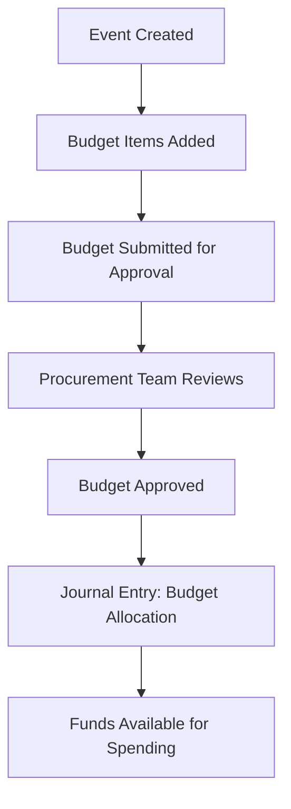
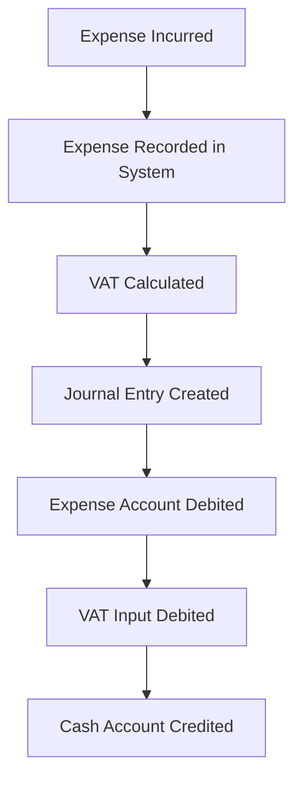
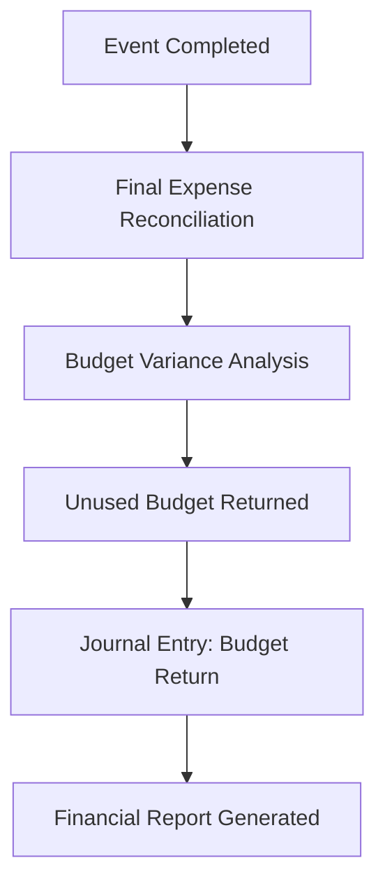

# 📊 Events Management - Accounting Integration

## Overview

The Events Management module is fully integrated with the accounting system to ensure proper financial tracking and journal entry creation for all event-related transactions. This integration follows double-entry bookkeeping principles and maintains audit trails.

## 🔗 Integration Points

### 1. **Budget Allocation Journal Entries**

When an event budget is approved, the system automatically creates journal entries to allocate funds:

```typescript
// Budget Approval Flow
POST /api/events/{eventId}/budget/approve
{
  "approvedBudget": 50000,
  "notes": "Approved by finance team"
}
```

**Journal Entry Created:**
- **Debit**: Event Budget Allocation Account (Asset) - $50,000
- **Credit**: Cash/Bank Account (Asset) - $50,000

**Purpose**: Tracks allocated budget for the event and reduces available cash.

### 2. **Expense Recording with Journal Entries**

When event expenses are recorded, the system creates proper journal entries:

```typescript
// Expense Recording Flow
POST /api/events/{eventId}/expenses
{
  "description": "Venue rental",
  "amount": 15000,
  "category": "VENUE",
  "vendor": "Convention Center",
  "paymentMethod": "BANK_TRANSFER",
  "isTaxable": true
}
```

**Journal Entry Created:**
- **Debit**: Event Expense Account (Expense) - $15,000
- **Debit**: VAT Input Account (Asset) - $1,500 (if taxable)
- **Credit**: Cash/Bank Account (Asset) - $16,500

**Purpose**: Records actual expenses and maintains proper expense categorization.

## 🏗️ Chart of Accounts Integration

### **Event-Specific Accounts**

The system automatically creates and manages the following accounts:

#### **Asset Accounts**
- **Event Budget Allocation** (EBA-001)
  - Tracks allocated budget for events
  - Debit when budget is approved
  - Credit when expenses are incurred

#### **Expense Accounts**
- **Event Expenses - Venue** (EEV-001)
- **Event Expenses - Catering** (EEC-001)
- **Event Expenses - Marketing** (EEM-001)
- **Event Expenses - Technology** (EET-001)
- **Event Expenses - Other** (EEO-001)

#### **VAT Accounts**
- **VAT Input** (VAT-001)
  - Tracks VAT on event expenses
  - Used for VAT reclaim

## 📋 Journal Entry Examples

### **Example 1: Budget Approval**

```sql
-- Journal Entry: BUDGET-EVENT123-1703123456789
Transaction Date: 2024-01-15
Description: Event Budget Allocation: Annual Conference 2024

-- Journal Entry Lines:
Line 1: Debit Event Budget Allocation - $50,000
Line 2: Credit Cash - $50,000
```

### **Example 2: Venue Expense**

```sql
-- Journal Entry: JE-1703123456789
Transaction Date: 2024-01-20
Description: Event Expense: Venue rental (Event: Annual Conference 2024)

-- Journal Entry Lines:
Line 1: Debit Event Expenses - Venue - $15,000
Line 2: Debit VAT Input - $1,500
Line 3: Credit Cash - $16,500
```

### **Example 3: Catering Expense**

```sql
-- Journal Entry: JE-1703123456790
Transaction Date: 2024-01-22
Description: Event Expense: Catering services (Event: Annual Conference 2024)

-- Journal Entry Lines:
Line 1: Debit Event Expenses - Catering - $8,000
Line 2: Debit VAT Input - $800
Line 3: Credit Cash - $8,800
```

## 🔄 Complete Accounting Workflow

### **1. Budget Planning Phase**


### **2. Expense Recording Phase**


### **3. Event Completion Phase**


## 🛠️ Technical Implementation

### **EventService Integration**

The `EventService` has been enhanced with accounting integration:

```typescript
// Budget approval with journal entry
static async approveBudget(eventId: string, approverId: string, approvedBudget: number, notes?: string) {
  // Update event status
  const event = await prisma.event.update({...});
  
  // Create journal entry for budget allocation
  await this.createBudgetAllocationJournalEntry(eventId, approvedBudget, approverId);
  
  // Send notification
  await EmailNotificationService.sendBudgetApprovalEmail({...});
}

// Expense recording with journal entry
static async recordExpense(eventId: string, expenseData: any, createdById: string) {
  // Create event expense record
  const expense = await prisma.eventExpense.create({...});
  
  // Create journal entry for expense
  const journalEntryParams = {
    vendorId: await this.getOrCreateVendor(expenseData.vendor, createdById),
    categoryId: await this.getExpenseCategoryId(expenseData.category),
    amount: Number(expenseData.amount),
    vatAmount: calculatedVAT,
    totalAmount: totalAmount,
    currencyId: await this.getDefaultCurrencyId(),
    transactionDate: new Date(),
    description: `Event Expense: ${expenseData.description} (Event: ${event.title})`,
    isTaxable: expenseData.isTaxable,
    paymentMethod: expenseData.paymentMethod,
    createdById
  };
  
  await JournalEntryService.createExpenseJournalEntry(journalEntryParams);
}
```

### **Category Mapping**

Event expense categories are automatically mapped to accounting expense categories:

```typescript
const categoryMapping = {
  'VENUE': 'Venue & Facilities',
  'CATERING': 'Food & Beverage', 
  'DECORATIONS': 'Marketing & Promotions',
  'ENTERTAINMENT': 'Entertainment',
  'TRANSPORT': 'Travel & Transportation',
  'MARKETING': 'Marketing & Promotions',
  'TECHNOLOGY': 'Technology & Equipment',
  'STAFFING': 'Professional Services',
  'SECURITY': 'Security & Safety',
  'CLEANING': 'Maintenance & Cleaning',
  'INSURANCE': 'Insurance',
  'UTILITIES': 'Utilities',
  'OTHER': 'Other Expenses'
};
```

## 📊 Financial Reporting

### **Event Financial Summary**

The system provides comprehensive financial reporting for each event:

```typescript
// Event Financial Metrics
{
  "totalBudget": 50000,
  "totalExpenses": 45200,
  "budgetVariance": 4800,
  "costPerAttendee": 150.67,
  "expenseBreakdown": {
    "venue": 15000,
    "catering": 12000,
    "marketing": 8000,
    "technology": 5000,
    "other": 5200
  },
  "vatTotal": 4520,
  "netExpenses": 40680
}
```

### **Budget vs Actual Analysis**

```typescript
// Budget vs Actual Comparison
{
  "budgetedAmount": 50000,
  "actualAmount": 45200,
  "variance": 4800,
  "variancePercentage": 9.6,
  "status": "UNDER_BUDGET"
}
```

## 🔍 Audit Trail

### **Journal Entry Tracking**

Every event-related transaction is tracked with:

- **Reference Numbers**: Unique identifiers for each journal entry
- **Transaction Dates**: When the transaction occurred
- **User Tracking**: Who created/approved the transaction
- **Description**: Detailed description of the transaction
- **Amounts**: Debit and credit amounts for each account

### **Event Expense Audit**

```typescript
// Audit trail for event expenses
{
  "expenseId": "exp_123",
  "eventId": "event_456", 
  "journalEntryId": "je_789",
  "referenceNumber": "JE-1703123456789",
  "createdBy": "user_123",
  "createdAt": "2024-01-20T10:30:00Z",
  "amount": 15000,
  "vatAmount": 1500,
  "totalAmount": 16500,
  "status": "POSTED"
}
```

## 🚀 Benefits

### **1. Financial Control**
- Real-time budget tracking
- Automatic expense categorization
- VAT calculation and tracking
- Budget variance analysis

### **2. Compliance**
- Double-entry bookkeeping
- Audit trail maintenance
- Proper expense documentation
- VAT reclaim tracking

### **3. Reporting**
- Event profitability analysis
- Cost per attendee tracking
- Budget performance metrics
- Financial reconciliation

### **4. Integration**
- Seamless accounting system integration
- Automatic journal entry creation
- Real-time financial updates
- Comprehensive audit trails

## 📝 API Endpoints

### **Budget Management**
- `POST /api/events/{eventId}/budget/approve` - Approve budget with journal entry
- `GET /api/events/{eventId}/budget` - Get budget details with journal entries

### **Expense Management**
- `POST /api/events/{eventId}/expenses` - Record expense with journal entry
- `GET /api/events/{eventId}/expenses` - Get expenses with journal entries
- `PUT /api/events/{eventId}/expenses/{expenseId}` - Update expense

### **Financial Reporting**
- `GET /api/events/{eventId}/financial-summary` - Get financial summary
- `GET /api/events/{eventId}/budget-variance` - Get budget variance analysis
- `GET /api/events/{eventId}/expense-breakdown` - Get expense breakdown by category

## 🔧 Configuration

### **Required Setup**

1. **Chart of Accounts**: Ensure event-specific accounts exist
2. **VAT Configuration**: Set up VAT rates and rules
3. **Currency Setup**: Configure default currency
4. **User Permissions**: Set up accounting user permissions

### **Environment Variables**

```env
# Accounting Integration
ACCOUNTING_ENABLED=true
DEFAULT_CURRENCY=USD
VAT_RATE=10
EVENT_BUDGET_ACCOUNT_CODE=EBA-001
CASH_ACCOUNT_CODE=CASH-001
```

## 🎯 Best Practices

### **1. Budget Planning**
- Set realistic budgets based on historical data
- Include contingency for unexpected expenses
- Regular budget reviews and adjustments

### **2. Expense Management**
- Record expenses immediately when incurred
- Attach receipts and supporting documentation
- Regular expense reconciliation

### **3. Financial Reporting**
- Generate regular financial reports
- Monitor budget variance closely
- Analyze cost per attendee trends

### **4. Audit Compliance**
- Maintain complete audit trails
- Regular financial reconciliations
- Proper documentation of all transactions

This comprehensive accounting integration ensures that the Events Management module maintains proper financial controls and provides complete audit trails for all event-related financial transactions! 🎉


