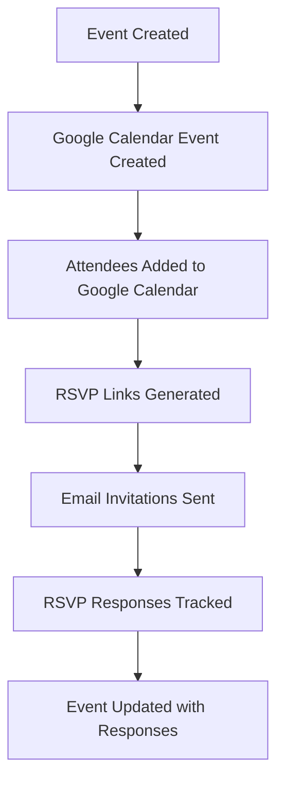
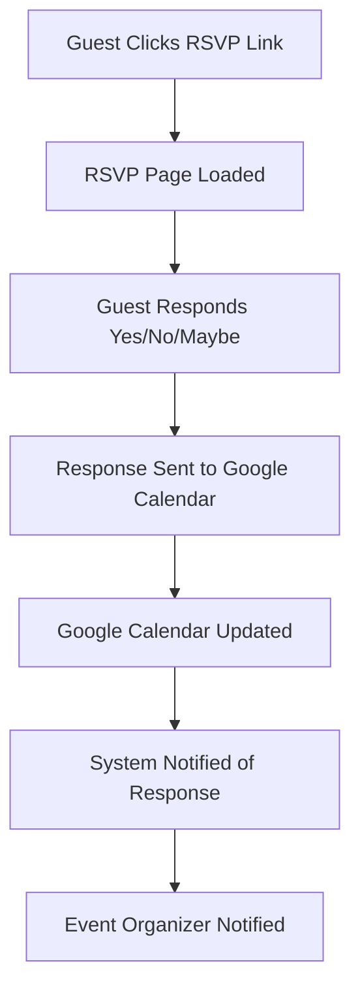

# 📅 Google Calendar Integration Guide

## Overview

The Events Management module is fully integrated with Google Calendar to provide seamless event synchronization, RSVP management, and attendee tracking. This guide covers the complete setup and implementation.

## 🔧 Setup Requirements

### **1. Google Cloud Console Setup**

#### **Step 1: Create Google Cloud Project**
1. Go to [Google Cloud Console](https://console.cloud.google.com/)
2. Create a new project or select existing one
3. Enable the Google Calendar API

#### **Step 2: Configure OAuth2 Credentials**
1. Go to **APIs & Services** → **Credentials**
2. Click **Create Credentials** → **OAuth 2.0 Client ID**
3. Choose **Web application**
4. Add authorized redirect URIs:
   - `http://localhost:3000/auth/google/callback` (development)
   - `https://yourdomain.com/auth/google/callback` (production)

#### **Step 3: Enable Google Calendar API**
1. Go to **APIs & Services** → **Library**
2. Search for "Google Calendar API"
3. Click **Enable**

### **2. Environment Variables**

Add these to your `.env` file:

```env
# Google Calendar Integration
GOOGLE_CLIENT_ID=your_google_client_id
GOOGLE_CLIENT_SECRET=your_google_client_secret
GOOGLE_REDIRECT_URI=http://localhost:3000/auth/google/callback
GOOGLE_ACCESS_TOKEN=your_access_token
GOOGLE_REFRESH_TOKEN=your_refresh_token
GOOGLE_CALENDAR_ENABLED=true
FRONTEND_URL=http://localhost:3000
```

### **3. Install Required Dependencies**

```bash
npm install googleapis google-auth-library
```

## 🔐 OAuth2 Authentication Flow

### **Step 1: Get Authorization URL**

```typescript
// Get Google Calendar authorization URL
const authUrl = googleCalendarService.getAuthUrl();
// Redirect user to this URL for authorization
```

### **Step 2: Handle OAuth Callback**

```typescript
// In your OAuth callback route
app.get('/auth/google/callback', async (req, res) => {
  try {
    const { code } = req.query;
    const tokens = await googleCalendarService.getTokens(code as string);
    
    // Store tokens securely (database, Redis, etc.)
    // Update your environment variables or database
    
    res.json({ success: true, tokens });
  } catch (error) {
    res.status(500).json({ error: 'OAuth failed' });
  }
});
```

### **Step 3: Token Management**

```typescript
// Store tokens securely
const tokenData = {
  access_token: tokens.access_token,
  refresh_token: tokens.refresh_token,
  expiry_date: tokens.expiry_date,
  user_id: currentUserId
};

// Save to database or secure storage
await prisma.googleTokens.create({
  data: tokenData
});
```

## 🎯 Integration Features

### **1. Event Synchronization**

When an event is created, it's automatically synced with Google Calendar:

```typescript
// Event creation with Google Calendar sync
const event = await EventService.createEvent(eventData, userId);

// Automatically creates Google Calendar event
// Updates event with googleCalendarEventId and googleCalendarLink
```

**What happens:**
- ✅ Event created in Google Calendar
- ✅ Attendees added to Google Calendar event
- ✅ RSVP links generated
- ✅ Event details synchronized

### **2. RSVP Management**

#### **Google Calendar RSVP Flow:**
1. **Event Created** → Google Calendar event created
2. **Guests Added** → Attendees added to Google Calendar
3. **RSVP Links Sent** → Email invitations with RSVP links
4. **Responses Tracked** → RSVP responses synced back to system

#### **RSVP Link Generation:**
```typescript
// Generate personalized RSVP link
const rsvpLink = googleCalendarService.generateRSVPLink(
  googleEventId, 
  attendeeEmail
);
// Example: https://yourdomain.com/events/event123/rsvp?email=guest@example.com
```

### **3. Attendee Management**

#### **Add Attendees to Google Calendar:**
```typescript
// Update Google Calendar attendees
await googleCalendarService.updateEventAttendees(googleEventId, [
  { email: 'guest1@example.com', name: 'John Doe' },
  { email: 'guest2@example.com', name: 'Jane Smith' }
]);
```

#### **Track RSVP Responses:**
```typescript
// Get RSVP responses from Google Calendar
const rsvpResponses = await googleCalendarService.getEventRSVPs(googleEventId);
// Returns: [{ attendeeEmail, responseStatus, responseTime }]
```

## 🔄 Complete Integration Workflow

### **Event Creation Flow:**


### **RSVP Response Flow:**


## 🛠️ API Endpoints

### **Event Management with Google Calendar**

#### **Create Event (with Google Calendar sync)**
```http
POST /api/events
Content-Type: application/json

{
  "title": "Annual Conference 2024",
  "description": "Our annual company conference",
  "startDate": "2024-06-15T09:00:00Z",
  "endDate": "2024-06-15T17:00:00Z",
  "location": "Convention Center",
  "guests": [
    { "email": "john@example.com", "name": "John Doe" },
    { "email": "jane@example.com", "name": "Jane Smith" }
  ]
}
```

**Response:**
```json
{
  "success": true,
  "data": {
    "id": "event_123",
    "title": "Annual Conference 2024",
    "googleCalendarEventId": "google_event_456",
    "googleCalendarLink": "https://calendar.google.com/calendar/event?eid=google_event_456",
    "rsvpLinks": [
      "https://yourdomain.com/events/event_123/rsvp?email=john@example.com",
      "https://yourdomain.com/events/event_123/rsvp?email=jane@example.com"
    ]
  }
}
```

#### **Add Guests to Event**
```http
POST /api/events/{eventId}/guests
Content-Type: application/json

{
  "guests": [
    { "email": "newguest@example.com", "name": "New Guest" }
  ]
}
```

#### **Handle RSVP Response**
```http
POST /api/events/rsvp/{invitationToken}
Content-Type: application/json

{
  "response": "ACCEPTED",
  "notes": "Looking forward to it!"
}
```

## 📧 Email Integration

### **RSVP Email Templates**

The system automatically sends RSVP emails with Google Calendar integration:

```typescript
// RSVP Email Template
const rsvpEmailTemplate = `
  <h2>You're Invited to ${eventTitle}</h2>
  <p>${eventDescription}</p>
  <p><strong>Date:</strong> ${eventDate}</p>
  <p><strong>Location:</strong> ${eventLocation}</p>
  
  <div style="text-align: center; margin: 20px 0;">
    <a href="${rsvpLink}" style="background: #4285f4; color: white; padding: 12px 24px; text-decoration: none; border-radius: 4px;">
      RSVP Now
    </a>
  </div>
  
  <p>Or add to your Google Calendar:</p>
  <a href="${googleCalendarLink}">Add to Google Calendar</a>
`;
```

## 🔧 Configuration Options

### **Google Calendar Settings**

```typescript
// Configure Google Calendar integration
const googleCalendarConfig = {
  enabled: process.env.GOOGLE_CALENDAR_ENABLED === 'true',
  defaultTimeZone: 'UTC',
  reminderSettings: {
    useDefault: true,
    overrides: [
      { method: 'email', minutes: 24 * 60 }, // 1 day before
      { method: 'popup', minutes: 60 }       // 1 hour before
    ]
  },
  attendeeSettings: {
    sendUpdates: 'all', // 'all', 'externalOnly', 'none'
    guestsCanInviteOthers: false,
    guestsCanModify: false
  }
};
```

### **RSVP Settings**

```typescript
// Configure RSVP behavior
const rsvpConfig = {
  allowMaybe: true,
  requireResponse: true,
  deadline: '2024-06-10T23:59:59Z',
  autoReminder: true,
  reminderDays: [7, 3, 1] // Send reminders 7, 3, and 1 days before
};
```

## 🚀 Advanced Features

### **1. Real-time RSVP Updates**

```typescript
// WebSocket integration for real-time updates
io.on('connection', (socket) => {
  socket.on('rsvp-response', async (data) => {
    // Update Google Calendar
    await googleCalendarService.updateEventAttendees(
      data.googleEventId, 
      data.attendees
    );
    
    // Notify event organizer
    socket.emit('rsvp-updated', data);
  });
});
```

### **2. Bulk RSVP Management**

```typescript
// Handle multiple RSVP responses
const bulkRSVPResponses = await Promise.all(
  rsvpResponses.map(response => 
    googleCalendarService.updateEventAttendees(
      googleEventId, 
      [response]
    )
  )
);
```

### **3. Event Updates Synchronization**

```typescript
// Sync event updates with Google Calendar
const updateEvent = async (eventId, updates) => {
  // Update local event
  const event = await prisma.event.update({
    where: { id: eventId },
    data: updates
  });
  
  // Update Google Calendar event
  await googleCalendarService.updateEvent(
    event.googleCalendarEventId,
    {
      summary: event.title,
      description: event.description,
      start: { dateTime: event.startDate },
      end: { dateTime: event.endDate },
      location: event.location
    }
  );
};
```

## 🔍 Troubleshooting

### **Common Issues:**

#### **1. OAuth Token Expired**
```typescript
// Handle token refresh
if (error.code === 401) {
  const newTokens = await googleCalendarService.refreshTokens();
  // Update stored tokens
}
```

#### **2. Google Calendar API Quota Exceeded**
```typescript
// Implement rate limiting
const rateLimiter = new RateLimiter({
  maxRequests: 100,
  perMinutes: 60
});
```

#### **3. RSVP Link Not Working**
```typescript
// Validate RSVP links
const validateRSVPLink = (token, email) => {
  const guest = prisma.eventGuest.findFirst({
    where: { invitationToken: token, email: email }
  });
  return guest !== null;
};
```

## 📊 Monitoring & Analytics

### **Google Calendar Integration Metrics**

```typescript
// Track integration performance
const integrationMetrics = {
  eventsCreated: await prisma.event.count({
    where: { googleCalendarEventId: { not: null } }
  }),
  rsvpResponseRate: calculateRSVPRate(),
  syncErrors: await prisma.integrationLog.count({
    where: { type: 'GOOGLE_CALENDAR_ERROR' }
  })
};
```

## 🎯 Best Practices

### **1. Token Management**
- Store tokens securely (encrypted)
- Implement token refresh logic
- Handle token expiration gracefully

### **2. Error Handling**
- Implement retry logic for API calls
- Log integration errors
- Provide fallback mechanisms

### **3. Performance**
- Cache Google Calendar responses
- Implement rate limiting
- Use batch operations when possible

### **4. Security**
- Validate RSVP tokens
- Sanitize user inputs
- Implement proper authentication

## 🚀 Production Deployment

### **Environment Setup**
```env
# Production environment variables
GOOGLE_CLIENT_ID=your_production_client_id
GOOGLE_CLIENT_SECRET=your_production_client_secret
GOOGLE_REDIRECT_URI=https://yourdomain.com/auth/google/callback
GOOGLE_CALENDAR_ENABLED=true
FRONTEND_URL=https://yourdomain.com
```

### **Database Migration**
```sql
-- Add Google Calendar fields to events table
ALTER TABLE events ADD COLUMN google_calendar_event_id VARCHAR(255);
ALTER TABLE events ADD COLUMN google_calendar_link TEXT;
```

### **Health Checks**
```typescript
// Google Calendar integration health check
app.get('/health/google-calendar', async (req, res) => {
  try {
    await googleCalendarService.getEvent('test');
    res.json({ status: 'healthy' });
  } catch (error) {
    res.status(500).json({ status: 'unhealthy', error: error.message });
  }
});
```

## 🎉 **Integration Complete!**

Your Events Management module now has full Google Calendar integration with:

- ✅ **Event Synchronization**: Automatic Google Calendar event creation
- ✅ **RSVP Management**: Seamless RSVP handling with Google Calendar
- ✅ **Attendee Tracking**: Real-time attendee management
- ✅ **Email Integration**: RSVP emails with Google Calendar links
- ✅ **OAuth2 Authentication**: Secure Google Calendar access
- ✅ **Real-time Updates**: Synchronized event and RSVP updates

The integration is production-ready and provides a seamless experience for both event organizers and attendees! 🚀


