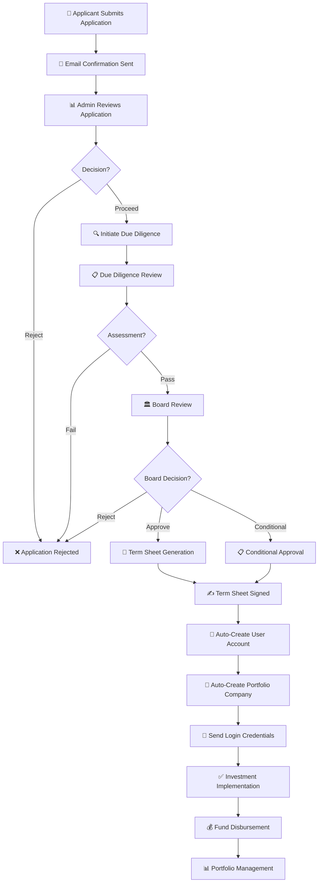

# 🏢 PORTFOLIO MODULE - COMPLETE WORKFLOW DOCUMENTATION

## 📋 OVERVIEW

The Portfolio Module manages the complete investment lifecycle from application submission to portfolio company management, including automatic user creation, due diligence, board review, term sheet negotiation, and investment implementation.

---

## 🔄 COMPLETE WORKFLOW DIAGRAM



---

## 👤 APPLICANT SIDE WORKFLOW

### **STAGE 1: Application Submission (PUBLIC - No Auth Required)**

#### **Endpoint:**
```http
POST /api/applications
```

#### **What Happens:**
1. Applicant fills out application form with:
   - Personal information (name, email, phone, address)
   - Business information (name, description, industry, stage, founding date)
   - Investment details (requested amount, optional fund selection)
   - Required documents upload

2. **Required Documents:**
   - `BUSINESS_PLAN` - Comprehensive business strategy
   - `PROOF_OF_CONCEPT` - Working prototype or demo
   - `MARKET_RESEARCH` - Industry analysis and market size
   - `PROJECTED_CASH_FLOWS` - Financial projections
   - `HISTORICAL_FINANCIALS` - Past financial performance (optional)

3. **Validation:**
   - Email format validation
   - Requested amount > 0
   - Fund must be OPEN (if fundId provided)
   - All required documents must be uploaded

4. **Application Created:**
   - Status: `SHORTLISTED`
   - `submittedAt`: Current timestamp
   - Documents linked to application
   - Email notification sent to applicant

#### **Response:**
```json
{
  "success": true,
  "message": "Application created successfully",
  "data": {
    "id": "cmh4k3d830000unb44xt2w6ef",
    "applicantName": "John Doe",
    "applicantEmail": "john.doe@techstartup.com",
    "businessName": "TechStartup Ltd",
    "requestedAmount": 500000,
    "currentStage": "SHORTLISTED",
    "submittedAt": "2024-01-15T10:30:00.000Z"
  }
}
```

---

### **STAGE 2: Check Application Status (PUBLIC - No Auth Required)**

#### **Endpoint:**
```http
GET /api/applications/:id/status
```

#### **What Happens:**
- Applicant can check their application status using application ID
- Returns current stage and submission date

---

### **STAGE 3: After Approval - User Account Created Automatically**

When application is approved and term sheet is signed, the system automatically:

1. **Creates User Account:**
   - Email: From application data
   - Password: Auto-generated secure password
   - Role: "applicant" (with permissions: portfolio_company, profile, applications, term_sheets)
   - Name: Split from applicantName

2. **Creates Portfolio Company:**
   - Linked to user account
   - Name: From businessName
   - All business data migrated from application
   - Status: `PENDING` initially

3. **Sends Login Credentials:**
   - Email with temporary password
   - Instructions to change password on first login

---

### **STAGE 4: Applicant Portal Access (PROTECTED - Auth Required)**

#### **Available Endpoints:**
- `GET /api/applicant/profile` - Get applicant profile
- `PUT /api/applicant/profile` - Update profile
- `GET /api/applicant/application` - Get application details
- `GET /api/applicant/company` - Get portfolio company
- `PUT /api/applicant/company` - Update portfolio company
- `GET /api/applicant/dashboard` - Get dashboard summary
- `GET /api/applicant/application/timeline` - Get application timeline
- `GET /api/applicant/investment` - Get investment details
- `GET /api/applicant/valuations` - Get portfolio valuations
- `GET /api/applicant/reports` - Get performance reports

#### **Dashboard Features:**
- View application status and timeline
- View portfolio company profile
- Update company information
- View term sheet details
- Track investment implementation progress
- View valuations and performance reports

---

## 🏛️ INVESTOR/ADMIN SIDE WORKFLOW

### **STAGE 1: Review Applications (PROTECTED - Admin/Fund Manager)**

#### **Endpoint:**
```http
GET /api/applications?page=1&limit=10&stage=SHORTLISTED
Authorization: Bearer {admin_token}
```

#### **What Happens:**
1. Admin views all applications with filtering:
   - By stage (SHORTLISTED, UNDER_DUE_DILIGENCE, etc.)
   - By fund
   - Pagination support

2. **Admin Actions:**
   - View application details
   - Download documents
   - Change application stage
   - Assign reviewers
   - Update application information

#### **Available Actions:**
- `GET /api/applications/:id` - Get application details
- `PUT /api/applications/:id` - Update application
- `POST /api/applications/:id/change-stage` - Change stage
- `DELETE /api/applications/:id` - Delete application (only if SHORTLISTED)

---

### **STAGE 2: Due Diligence Review (PROTECTED - Admin/Fund Manager)**

#### **Initiate Due Diligence:**
```http
POST /api/applications/:id/due-diligence/initiate
Authorization: Bearer {admin_token}
```

#### **What Happens:**
1. **Validation:**
   - Application must be in `SHORTLISTED` stage
   - No existing due diligence review

2. **Due Diligence Created:**
   - Status: `IN_PROGRESS`
   - Reviewer assigned
   - Application stage updated to `UNDER_DUE_DILIGENCE`

3. **Update Due Diligence:**
```http
PUT /api/applications/:id/due-diligence
```

**Assessment Areas:**
- Market Research Viability (Yes/No + Comments)
- Financial Viability (Yes/No + Comments)
- Competitive Opportunities (Yes/No + Comments)
- Management Team Qualification (Yes/No + Comments)
- Legal Compliance (Yes/No + Comments)
- Risk Tolerance (Yes/No + Comments)
- Overall Score (0-100%)
- Recommendation (APPROVE, REJECT, CONDITIONAL)
- Final Comments

4. **Complete Due Diligence:**
```http
POST /api/applications/:id/due-diligence/complete
```

**What Happens:**
- Due diligence status set to `COMPLETED`
- Application stage updated to:
  - `DUE_DILIGENCE_COMPLETED` if recommendation is APPROVE
  - `REJECTED` if recommendation is REJECT
  - `UNDER_BOARD_REVIEW` if recommendation is CONDITIONAL or needs board review

#### **Due Diligence Endpoints:**
- `POST /api/applications/:id/due-diligence/initiate` - Start due diligence
- `PUT /api/applications/:id/due-diligence` - Update assessment
- `GET /api/applications/:id/due-diligence` - Get due diligence report
- `POST /api/applications/:id/due-diligence/complete` - Complete review
- `GET /api/applications/due-diligence` - Get all due diligence reviews

---

### **STAGE 3: Board Review (PROTECTED - Admin/Fund Manager)**

#### **Create Board Review:**
```http
POST /api/board-reviews/:applicationId
Authorization: Bearer {admin_token}
```

#### **What Happens:**
1. **Validation:**
   - Application must be in `UNDER_BOARD_REVIEW` stage
   - Only ONE decision option can be selected:
     - `investmentApproved: true` OR
     - `investmentRejected: true` OR
     - `conditionalApproval: true`

2. **Board Review Created:**
   - Status: `IN_PROGRESS`
   - Reviewer assigned
   - Decision options set

3. **Board Review Fields:**
   - Investment Decision (one of: Approved, Rejected, Conditional)
   - Recommendation Report (condensed proposal)
   - Additional Information Requested
   - Decision Reason
   - Conditions (for conditional approval)
   - Next Steps
   - Overall Score (0-100%)
   - Final Comments

4. **Complete Board Review:**
```http
POST /api/board-reviews/:applicationId/complete
```

**What Happens:**
- Board review status set to `COMPLETED`
- Application stage updated based on decision:
  - `BOARD_APPROVED` → Move to term sheet
  - `BOARD_REJECTED` → Application rejected
  - `BOARD_CONDITIONAL` → Conditional approval with conditions

#### **Board Review Endpoints:**
- `POST /api/board-reviews/:applicationId` - Create board review
- `GET /api/board-reviews/:applicationId` - Get board review
- `PUT /api/board-reviews/:applicationId` - Update board review
- `POST /api/board-reviews/:applicationId/complete` - Complete review
- `GET /api/board-reviews` - Get all board reviews
- `GET /api/board-reviews/my` - Get my board reviews
- `GET /api/board-reviews/summary` - Get summary statistics

---

### **STAGE 4: Term Sheet Generation (PROTECTED - Admin/Fund Manager)**

#### **Create Term Sheet:**
```http
POST /api/term-sheets/:applicationId
Authorization: Bearer {admin_token}
```

#### **What Happens:**
1. **Term Sheet Created:**
   - Status: `DRAFT` initially
   - Version: "1.0"
   - Investment amount, equity percentage, valuation
   - Key terms, conditions, timeline
   - Document URL (if uploaded)

2. **Term Sheet Fields:**
   - Title
   - Investment Amount
   - Equity Percentage
   - Valuation
   - Key Terms (text)
   - Conditions (text)
   - Timeline (text)
   - Document (file URL, name, size)

3. **Finalize Term Sheet:**
```http
POST /api/term-sheets/:applicationId/finalize
```

**What Happens:**
- Status updated to `FINAL`
- `isFinal: true`
- `isDraft: false`

4. **Applicant Signs Term Sheet:**
```http
POST /api/term-sheets/:applicationId/sign
Authorization: Bearer {applicant_token}
```

**What Happens:**
- `isSigned: true`
- `signedAt: current timestamp`
- Status: `SIGNED`
- **Triggers automatic user and portfolio company creation**

#### **Term Sheet Endpoints:**
- `POST /api/term-sheets/:applicationId` - Create term sheet
- `GET /api/term-sheets/:applicationId` - Get term sheet
- `PUT /api/term-sheets/:applicationId` - Update term sheet
- `POST /api/term-sheets/:applicationId/finalize` - Mark as final
- `POST /api/term-sheets/:applicationId/sign` - Sign term sheet (applicant)
- `GET /api/term-sheets` - Get all term sheets (admin)
- `GET /api/term-sheets/my` - Get my term sheets (applicant)

---

### **STAGE 5: Automatic User & Portfolio Company Creation**

#### **Trigger:**
When term sheet is signed by applicant, the system automatically:

1. **Creates User Account:**
   ```typescript
   // BoardReviewService.createUserAndPortfolioCompany()
   - Checks if user already exists (by email)
   - Generates secure temporary password
   - Creates "applicant" role if doesn't exist
   - Creates user with:
     * firstName: Split from applicantName
     * lastName: Split from applicantName
     * email: From application
     * password: Hashed temporary password
     * roleId: Applicant role ID
   ```

2. **Creates Portfolio Company:**
   ```typescript
   - Links to created user
   - name: From businessName
   - registrationNumber: Auto-generated (REG-{timestamp})
   - industry: From application
   - foundingDate: From application
   - address: From applicantAddress
   - description: From businessDescription
   - status: "PENDING"
   - companySize: Based on businessStage
   - fundingStage: "SEED"
   - contactPerson: From applicantName
   - contactPhone: From applicantPhone
   - contactEmail: From applicantEmail
   ```

3. **Sends Email:**
   - To: applicantEmail
   - Subject: "Investment Approved - Login Credentials"
   - Message: Includes email and temporary password
   - Instructions to change password on first login

---

### **STAGE 6: Investment Implementation (PROTECTED - Admin/Fund Manager)**

#### **Get Signed Term Sheets:**
```http
GET /api/investment-implementations/signed-term-sheets
Authorization: Bearer {admin_token}
```

#### **Initiate Implementation:**
```http
POST /api/investment-implementations/initiate
Authorization: Bearer {admin_token}
```

**Request Body:**
```json
{
  "portfolioCompanyId": "pc_123",
  "applicationId": "app_123",
  "fundId": "fund_123",
  "implementationPlan": "Implementation plan details...",
  "assignedTeam": "user1,user2,user3",
  "notes": "Additional notes"
}
```

**What Happens:**
- Creates InvestmentImplementation record
- Status: `IN_PROGRESS`
- Links to portfolio company, application, and fund

#### **Implementation Checklist:**
```http
PUT /api/investment-implementations/:portfolioCompanyId/checklist
```

**Checklist Items:**
- `finalDueDiligence: boolean` - Final due diligence completed
- `contractsSigned: boolean` - Legal contracts signed
- `fundsDisbursed: boolean` - Funds disbursed to company
- `notes: string` - Additional notes

#### **Milestones:**
```http
POST /api/investment-implementations/:portfolioCompanyId/milestones
```

**Create Milestone:**
- Title, description, amount, due date
- Deliverables
- Linked to implementation

**Complete Milestone:**
```http
POST /api/investment-implementations/milestones/:milestoneId/complete
```

#### **Fund Disbursement:**
```http
POST /api/investment-implementations/disbursements
```

**Create Disbursement:**
- Investment implementation ID
- Milestone ID (optional)
- Amount
- Disbursement date
- Type: INITIAL, MILESTONE, or FINAL
- Notes

**Approve Disbursement:**
```http
POST /api/investment-implementations/disbursements/:disbursementId/approve
```

**Mark as Disbursed:**
```http
POST /api/investment-implementations/disbursements/:disbursementId/disburse
```

**Request Body:**
```json
{
  "transactionReference": "TXN-123456789"
}
```

#### **Investment Implementation Endpoints:**
- `GET /api/investment-implementations/signed-term-sheets` - Get ready for implementation
- `POST /api/investment-implementations/initiate` - Start implementation
- `GET /api/investment-implementations/:portfolioCompanyId` - Get implementation
- `PUT /api/investment-implementations/:portfolioCompanyId/checklist` - Update checklist
- `POST /api/investment-implementations/:portfolioCompanyId/milestones` - Add milestone
- `POST /api/investment-implementations/milestones/:milestoneId/complete` - Complete milestone
- `POST /api/investment-implementations/disbursements` - Create disbursement
- `POST /api/investment-implementations/disbursements/:disbursementId/approve` - Approve
- `POST /api/investment-implementations/disbursements/:disbursementId/disburse` - Mark disbursed
- `GET /api/investment-implementations` - Get all implementations

---

### **STAGE 7: Portfolio Company Management (PROTECTED)**

#### **Admin Creation:**
```http
POST /api/portfolio-companies/admin
Authorization: Bearer {admin_token}
```

**Enhanced Fields:**
- Fund association (fundId)
- Investment dates (startDate, endDate)
- Cap table (JSON)
- Financial KPIs (JSON)
- Financial history Excel (file info)
- E-signature data

#### **Portfolio Company Endpoints:**
- `POST /api/portfolio-companies` - Create with user (public)
- `POST /api/portfolio-companies/admin` - Create by admin
- `GET /api/portfolio-companies` - Get all (admin)
- `GET /api/portfolio-companies/:id` - Get by ID
- `GET /api/portfolio-companies/user/:user_id` - Get by user ID
- `GET /api/portfolio-companies/me` - Get current user's company (applicant)
- `PUT /api/portfolio-companies/:id` - Update company
- `PUT /api/portfolio-companies/me` - Update current user's company (applicant)
- `DELETE /api/portfolio-companies/:id` - Delete (admin)

---

### **STAGE 8: Portfolio Valuation (PROTECTED - Admin/CEO/CFO)**

#### **Create Valuation:**
```http
POST /api/portfolio-valuations
Authorization: Bearer {admin_token}
```

#### **Valuation Management:**
- Create valuation records
- Track valuation activities
- Quarterly summaries
- Analytics and reporting

#### **Portfolio Valuation Endpoints:**
- `POST /api/portfolio-valuations` - Create valuation
- `GET /api/portfolio-valuations` - Get all valuations
- `GET /api/portfolio-valuations/:id` - Get by ID
- `PUT /api/portfolio-valuations/:id` - Update valuation
- `DELETE /api/portfolio-valuations/:id` - Delete valuation
- `POST /api/portfolio-valuations/:id/activities` - Add activity
- `GET /api/portfolio-valuations/:id/activities` - Get activities
- `GET /api/portfolio-valuations/summary/quarterly` - Quarterly summary
- `GET /api/portfolio-valuations/analytics/summary` - Analytics

---

## 🔄 APPLICATION STAGES

### **Stage Flow**

| Stage | `currentStage` Status | Description |
| ----- | --------------------- | ----------- |
| Application Submission | `SHORTLISTED` | Applicant form submitted; documents linked; status visible for applicants. |
| Due Diligence | `UNDER_DUE_DILIGENCE` | Due diligence review in progress by Investments team. |
| Due Diligence Completed | `DUE_DILIGENCE_COMPLETED` | Due diligence finished, preparing the package for term sheet creation. |
| Term Sheet Negotiation | `TERM_SHEET_NEGOTIATION` | Negotiating the term sheet before finalizing the deal. |
| Term Sheet Finalization | `TERM_SHEET` (includes final and signed states such as `TERM_SHEET_SIGNED`) | Term sheet generated, finalized, and signed by applicant; triggers next approvals. |
| Board Review | `UNDER_BOARD_REVIEW` | Application queued for the board to review the finalized term sheet. |
| Board Decision | `BOARD_APPROVED`, `BOARD_CONDITIONAL`, `BOARD_REJECTED` | Board outcomes that determine whether the deal moves forward, requires conditions, or is rejected. |
| Investment Implementation | `INVESTMENT_IMPLEMENTATION` | Implementation plan started; milestones, checklists, and disbursements managed. |
| Disbursement Lifecycle | `DISBURSED`, `FUNDED` | All disbursements approved/disbursed and investment marked as funded. |
| Rejection Path | `REJECTED`, `BELOW_THRESHOLD` | Any stage can transition here when the application fails to meet criteria. |
11. **REJECTED** - Application rejected at any stage

### **Portfolio Company Status:**
- **PENDING** - Awaiting final setup
- **ACTIVE** - Fully operational
- **SUSPENDED** - Temporarily suspended
- **TERMINATED** - Relationship ended

---

## 🔐 AUTHENTICATION & AUTHORIZATION

### **Public Endpoints (No Auth):**
- `POST /api/applications` - Submit application
- `GET /api/applications/:id/status` - Check status

### **Applicant Endpoints (Auth Required - "applicant" role):**
- All `/api/applicant/*` endpoints
- `GET /api/portfolio-companies/me`
- `PUT /api/portfolio-companies/me`
- `POST /api/term-sheets/:applicationId/sign`
- `GET /api/term-sheets/my`

### **Admin/Fund Manager Endpoints (Auth Required):**
- All `/api/applications/*` (except public ones)
- All `/api/due-diligence/*`
- All `/api/board-reviews/*`
- All `/api/term-sheets/*` (except applicant ones)
- All `/api/investment-implementations/*`
- All `/api/portfolio-companies/*` (admin endpoints)
- All `/api/portfolio-valuations/*`

---

## 📧 EMAIL NOTIFICATIONS

### **Automated Emails:**
1. **Application Received** - Sent to applicant when application is submitted
2. **Admin Notification** - Sent to admin when new application is received
3. **Login Credentials** - Sent to applicant when term sheet is signed (includes temporary password)
4. **Status Updates** - Sent when application stage changes
5. **Due Diligence Completion** - Sent when due diligence is completed
6. **Board Decision** - Sent when board makes decision
7. **Term Sheet Finalized** - Sent when term sheet is marked as final
8. **Term Sheet Signed** - Sent when term sheet is signed

---

## 🗄️ DATABASE MODELS

### **Core Models:**
1. **Application** - Main application data
2. **ApplicationDocument** - Uploaded documents
3. **ApplicationNotification** - Email notifications
4. **DueDiligenceReview** - Due diligence assessment
5. **BoardReview** - Board review and decision
6. **TermSheet** - Investment terms
7. **InvestmentImplementation** - Implementation tracking
8. **InvestmentMilestone** - Implementation milestones
9. **FundDisbursement** - Fund disbursement records
10. **PortfolioCompany** - Portfolio company profiles
11. **PortfolioValuation** - Valuation records
12. **PortfolioValuationActivity** - Valuation activities

---

## 🎯 KEY FEATURES

### **✅ Public Application Portal:**
- No authentication required for submission
- Comprehensive application form
- Document upload functionality
- Email confirmations

### **✅ Admin Review System:**
- Protected admin dashboard
- Application filtering and pagination
- Document review capabilities
- Stage management
- Reviewer assignment

### **✅ Automated Workflow:**
- Automatic stage transitions
- Automatic user creation upon approval
- Automatic portfolio company creation
- Automatic email notifications

### **✅ Due Diligence Process:**
- Comprehensive assessment areas
- Scoring system (0-100%)
- Recommendation tracking
- One review per application

### **✅ Board Review Process:**
- Three decision options (Approve/Reject/Conditional)
- Recommendation reports
- Decision reasoning
- Conditional approval handling

### **✅ Term Sheet Management:**
- Draft → Final → Signed workflow
- Version control
- Document attachment
- Applicant signing capability

### **✅ Investment Implementation:**
- Checklist tracking
- Milestone management
- Fund disbursement workflow
- Approval and disbursement tracking

### **✅ Portfolio Management:**
- Company profile management
- Valuation tracking
- Performance reporting
- Cap table management

---

## 🚀 SUMMARY

The Portfolio Module provides a **complete end-to-end investment management system** that:

1. **Allows public application submission** without authentication
2. **Manages applications** through multiple review stages
3. **Automates due diligence and board review** processes
4. **Handles term sheet negotiation** and signing
5. **Automatically creates user accounts** and portfolio companies upon approval
6. **Tracks investment implementation** with milestones and disbursements
7. **Manages portfolio companies** with valuations and reporting
8. **Provides email notifications** throughout the entire process

**✅ The system is fully automated from application submission to portfolio company management!** 🚀

