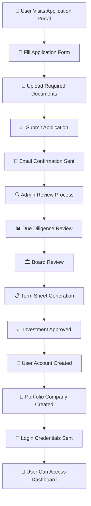

# 🏢 **PORTFOLIO MODULE USER APPLICATION FLOW**

## 📋 **COMPLETE USER APPLICATION PROCESS**



---

## 🎯 **DETAILED APPLICATION STAGES**

### **STAGE 1: 📝 APPLICATION SUBMISSION**

#### **User Journey:**
1. **User visits application portal** (no authentication required)
2. **Fills out comprehensive application form**
3. **Uploads required documents**
4. **Submits application for review**

#### **API Request: Create Application**
```http
POST /api/applications
Content-Type: application/json
```

**Request Body:**
```json
{
  "applicantName": "John Doe",
  "applicantEmail": "john.doe@techstartup.com",
  "applicantPhone": "+263771234567",
  "applicantAddress": "123 Business Street, Harare, Zimbabwe",
  "businessName": "TechStartup Ltd",
  "businessDescription": "AI-powered fintech solution for SMEs",
  "industry": "Technology",
  "businessStage": "STARTUP",
  "foundingDate": "2023-01-15",
  "requestedAmount": 500000,
  "fundId": "clx1234567890abcdef",
  "documents": [
    {
      "documentType": "BUSINESS_PLAN",
      "fileName": "business_plan.pdf",
      "fileUrl": "https://drive.google.com/file/...",
      "fileSize": 2048576,
      "isRequired": true
    },
    {
      "documentType": "PROOF_OF_CONCEPT",
      "fileName": "poc_demo.mp4",
      "fileUrl": "https://drive.google.com/file/...",
      "fileSize": 15728640,
      "isRequired": true
    },
    {
      "documentType": "MARKET_RESEARCH",
      "fileName": "market_analysis.pdf",
      "fileUrl": "https://drive.google.com/file/...",
      "fileSize": 1024000,
      "isRequired": true
    },
    {
      "documentType": "PROJECTED_CASH_FLOWS",
      "fileName": "financial_projections.xlsx",
      "fileUrl": "https://drive.google.com/file/...",
      "fileSize": 512000,
      "isRequired": true
    }
  ]
}
```

**Response Body:**
```json
{
  "success": true,
  "message": "Application created successfully",
  "data": {
    "id": "app_1234567890",
    "applicantName": "John Doe",
    "applicantEmail": "john.doe@techstartup.com",
    "businessName": "TechStartup Ltd",
    "requestedAmount": 500000,
    "currentStage": "SHORTLISTED",
    "submittedAt": "2024-01-15T10:30:00.000Z",
    "documents": [
      {
        "id": "doc_001",
        "documentType": "BUSINESS_PLAN",
        "fileName": "business_plan.pdf",
        "fileUrl": "https://drive.google.com/file/...",
        "isRequired": true,
        "isSubmitted": true
      }
    ],
    "notifications": []
  }
}
```

#### **Required Documents:**
- ✅ **Business Plan** - Comprehensive business strategy
- ✅ **Proof of Concept** - Working prototype or demo
- ✅ **Market Research** - Industry analysis and market size
- ✅ **Projected Cash Flows** - Financial projections
- ✅ **Historical Financials** - Past financial performance (if available)

#### **Validation Rules:**
- ✅ **Email format validation**
- ✅ **Required amount > 0**
- ✅ **Fund must be OPEN for applications**
- ✅ **All required documents must be uploaded**
- ✅ **Business stage must be valid (IDEA, STARTUP, OPERATIONAL)**

---

### **STAGE 2: 📧 EMAIL NOTIFICATIONS**

#### **Automatic Email Sent:**
```json
{
  "to": "john.doe@techstartup.com",
  "subject": "Application Received - TechStartup Ltd",
  "message": "Your application has been received and is under review. Application ID: app_1234567890"
}
```

#### **Admin Notification:**
```json
{
  "to": "admin@fund.com",
  "subject": "New Application Received",
  "message": "New application from TechStartup Ltd for $500,000 investment"
}
```

---

### **STAGE 3: 🔍 ADMIN REVIEW PROCESS**

#### **Admin Dashboard View:**
```http
GET /api/applications?page=1&limit=10&stage=SHORTLISTED
Authorization: Bearer {admin_token}
```

**Response Body:**
```json
{
  "success": true,
  "data": {
    "applications": [
      {
        "id": "app_1234567890",
        "applicantName": "John Doe",
        "businessName": "TechStartup Ltd",
        "industry": "Technology",
        "requestedAmount": 500000,
        "currentStage": "SHORTLISTED",
        "submittedAt": "2024-01-15T10:30:00.000Z",
        "documents": [
          {
            "documentType": "BUSINESS_PLAN",
            "fileName": "business_plan.pdf",
            "isSubmitted": true
          }
        ],
        "portfolioCompany": null
      }
    ],
    "total": 1,
    "page": 1,
    "totalPages": 1
  }
}
```

#### **Admin Actions:**
1. **Review application details**
2. **Download and review documents**
3. **Move to next stage (UNDER_DUE_DILIGENCE)**
4. **Assign due diligence reviewer**

---

### **STAGE 4: 📊 DUE DILIGENCE REVIEW**

#### **Create Due Diligence:**
```http
POST /api/due-diligence
Authorization: Bearer {admin_token}
Content-Type: application/json
```

**Request Body:**
```json
{
  "applicationId": "app_1234567890",
  "dueDiligenceType": "FINANCIAL",
  "assignedTo": "reviewer_user_id",
  "priority": "HIGH",
  "deadline": "2024-02-15T00:00:00Z",
  "requirements": [
    "Financial statements for last 3 years",
    "Tax compliance certificates",
    "Audit reports",
    "Bank statements",
    "Revenue verification"
  ],
  "notes": "Focus on revenue growth and market expansion plans"
}
```

#### **Due Diligence Process:**
1. **Financial analysis**
2. **Market validation**
3. **Technical assessment**
4. **Legal compliance check**
5. **Management team evaluation**

---

### **STAGE 5: 🏛️ BOARD REVIEW**

#### **Create Board Review:**
```http
POST /api/board-reviews
Authorization: Bearer {admin_token}
Content-Type: application/json
```

**Request Body:**
```json
{
  "applicationId": "app_1234567890",
  "reviewType": "INVESTMENT_DECISION",
  "scheduledDate": "2024-02-20T14:00:00Z",
  "reviewers": [
    "board_member_1",
    "board_member_2",
    "board_member_3"
  ],
  "agenda": [
    "Financial analysis review",
    "Market opportunity assessment",
    "Management team evaluation",
    "Investment decision"
  ]
}
```

#### **Board Decision:**
- ✅ **APPROVED** - Investment approved
- ❌ **REJECTED** - Application rejected
- ⚠️ **CONDITIONAL_APPROVAL** - Approved with conditions

---

### **STAGE 6: 📋 TERM SHEET GENERATION**

#### **Create Term Sheet:**
```http
POST /api/term-sheets
Authorization: Bearer {admin_token}
Content-Type: application/json
```

**Request Body:**
```json
{
  "applicationId": "app_1234567890",
  "investmentAmount": 500000,
  "equityPercentage": 15.5,
  "valuation": 3200000,
  "investmentTerms": {
    "liquidationPreference": "1x non-participating",
    "antiDilution": "Weighted average",
    "boardSeats": 1,
    "votingRights": "Standard",
    "dragAlong": true,
    "tagAlong": true
  },
  "conditions": [
    "Completion of due diligence",
    "Legal documentation",
    "Regulatory approvals"
  ]
}
```

---

### **STAGE 7: ✅ INVESTMENT APPROVAL**

#### **Update Application Status:**
```http
PUT /api/applications/app_1234567890
Authorization: Bearer {admin_token}
Content-Type: application/json
```

**Request Body:**
```json
{
  "currentStage": "APPROVED",
  "boardDecision": "APPROVED",
  "approvedAmount": 500000,
  "approvedDate": "2024-02-25T16:00:00Z"
}
```

---

### **STAGE 8: 👤 USER ACCOUNT CREATION**

#### **Automatic User Account Creation:**
```typescript
// This happens automatically when investment is approved
const user = await prisma.user.create({
  data: {
    firstName: "John",
    lastName: "Doe",
    email: "john.doe@techstartup.com",
    password: hashedPassword, // Generated secure password
    roleId: applicantRole.id // "applicant" role
  }
});
```

#### **User Account Details:**
- ✅ **Email:** john.doe@techstartup.com
- ✅ **Password:** Generated secure temporary password
- ✅ **Role:** "applicant" (can manage portfolio company)
- ✅ **Permissions:** portfolio_company, profile, applications, term_sheets

---

### **STAGE 9: 🏢 PORTFOLIO COMPANY CREATION**

#### **Automatic Portfolio Company Creation:**
```typescript
const portfolioCompany = await prisma.portfolioCompany.create({
  data: {
    userId: user.id,
    name: "TechStartup Ltd",
    registrationNumber: `REG-${Date.now()}`,
    industry: "Technology",
    foundingDate: "2023-01-15",
    address: "123 Business Street, Harare, Zimbabwe",
    description: "AI-powered fintech solution for SMEs",
    status: "PENDING",
    companySize: "SMALL",
    fundingStage: "SEED",
    contactPerson: "John Doe",
    contactPhone: "+263771234567",
    contactEmail: "john.doe@techstartup.com"
  }
});
```

#### **Portfolio Company Details:**
- ✅ **Name:** TechStartup Ltd
- ✅ **Status:** PENDING (awaiting final setup)
- ✅ **Industry:** Technology
- ✅ **Funding Stage:** SEED
- ✅ **Company Size:** SMALL
- ✅ **Contact:** John Doe

---

### **STAGE 10: 📧 LOGIN CREDENTIALS SENT**

#### **Email with Login Credentials:**
```json
{
  "to": "john.doe@techstartup.com",
  "subject": "Investment Approved - Login Credentials",
  "message": "Congratulations! Your investment has been approved. Login credentials: Email: john.doe@techstartup.com, Password: TempPass123! Please change your password on first login."
}
```

---

### **STAGE 11: 🎯 USER DASHBOARD ACCESS**

#### **User Login:**
```http
POST /api/auth/login
Content-Type: application/json
```

**Request Body:**
```json
{
  "email": "john.doe@techstartup.com",
  "password": "TempPass123!"
}
```

**Response Body:**
```json
{
  "success": true,
  "message": "Login successful",
  "data": {
    "user": {
      "id": "user_1234567890",
      "firstName": "John",
      "lastName": "Doe",
      "email": "john.doe@techstartup.com",
      "role": "applicant"
    },
    "portfolioCompany": {
      "id": "pc_1234567890",
      "name": "TechStartup Ltd",
      "status": "PENDING",
      "industry": "Technology"
    },
    "token": "eyJhbGciOiJIUzI1NiIsInR5cCI6IkpXVCJ9..."
  }
}
```

#### **User Dashboard Features:**
- ✅ **View portfolio company profile**
- ✅ **Update company information**
- ✅ **Upload additional documents**
- ✅ **View investment terms**
- ✅ **Track application status**
- ✅ **Manage company profile**

---

## 🔄 **APPLICATION WORKFLOW STAGES**

### **Application Stages:**
1. **SHORTLISTED** - Initial application received
2. **UNDER_DUE_DILIGENCE** - Due diligence in progress
3. **DUE_DILIGENCE_COMPLETED** - Due diligence finished
4. **BOARD_REVIEW** - Under board consideration
5. **APPROVED** - Investment approved
6. **REJECTED** - Application rejected
7. **CONDITIONAL_APPROVAL** - Approved with conditions

### **Portfolio Company Status:**
1. **PENDING** - Awaiting final setup
2. **ACTIVE** - Fully operational
3. **SUSPENDED** - Temporarily suspended
4. **TERMINATED** - Relationship ended

---

## 🎯 **KEY FEATURES**

### **✅ Public Application Portal:**
- No authentication required for application submission
- Comprehensive application form
- Document upload functionality
- Email confirmations

### **✅ Admin Review System:**
- Protected admin dashboard
- Application filtering and pagination
- Document review capabilities
- Stage management

### **✅ Automated User Creation:**
- Automatic user account creation upon approval
- Secure password generation
- Role-based permissions
- Email notifications

### **✅ Portfolio Company Management:**
- Automatic portfolio company creation
- Company profile management
- Status tracking
- Document management

### **✅ Email Notifications:**
- Application received confirmation
- Admin notifications
- Login credentials delivery
- Status update notifications

---

## 🚀 **TECHNICAL IMPLEMENTATION**

### **Database Models:**
- **Application** - Main application data
- **ApplicationDocument** - Uploaded documents
- **ApplicationNotification** - Email notifications
- **User** - Created user accounts
- **PortfolioCompany** - Company profiles
- **DueDiligenceReview** - Due diligence process
- **BoardReview** - Board review process
- **TermSheet** - Investment terms

### **API Endpoints:**
- **POST /api/applications** - Create application (public)
- **GET /api/applications** - Get all applications (protected)
- **GET /api/applications/:id** - Get application by ID (protected)
- **PUT /api/applications/:id** - Update application (protected)
- **POST /api/due-diligence** - Create due diligence (protected)
- **POST /api/board-reviews** - Create board review (protected)
- **POST /api/term-sheets** - Create term sheet (protected)

### **Security Features:**
- ✅ **Public application submission** (no auth required)
- ✅ **Protected admin endpoints** (authentication required)
- ✅ **Role-based permissions** (admin, fund_manager)
- ✅ **Email validation** and format checking
- ✅ **Document validation** and type checking
- ✅ **Secure password generation** for new users

---

## 🎉 **SUMMARY**

The portfolio module's user application process is a **comprehensive, automated system** that:

1. **Allows public application submission** without authentication
2. **Validates and processes applications** through multiple stages
3. **Automatically creates user accounts** upon approval
4. **Generates portfolio companies** for approved applications
5. **Provides email notifications** throughout the process
6. **Enables dashboard access** for approved users

**✅ The system is fully automated from application submission to user dashboard access!** 🚀


