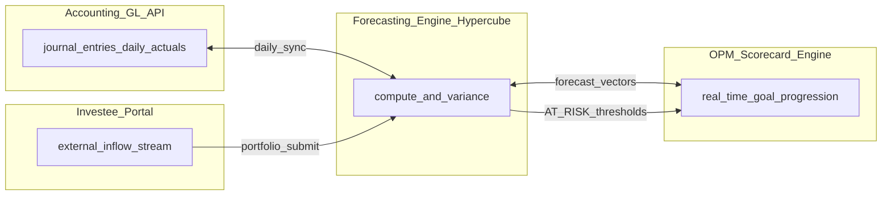
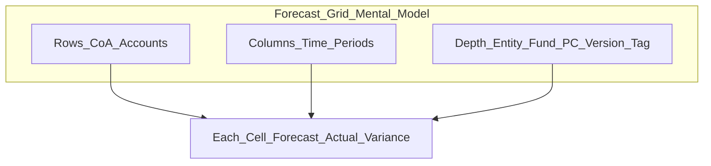
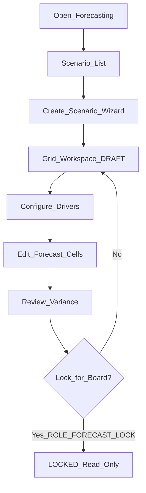
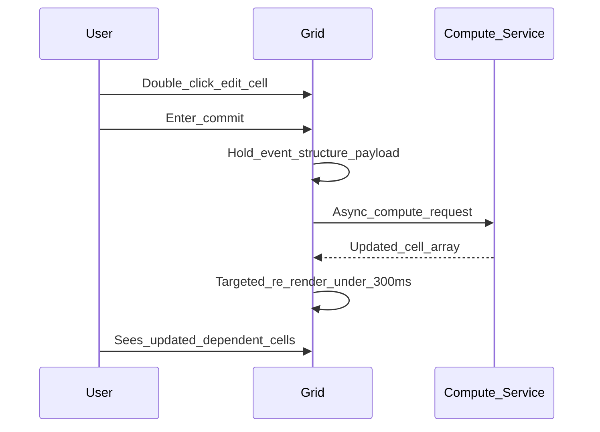
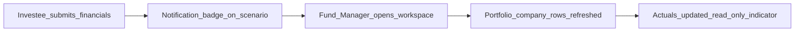

# Forecasting Engine — frontend design session

This document is for **product and frontend implementation**. It describes **what users should see and do** in the Arcus **Forecasting Engine**: navigation, roles, the interactive planning grid, scenario lifecycle, driver configuration, variance views, and cross-module indicators. It intentionally **does not** list API routes or request bodies; wire screens to the backend contract in [`docs/forecasting-engine-backend-requirements.md`](../docs/forecasting-engine-backend-requirements.md).

---

## How to use this document

- Use this in a **design session** with the frontend developer before backend implementation begins.
- Each section mixes **user stories** with **UI expectations** and **roles**.
- **Backend alignment notes** flag where today’s codebase has related but separate features (org budgets, GL actuals, investee reports) so labels and guards stay honest.
- **Numeric display** uses monospaced fonts and high information density; variances use semantic colour (see Design tokens).

---

## 1. Purpose and audience

### What this module is

The **Arcus Autonomous Multi-Dimensional Forecasting Engine** unifies **historical accounting actuals** and **future business projections** in one interactive planning surface. It replaces the spreadsheet export/import loop that breaks compliance and delays strategic metrics.

Every value in the grid lives at a **cell address** indexed by:

```
{ Period, Legal Entity, Fund Pool, Portfolio Company, Account ID, Analytical Tag, Version }
```

When the Accounting module posts a journal entry, or an investee updates financials through the portal, affected forecast cells and linked scorecard metrics **recalculate automatically** — the UI should reflect that freshness without a full page reload.

### Who uses it

| Role | Typical tasks |
|------|----------------|
| Corporate Financial Analyst | Create operational scenarios, edit forecast cells, configure horizons |
| Fund Manager | Create fund/portfolio scenarios, review aggregated portfolio projections |
| Finance Administrator | Bind drivers and formulas to ledger line ranges |
| Chief Financial Officer (CFO) | Review actual vs forecast variance, detect budget drift |
| Venture Capital Partner | Same as CFO for fund-level and portfolio company views |
| Executive Board Member | View locked board-approved versions (read-only) |

### Scope — two business domains in one UI

1. **Operational use cases** — internal OpEx, department overheads, payroll growth, cash runway vs cashbook.
2. **Investment use cases** — portfolio company growth, fund-level IRR, valuation adjustments, dilution (Phase 2+ UI for cap table / IRR charts).

**Backend alignment note:** This engine is **net-new**. Existing org budgets (`Budget` / `BudgetItem` under Finance → Budget Management) are flat annual stores with manual actuals — they do **not** replace this module. Coexistence is the default until product decides consolidation.

---

## 2. System context (what the UI sits inside)

Arcus coordinates four modules through a shared data bus. The forecasting workspace is the **centre** of this diagram; other modules push actuals in and consume projections out.


| Module | What the user sees from Forecasting |
|--------|-------------------------------------|
| **Accounting GL** | Elapsed period columns auto-fill with posted actuals |
| **Investee Portal** | Portfolio company rows refresh when investee submits financials; badge on affected scenario |
| **OPM Scorecard** | Linked strategic goals show **AT_RISK** when forecast misses threshold |
| **Events** | Event budget overrun surfaces as finance alert; event approval may block |



---

## 3. Information architecture

### Placement

- Primary nav: **Finance → Forecasting**
- Secondary entry (fund-scoped users): **Portfolio → Fund Planning** — same workspace, pre-filtered to a fund and portfolio companies

### Sub-areas (tabs or nested routes)

| Area | Route suggestion | Purpose |
|------|------------------|---------|
| **Scenarios** | `/forecasting` | List, filter, create scenarios |
| **Workspace** | `/forecasting/scenarios/:id` | Main Ag-Grid planning surface |
| **Drivers** | `/forecasting/scenarios/:id/drivers` | Formula and parameter editor (slide-over or tab) |
| **Variance** | `/forecasting/scenarios/:id/variance` | CFO-focused actual vs forecast view |
| **Versions** | `/forecasting/scenarios/:id/versions` | History, lock management, board-approved snapshots |

Optional global: **Alerts** panel (investee updates, event budget blocks, OPM AT_RISK) — bell icon or sidebar strip.

---

## 4. Core concept for the UI (plain language)

Think of the workspace as a **spreadsheet with superpowers**:

- **Rows** = Chart of Accounts (CoA) lines and groupings (Revenue, OpEx, Overheads, etc.)
- **Columns** = time periods across the scenario horizon (months, quarters, or years)
- **Depth** (filters / version selector) = scenario version, legal entity, fund, portfolio company, analytical tag



Each cell can show:

- **Forecast** (editable in future periods for authorised users)
- **Actual** (read-only for elapsed periods, sourced from GL)
- **Variance** (Actual − Forecast) and **% Deviation**
- **Dual currency** — transaction currency value + ZIG base (toggle or side-by-side sub-columns)

---

## 5. Screen inventory

| Screen | Primary user | Key elements |
|--------|--------------|--------------|
| **Scenario list** | Analyst, Fund Manager | Create button, filters (entity, fund, status, version), status badges `DRAFT` / `ACTIVE` / `LOCKED` |
| **Create scenario wizard** | Analyst | Multi-step: identity → scope → horizon → dimensions → confirm |
| **Forecast grid workspace** | Analyst, Admin | Sticky-axis Ag-Grid, period columns, variance columns, currency toggle |
| **Driver editor** | Finance Admin | Account range picker, driver type, formula editor, parameter fields |
| **Variance review** | CFO, Partner | Emphasis on actual vs forecast columns, heat-map style variance, export |
| **Version lock** | Board / exec with lock role | Lock action, version label, full read-only grid |

---

## 6. Screen specifications

### 6.1 Scenario list

**User story:** As an analyst, I want to see all my scenarios and their status so I can resume work or open a locked board version.

**UI elements:**

- Table or card list: name, description snippet, entity, fund (if any), horizon dates, granularity, status badge, last modified, owner
- Filters: entity, fund, status, date range, search by name
- Actions: **New scenario**, open workspace, duplicate (DRAFT only), archive (non-LOCKED)
- Empty state: illustration + “Create your first forecast scenario” CTA

**Status badges:**

| Status | Colour suggestion | Meaning |
|--------|-------------------|---------|
| `DRAFT` | Neutral / amber | Editable, not yet promoted |
| `ACTIVE` | Blue | In use, editable per role |
| `LOCKED` | Slate / lock icon | Immutable board-approved snapshot |

---

### 6.2 Create scenario wizard (Epic 1 — US-3.3.1)

**User story:** As a Corporate Financial Analyst or Fund Manager, I want to define a new forecasting scenario by selecting time horizons, legal entities, funds, and CoA ranges, so I can isolate operational planning from portfolio valuations.

**Step 1 — Identity**

| Field | Required | Notes |
|-------|----------|-------|
| Name | Yes | e.g. “Q3 Strategic Growth Runway” |
| Description | No | Free text |

**Step 2 — Scope**

| Field | Required | Notes |
|-------|----------|-------|
| Legal entity | Yes | Internal subsidiary or external startup (portfolio company) |
| Fund pool | Conditional | Required for investment scenarios |
| Base currency | Yes | `USD` or `ZIG` (official base for translated columns) |

**Step 3 — Horizon**

| Field | Required | Options |
|-------|----------|---------|
| Start date | Yes | Date picker |
| End date | Yes | Must be after start |
| Preset horizons | Optional shortcuts | Rolling 12 months, 24 months, 5 years |
| Granularity | Yes | Monthly, Quarterly, Annually |

**Step 4 — Dimensions**

| Dimension type | Example | Notes |
|----------------|---------|-------|
| `ACCOUNT` | CoA range e.g. Revenue 4000–4500 | Pulled dynamically from Accounting CoA for selected entity |
| `DEPT` | `DEPT_ALL` or specific department | Operational scenarios |
| Analytical tag | Optional | For tagged GL lines |

**Step 5 — Confirm**

- Summary card of all selections
- On submit: scenario created as **`DRAFT`** with **empty cell structure** (no pre-filled forecast values unless user imports from existing budget — open question)

**Backend alignment note:** CoA tree comes from the active Chart of Accounts in Accounting — do not hardcode account lists in the frontend.

---

### 6.3 Forecast grid workspace (central UI)

**Layout:**

```
┌─────────────────────────────────────────────────────────────────┐
│ [Scenario name]  [DRAFT ▼]  [Entity ▼] [Fund ▼] [Version ▼]     │
│ [USD|ZIG toggle]  [Drivers]  [Variance view]  [Lock] (if role)   │
├──────────────┬──────────┬──────────┬──────────┬───────────────┤
│ Account      │ Jan 2026 │ Feb 2026 │ ...      │ Dec 2026      │
│ (sticky)     │ F│A│Var  │ F│A│Var  │          │ F│A│Var       │
├──────────────┼──────────┼──────────┼──────────┼───────────────┤
│ 4000 Revenue │ ...      │ ...      │          │               │
│  ▼ OpEx      │ (group)  │          │          │               │
└──────────────┴──────────┴──────────┴──────────┴───────────────┘
```

- **F** = Forecast, **A** = Actual, **Var** = Variance + % Deviation
- Elapsed periods: Actual populated, Forecast may be read-only or editable per policy
- Future periods: Forecast editable (if not LOCKED), Actual blank or dashed

**Column groups:**

- Past / current periods: show Actual prominently; variance vs original forecast
- Future periods: Forecast editable; Actual hidden or greyed

---

### 6.4 Driver editor (Epic 2 — US-3.3.2)

**User story:** As a Finance Administrator, I want to bind mathematical drivers to ledger lines so the system auto-calculates future entries.

**UI — per driver row:**

| Field | Example |
|-------|---------|
| Target account range start | `4000` |
| Target account range end | `4500` |
| Driver type | `CAGR_DRIVEN`, headcount growth, inflation multiplier, FX scalar |
| Formula expression | `HISTORICAL_BASE * (1 + cagr_scalar)` |
| Parameters | `cagr_scalar: 0.045`, `historical_months_lookback: 6` |

**Formula editor capabilities (must be visible in UI):**

- Standard arithmetic (`+`, `-`, `*`, `/`)
- Conditional logic (`IF / THEN / ELSE`)
- Time-shifted variables (e.g. `t-12` for year-ago comparison)

**Feedback on save / parameter change:**

- Show **cascade in progress** on affected cells (spinner or pulse highlight)
- Target: affected cells refresh in **under 300 ms** after compute returns
- On circular reference: inline error on driver row — “Circular dependency detected” — no silent failure

---

### 6.5 Variance review (Epic 3 — US-3.3.3)

**User story:** As a CFO or VC Partner, I want a unified view comparing actuals to forecast with variance indicators so I detect overruns early.

**Display rules:**

| Metric | Formula (display only) |
|--------|------------------------|
| Absolute variance | Actual − Forecast |
| % Deviation | ((Actual − Forecast) / Forecast) × 100% |

**Semantic colouring — account-type aware:**

| Account type | “Good” (green) | “Bad” (red) |
|--------------|----------------|-------------|
| Revenue | Actual **above** forecast | Actual **below** forecast |
| Expense / OpEx | Actual **below** budget | Actual **above** budget |
| Neutral / balance sheet | Use signed variance; neutral grey if within tolerance |

Icons: ▲ green for favourable, ▼ red for unfavourable (context-dependent per row type).

**Elapsed periods only** show meaningful actual vs forecast — future columns show forecast-only or greyed variance.

**Backend alignment note:** Actuals for elapsed periods come from posted `journal_entries` via a daily sync — the UI should show “Last synced: …” timestamp on the variance view header.

---

### 6.6 Version lock (Epic 4 — US-3.3.4)

**User story:** As a Board Member (via authorised lock role), I want to lock a completed model as an immutable version so assumptions cannot be altered.

**UI behaviour when `LOCKED`:**

- Prominent banner: “This scenario is locked — `FY2026_BOARD_APPROVED`”
- All cells, drivers, and parameters **read-only**
- No Save, no inline edit, no driver add/remove
- **Lock** button visible only to users with `ROLE_FORECAST_LOCK`
- Lock flow: confirm modal → enter version label → irreversible warning

**On forbidden edit attempt (API returns 403):**

- Toast: “This forecast version is locked and cannot be modified.”
- No optimistic UI rollback confusion — refetch scenario status

---

## 7. Grid micro-interactions and design tokens

### 7.1 Interface styling (Section 7.1 of product spec)

| Token | Value | Usage |
|-------|-------|-------|
| Background primary | `#0F172A` | Page / panel background |
| Background secondary | `#1E293B` | Grid body, cards |
| Borders / grid lines | `#334155` | Cell borders, dividers |
| Positive variance | `#10B981` (Emerald) | Favourable variance text/icons |
| Negative variance | `#EF4444` (Crimson) | Unfavourable variance text/icons |
| Numerals | JetBrains Mono or Roboto Mono | All numeric cells — vertical alignment |

**High-density grid:** Use **Ag-Grid** (or equivalent) with:

- **Sticky left column** — CoA account hierarchy
- **Sticky top row** — period headers
- Horizontal and vertical scroll for deep models

### 7.2 Key micro-interactions (Section 7.2)

| Interaction | Behaviour |
|-------------|-----------|
| **Context-preserving cell edit** | Double-click future forecast cell → inline input → Enter or blur commits → async recalc |
| **Hover tooltip** | On variance or calculated cells: show formula, driver coefficients, last editor, timestamp |
| **Row collapse** | Click CoA group node (e.g. “Overheads”) → smooth collapse to subtotal row |
| **Compute feedback** | Brief highlight on changed cells after cascade completes |

---

## 8. Epic → UI mapping summary

| Epic | User story ID | Primary screens | Key UI acceptance |
|------|---------------|-----------------|-------------------|
| Multi-Dimensional Scenario Modeler | US-3.3.1 | Create wizard, scenario list | Horizons 12/24/60 mo; monthly/quarterly/annual; dynamic CoA; DRAFT + empty grid |
| Driver-Based Calculation Core | US-3.3.2 | Driver editor, grid | Inline formula editor; cascade on driver change; circular ref error |
| Actuals vs Projection Variance | US-3.3.3 | Grid, variance view | GL actuals in elapsed cols; variance formulas; green/red indicators |
| Immutable Auditing & Version Control | US-3.3.4 | Version lock, locked workspace | ROLE_FORECAST_LOCK gate; read-only when LOCKED; 403 messaging |

---

## 9. User flows

### 9.1 End-to-end planning flow



### 9.2 Cell edit → recalc flow (simplified for frontend)



### 9.3 Investee submit → fund manager visibility



---

## 10. Cross-module visibility (user-facing only)

| Source | What appears in Forecasting UI |
|--------|-------------------------------|
| **Accounting** | Actual columns fill for closed periods; “synced from GL” tooltip |
| **Investee Portal** | Toast + scenario badge when `PORTFOLIO_FORECAST_DISPATCHED`; portfolio rows update |
| **OPM Scorecard** | Link icon on rows tied to goals; navigate to goal detail; AT_RISK badge in Performance module |
| **Events** | Alert panel entry when event budget exceeds scenario boundary; link to blocked event |

---

## 11. Roles and permissions (UI gates)

| Capability | Analyst | Finance Admin | CFO / Partner | ROLE_FORECAST_LOCK | Board (read) |
|------------|---------|---------------|---------------|-------------------|--------------|
| View scenarios | Own + shared | All | All | All | Locked versions |
| Create scenario | Yes | Yes | Yes | No | No |
| Edit forecast cells (DRAFT/ACTIVE) | Yes | Yes | No | No | No |
| Edit drivers | No | Yes | No | No | No |
| Variance view | Yes | Yes | Yes | Yes | Yes |
| Lock version | No | No | No | Yes | No |
| View LOCKED | Yes | Yes | Yes | Yes | Yes |

Hide or disable controls the user cannot use — do not show a Lock button that always 403s.

---

## 12. States and edge cases

| State | UI treatment |
|-------|--------------|
| **Empty scenario** | Grid skeleton with “No forecast data — add drivers or edit cells” |
| **Loading grid** | Skeleton rows; preserve sticky headers |
| **Compute in progress** | Cell-level or row-level spinner; debounce rapid edits |
| **Formula error** | Red border on cell; tooltip with parser message |
| **Locked scenario** | Full read-only; banner; grey edit affordances |
| **Forecast = 0, Actual > 0** | Show % deviation as 100% (per engine rule) |
| **Forecast = 0, Actual = 0** | Show 0% or em dash |
| **Multi-currency** | Toggle USD / ZIG base columns; show tx currency in cell tooltip |
| **GL sync stale** | Amber “Actuals may be outdated” if last sync > 24h |
| **Network error on compute** | Revert cell to pre-edit value; retry CTA |

---

## 13. Data the frontend must display (field checklist)

### Scenario metadata (header / list)

- `name`, `description`, `status`, `version_label` (when locked)
- `entity` name, `fund` name (nullable)
- `base_currency`, `horizon_start_date`, `horizon_end_date`, `granularity`
- `created_by`, `updated_at`, `locked_at`, `locked_by`

### Grid cell (per period × account × dimensions)

- `forecast_value` (editable when allowed)
- `actual_value` (read-only for elapsed)
- `variance_absolute`, `variance_percent`
- `tx_currency`, `tx_currency_value`, `base_currency_value` (ZIG)
- `is_calculated` vs manual override flag
- `last_edited_by`, `last_edited_at` (for tooltip)

### Driver row

- `target_account_range_start`, `target_account_range_end`
- `driver_type`, `formula_expression`, `parameters` (key-value)
- validation `errors[]`

---

## 14. Open questions for design session

1. **Budget module coexistence** — Should “Import from existing budget” appear in the create wizard, or keep forecasting fully separate from `/api/budget-management`?
2. **Portfolio company layout** — Separate tab per portfolio company vs single grid with PC filter dimension?
3. **Charts in Phase 1** — Grid-only, or include runway line chart / fund IRR summary cards on variance view?
4. **Who can promote DRAFT → ACTIVE** — Analyst only, or manager approval step?
5. **Investment use cases** — Cap table / dilution matrix: defer to Phase 2 UI or stub navigation now?
6. **Event budget block** — Show block reason inline in Events module only, or also modal in Forecasting when finance reviews?

---

## 15. Out of scope — frontend Phase 1

- Cap table / dilution matrix interactive UI (investment use case — backend Phase 3)
- IRR sensitivity charts and Monte Carlo simulations
- Full export to Excel with formula preservation (nice-to-have later)
- Mobile-optimised grid (desktop-first for v1)

---

## 16. Related documents

| Document | Purpose |
|----------|---------|
| [`docs/forecasting-engine-backend-requirements.md`](../docs/forecasting-engine-backend-requirements.md) | Full backend spec, APIs, formulas, schema |
| [`docs/performance-contracts-scorecards-data-flow.md`](../docs/performance-contracts-scorecards-data-flow.md) | OPM / scorecard context |
| [`docs/investee-reporting-frontend-flow.md`](../docs/investee-reporting-frontend-flow.md) | Investee portal financial submit flow |
| [`docs/financial-reporting-background.md`](../docs/financial-reporting-background.md) | VC fund vs portfolio company accounting perspective |
