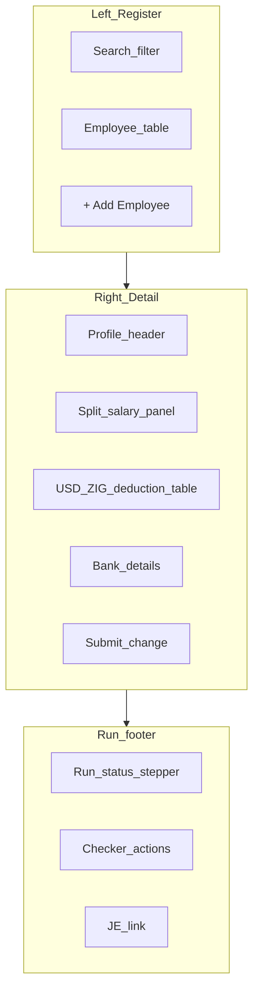

# Payroll, Employment & Training — frontend design session

This document is for **product and frontend implementation**. It describes **what users should see and do** in the Arcus **Payroll, Employment & Training** module (US-3.13.1–US-3.13.4): navigation, roles, the payroll admin console, compliance tracker, employee portal, and maker-checker states. It intentionally **does not** list API routes or request bodies; wire screens to the backend contract in [`docs/payroll-employment-training-backend-requirements.md`](../docs/payroll-employment-training-backend-requirements.md).

**Related:** [Payroll GL / COA verification](../docs/payroll-and-coa-spec-verification.md)

---

## How to use this document

- Use this in a **design session** with the frontend developer before or alongside backend implementation.
- Each section mixes **user stories** with **UI expectations** and **roles**.
- **Backend alignment notes** flag where today’s codebase already supports behaviour vs what is coming — keep labels honest (e.g. “Coming: dual-currency split”).
- **Numeric display** uses monospaced fonts and high information density; compliance status uses semantic colour (see Design tokens).
- Acceptance criteria traceability: see [Section 10](#10-acceptance-criteria--frontend-mapping) (mirrors backend matrix in the requirements doc).

---

## 1. Purpose and audience

### What this module is

The **Arcus Payroll, Employment, and Training Records** module is a **transaction-aware human capital ledger** that connects:

- Employment agreements and dual-currency salary splits
- Statutory payroll (ZIMRA PAYE, AIDS Levy, NSSA, SDL)
- Compliance training and certification lifecycle
- Automated GL postings and tamper-evident payslips

The UI is split into **two workspaces** that match Swagger sections **Payroll** (Section A) and **Employment & Training** (Section B).

### Who uses it

| Role | Typical tasks |
|------|----------------|
| HR Operations Manager | Onboard employees, configure contracts, submit sensitive changes (maker) |
| HR Checker / Finance Manager | Approve/reject employee change-requests and payroll runs (checker) |
| Payroll Officer | Create payroll runs, review statutory lines, submit for approval |
| Compliance Officer | Assign courses, verify uploads, force recertification |
| Financial Controller | Confirm balanced JE on finalize, audit payslip integrity |
| Employee (portal) | View payslips, leave balances, own certification status |

### Scope — two workspaces in one module

1. **Workspace A — Payroll Admin Console** — employee register, split salary, payroll run wizard, payslips.
2. **Workspace B — Compliance & Certification Tracker** — course catalog, assignments, cert grid, expiry warnings.

**Backend alignment note:** Workspace A **extends** existing Finance → Payroll screens and `/api/payroll/*`. Workspace B is **largely net-new** under `/api/payroll/compliance/*`.

---

## 2. Design tokens

From product spec Section 5.1 — apply consistently across both workspaces.

| Token | Value | Usage |
|-------|-------|-------|
| Font (numeric columns) | **JetBrains Mono** | Salary, deductions, net pay, FX rate, hash snippets |
| Background primary | `#0B0F19` | App shell, table headers |
| Surface / panel | `#151F32` | Cards, split-pane panes, modals |
| Accent / primary action | `#6366F1` | Run Calculations, Approve, primary buttons |
| Success / valid | `#10B981` | ACTIVE cert, hash verified, balanced run |
| Warning | Amber (system) | EXPIRING (≤30 days), pending approval |
| Danger | Red (system) | EXPIRED, TERMINATED, JE failed |

**Density:** Admin tables are **compact** (32–36px row height); payslip preview may use slightly larger line spacing for readability.

---

## 3. Information architecture

### Placement

- Primary nav: **HR & Payroll → Payroll** (Workspace A)
- Sibling nav: **HR & Payroll → Compliance & Training** (Workspace B)
- Employee self-service: **My Portal → Payslips & Compliance** (subset of existing employee portal)

### Sub-areas

| Area | Route suggestion | Workspace |
|------|------------------|-----------|
| Employee register | `/payroll/employees` | A |
| Employee detail | `/payroll/employees/:id` | A |
| Change-request queue | `/payroll/approvals/employee-changes` | A |
| Payroll runs | `/payroll/runs` | A |
| Run detail / wizard | `/payroll/runs/:id` | A |
| Statutory config | `/payroll/settings/statutory` | A |
| Course catalog | `/payroll/compliance/courses` | B |
| Assignments | `/payroll/compliance/assignments` | B |
| Certification grid | `/payroll/compliance/certifications` | B |
| Expiry dashboard | `/payroll/compliance/expiring` | B |
| Employee portal | `/employee/payslips` (extend) | A + B read-only |

---

## 4. Workspace A — Payroll Admin Console

### 4.1 Layout (split-pane)

```text
┌─────────────────────────────────────────────────────────────────────────────┐
│  PAYROLL ADMIN — JUNE 2026          FX: 1 USD = 13.56 ZIG    [Run Calc ▼]  │
├──────────────────────────────┬──────────────────────────────────────────────┤
│  EMPLOYEE REGISTER           │  EMPLOYEE DETAIL / PAY SLIP PREVIEW          │
│  ┌────────────────────────┐  │  Name: T. Moyo    Status: ACTIVE             │
│  │ Search…                │  │  Dept: OPS-12     ZIMRA BP: 1234567890       │
│  └────────────────────────┘  │  ─────────────────────────────────────────── │
│  # │ Name      │ Status    │  │  Split: 70% USD / 30% ZIG  [Pending ●]      │
│  1 │ T. Moyo   │ ACTIVE    │  │  Basic: 4,200 USD (ref)                     │
│  2 │ S. Ndlovu │ SUSPENDED │  │  ┌──────── USD leg ────────┬ ZIG leg ────┐ │
│  3 │ …         │ …         │  │  │ Gross    2,940.00       │ 17,089.44   │ │
│                              │  │ PAYE       425.00       │  2,468.00   │ │
│  [+ Add Employee]            │  │ AIDS        12.75       │     74.04   │ │
│                              │  │ NSSA       157.50       │    912.60   │ │
│                              │  │ Net      2,344.75       │ 13,634.80   │ │
│                              │  └─────────────────────────┴───────────────┘ │
│                              │  Bank: CBZ · ****4521   [Submit change]      │
├──────────────────────────────┴──────────────────────────────────────────────┤
│  RUN STATUS: DRAFT → Pending approval (2) → [Maker Approve disabled]       │
│  Checker: [Approve run] [Reject]     Journal: — (not posted)                │
└─────────────────────────────────────────────────────────────────────────────┘
```



### 4.2 Employee register

**User story:** As HR Ops, I need a searchable list of all employees with lifecycle status so I can open a profile quickly.

**UI expectations:**

- Columns: employee #, name, department code, lifecycle status badge, pending-change indicator (dot), last pay period.
- Filters: ACTIVE / SUSPENDED / TERMINATED; department; “has pending approval”.
- Row click loads right pane without full navigation (desktop); mobile stacks vertically.
- **Suspended** rows: muted styling; tooltip “Excluded from payroll runs”.

**Backend alignment note:** Register exists today with `isActive` / `terminated`. **Coming:** `lifecycleStatus` enum and pending-change flag from change-request API.

### 4.3 Employee detail — profile & split salary

**User story:** As HR Ops, I configure a 70/30 USD/ZIG split and see live preview of both legs.

**UI expectations:**

- **Split control:** Either dual numeric inputs (70 / 30) or slider with locked sum = 100%.
- **Live preview:** Two-column deduction table (USD | ZIG) using period FX from header — read-only until run calculated.
- **Sensitive fields** (salary, split, bank): show **Pending** badge when a change-request awaits checker; live values remain until approved.
- **Maker action:** “Submit for approval” — not “Save” for sensitive fields.
- **Non-sensitive fields** (address, photo, next of kin): direct save.

**Backend alignment note:** Today single `basicSalary` + one `currencyId`. Split panel is **net-new UI**; show “Coming soon” stub only if backend not ready.

### 4.4 Period header & FX

- Display pay period name (e.g. JUNE-2026), start/end dates.
- **FX rate:** `1 USD = X ZIG` from transaction-date resolver; read-only for Payroll Officer; link to Finance FX admin for Controllers.
- **Run Calculations** dropdown: Preview only | Submit for approval (disabled if pending employee changes in run).

### 4.5 Payroll run wizard

**States (stepper):**

| Step | Label | Who acts |
|------|-------|----------|
| 1 | DRAFT | Payroll Officer — add employees, preview |
| 2 | Pending approval | Checker — review totals |
| 3 | APPROVED | Payroll Officer — Process |
| 4 | PROCESSING | System |
| 5 | COMPLETED | All — payslips + JE link |
| — | FAILED | Controller — JE or PDF error banner |

**UI expectations:**

- Block **Process** until step 2 approved.
- Show aggregate totals per currency in footer.
- On COMPLETED: link “View journal entry #…” opens Accounting module (read-only).
- On FAILED: red banner with fail-closed message; no “completed” checkmark.

**Backend alignment note:** Today DRAFT → PROCESSING → COMPLETED without approval gate. Stepper should reflect **target** behaviour; gate Process button when backend ships approval endpoints.

### 4.6 Payslip view & integrity

**User story:** As an employee or HR user, I download my payslip and see whether the PDF integrity hash verifies.

**UI expectations:**

- Payslip list: period, gross, net, currency legs (if dual).
- Download button → PDF.
- **Integrity badge:** green “Verified” if SHA-256 matches stored hash; grey “Not generated”; red “Tampered or missing”.
- Optional: show truncated hash (`a3f2…9c01`) in JetBrains Mono for auditors.

**Backend alignment note:** PDF email exists; **persisted download + verify** endpoints are **coming**.

### 4.7 Statutory settings (admin)

- Tabbed: **ZIMRA brackets** (USD table | ZIG table), **Levies** (NSSA ceiling, AIDS 3%, SDL rate).
- Bracket editor: lower/upper bound, rate, offset — monospaced numeric cells.
- Effective date range per row.

**Backend alignment note:** Today flat `TaxRules`. Bracket UI is **new**; can show read-only seed data once API exists.

---

## 5. Workspace B — Compliance & Certification Tracker

### 5.1 Layout

```text
┌─────────────────────────────────────────────────────────────────────────────┐
│  COMPLIANCE & TRAINING                         [Assign course] [Upload cert] │
├─────────────────────────────────────────────────────────────────────────────┤
│  ⚠ 3 certifications expiring within 30 days — view dashboard                │
├──────────────────────────────┬──────────────────────────────────────────────┤
│  COURSE CATALOG              │  EMPLOYEE CERTIFICATIONS                     │
│  AML-SEC-01  Anti-Money…     │  Employee    │ Course      │ Status │ Expiry │
│  TRADE-02    Trading Rules   │  T. Moyo     │ AML-SEC-01  │ PASSED │ 2026-08│
│  HR-ONB-01   HR Onboarding   │  S. Ndlovu   │ AML-SEC-01  │ EXPIRING│ 2026-07│
│                              │  J. Phiri    │ TRADE-02    │ EXPIRED │ 2026-01│
├──────────────────────────────┴──────────────────────────────────────────────┤
│  Selected: S. Ndlovu — AML-SEC-01  [View upload] [Force recertification]    │
└─────────────────────────────────────────────────────────────────────────────┘
```

### 5.2 Course catalog

**User story:** As Compliance Officer, I maintain mandatory courses and assign them by role or department.

**UI expectations:**

- CRUD table: code, title, renewal period (months), linked permissions (chips).
- **Assign** modal: scope = All | Role | Department code; multi-select.
- Empty state: “No courses — create AML and trading courses first.”

**Backend alignment note:** **Net-new.** BSC training counter in Performance is separate — optional badge “Counts toward BSC KPI” when course linked.

### 5.3 Certification grid

**User story:** As Compliance Officer, I see who is compliant, expiring, or expired.

**Status badges:**

| Status | Colour | Meaning |
|--------|--------|---------|
| PASSED / VALID | `#10B981` | Current cert on file |
| EXPIRING | Amber | ≤30 days to expiry |
| EXPIRED | Red | Permissions revoked |
| REVOKED | Red outline | Manual compliance action |

**UI expectations:**

- Upload: drag-drop PDF/image; show upload progress; display verifier name and issue/expiry dates after save.
- **Force recertification:** confirmation modal — explains permission lock until new upload approved.
- Filter by department, course, status.

### 5.4 Expiry dashboard

- Cards: Expiring in 30 / 60 / 90 days.
- Table sortable by expiry date.
- Bulk actions: send reminder (if notifications wired).

**Backend alignment note:** Cron + notifications **coming**; dashboard can ship with static data first.

### 5.5 Permission revocation (cross-module UX)

When cert expires, affected modules should show:

- Locked action buttons with tooltip: “AML certification expired — contact Compliance.”
- Optional banner on login for employee.

Frontend **does not** implement revocation logic — consumes RBAC/permission flags from auth payload after backend sync.

---

## 6. Employee portal (extended)

**Existing:** payslips list, leave balances (`/employee/portal`).

**Add:**

- Certification summary card: course, status, expiry, link to upload (if self-service upload allowed).
- Payslip download + integrity badge (same as admin view, scoped to self).
- Warning banner at T-30 for expiring certs.

**Backend alignment note:** Portal routes exist; cert summary depends on Section B APIs.

---

## 7. Screen inventory & key flows

### 7.1 Onboarding flow

1. HR creates user + employee record (employee #, department, ZIMRA BP).
2. Configure split salary → **Submit change-request** (maker).
3. Checker approves → status ACTIVE, split live.
4. Compliance assigns mandatory courses by department → employee sees portal tasks.

### 7.2 Monthly payroll flow

1. Payroll Officer creates run for period; FX snapshot shown.
2. **Run Calculations** → preview USD/ZIG legs per employee.
3. Submit run for approval → checker reviews totals.
4. Checker approves → Officer **Process**.
5. System posts JE + generates payslips → COMPLETED; employees notified.

### 7.3 Certification renewal flow

1. T-30: banner + email (employee + compliance).
2. Employee uploads new cert OR compliance uploads on behalf.
3. Compliance verifies → status VALID, permissions restored.
4. If T-0 without renewal → EXPIRED, trading/approval UI locked.

### 7.4 Termination / suspension

- **Suspend:** confirmation; employee excluded from next run (greyed in register).
- **Terminate:** existing terminate flow; status TERMINATED; certs marked inactive (no new assignments).

---

## 8. States & guards (what to disable)

| Condition | UI behaviour |
|-----------|--------------|
| Pending employee change-request | Sensitive fields read-only; “Awaiting checker” banner; block run submit if employee in run |
| Employee SUSPENDED | Exclude from run employee picker; show reason in tooltip |
| Employee TERMINATED | Read-only profile; no payroll actions |
| Run PENDING_APPROVAL | Hide Process; show Approve/Reject for checker only |
| Run not APPROVED | Process button disabled + tooltip |
| AML cert EXPIRED | Disable trading/approval actions in other modules (permission guard) |
| Payslip not generated | Download disabled |
| Maker = current user on approval | Disable Approve (segregation) |

---

## 9. Backend alignment notes (summary)

| Feature | Today | Target |
|---------|-------|--------|
| Employee CRUD | ✅ Basic fields, terminate | Split %, ZIMRA BP, dept, SUSPENDED, maker-checker |
| Payroll run | ✅ DRAFT → process | Approval gate, dual-currency legs |
| Statutory calc | ⚠️ Flat PAYE; AIDS on gross | ZIMRA brackets; AIDS on PAYE; SDL |
| GL posting | ✅ 5010/2150/2160/2250 | Fail-closed; SDL 2170; journalEntryId on run |
| Payslip PDF | ⚠️ Email buffer | Persist + download + SHA-256 verify |
| Training/certs | ❌ BSC counter only | Full Section B registry + expiry + RBAC |
| FX rate | ⚠️ Hardcoded 1:40 | Transaction-date resolver |

Use **“Beta”** or **“Coming”** labels in UI until backend phase ships (see backend doc [Section 16](../docs/payroll-employment-training-backend-requirements.md#16-implementation-phases)).

---

## 10. Acceptance criteria — frontend mapping

Each product acceptance criterion and the **primary screen** where the user sees it. Backend behaviour and API sections are in the [traceability matrix](../docs/payroll-employment-training-backend-requirements.md#5-acceptance-criteria-traceability-matrix).

| ID | User-visible outcome | Primary screen |
|----|----------------------|----------------|
| US-3.13.1-A1 | Full profile with dept + ZIMRA BP | Employee detail form |
| US-3.13.1-A2 | 70/30 split with USD/ZIG preview | Split salary panel |
| US-3.13.1-A3 | ACTIVE / SUSPENDED / TERMINATED badges | Register + detail header |
| US-3.13.1-A4 | Pending vs live values | Detail + change-request queue |
| US-3.13.2-A1 | Separate USD/ZIG deduction columns | Run preview / payslip |
| US-3.13.2-A2 | AIDS line = 3% of PAYE | Deduction table |
| US-3.13.2-A3 | SDL line visible | Deduction table + statutory settings |
| US-3.13.2-A4 | Run/Process disabled until approved | Run wizard footer |
| US-3.13.3-A1 | Assign course to role/dept | Assignments modal |
| US-3.13.3-A2 | Upload cert with dates | Certification grid |
| US-3.13.3-A3 | 30-day warning banners | Compliance header + portal |
| US-3.13.3-A4 | EXPIRED badge + locked modules | Cert grid + cross-module guards |
| US-3.13.4-A1 | Finalize only when JE balanced | Run COMPLETED step |
| US-3.13.4-A2 | JE link on completed run | Run footer |
| US-3.13.4-A3 | Download PDF + integrity badge | Payslip list / detail |

---

## 11. Accessibility & density

- Monospaced numerics: JetBrains Mono for all currency columns and hashes.
- Status badges: not colour-only — include text (PASSED, EXPIRING, EXPIRED).
- Keyboard: register navigable with arrow keys; Enter opens detail pane.
- Focus order: left register → right detail → footer actions.
- High-density tables: sticky header, horizontal scroll on small viewports for dual-currency columns.

---

## 12. Open questions for design session

1. **Split control:** slider vs numeric inputs — product preference?
2. **Self-service cert upload:** allowed for all courses or compliance-only upload?
3. **SDL:** show on employee payslip as deduction or employer-only accrual line?
4. **Mobile:** is payroll admin console desktop-only for v1?

---

*Document version: 1.0 — 2026-06-15*
