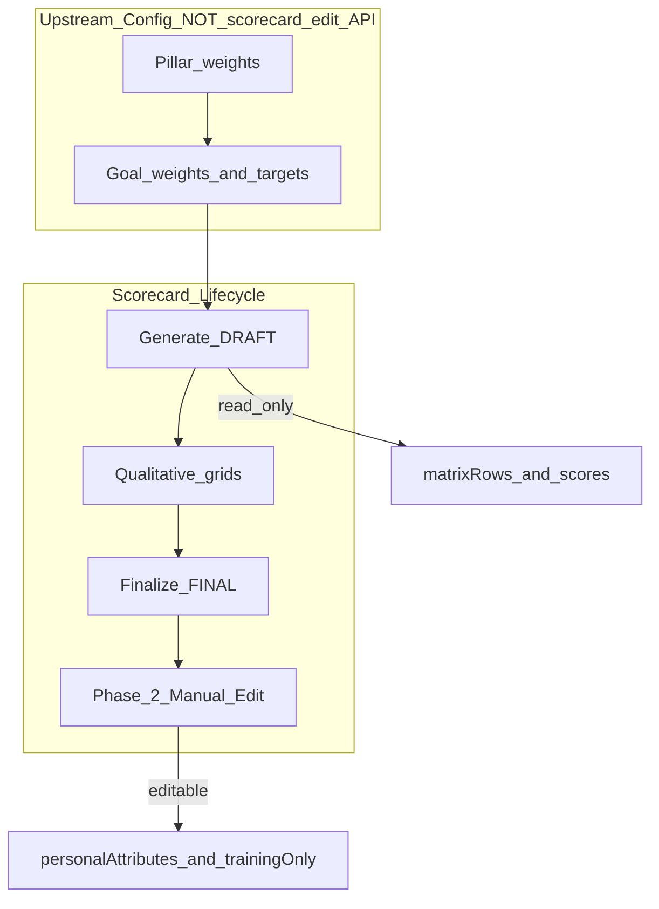
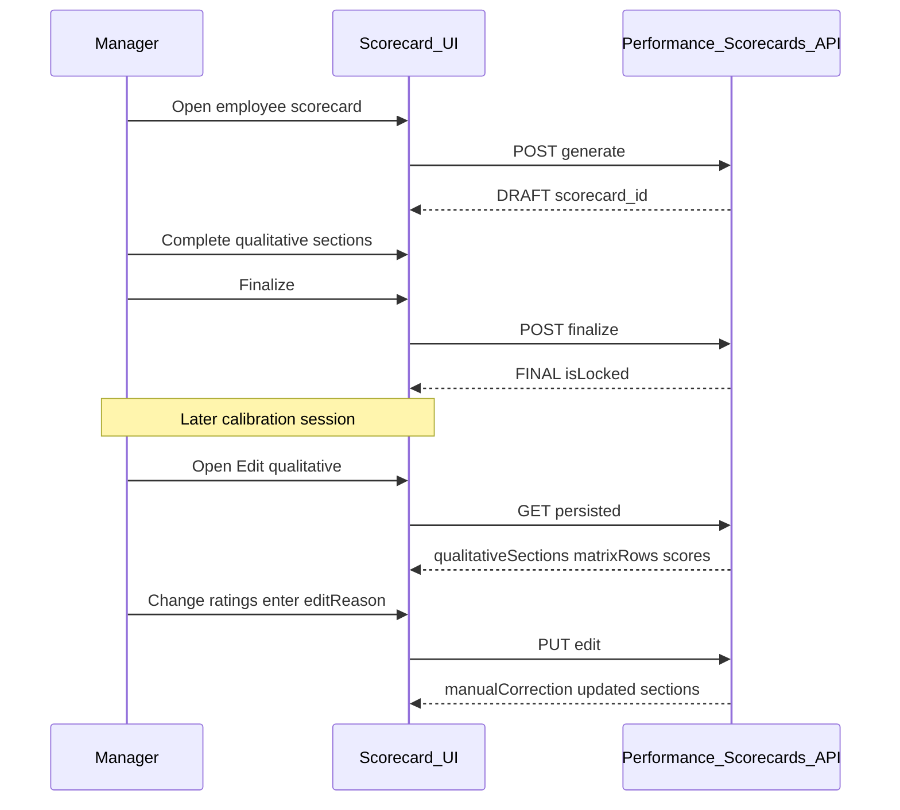
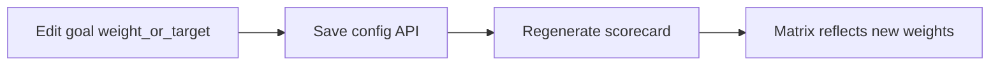
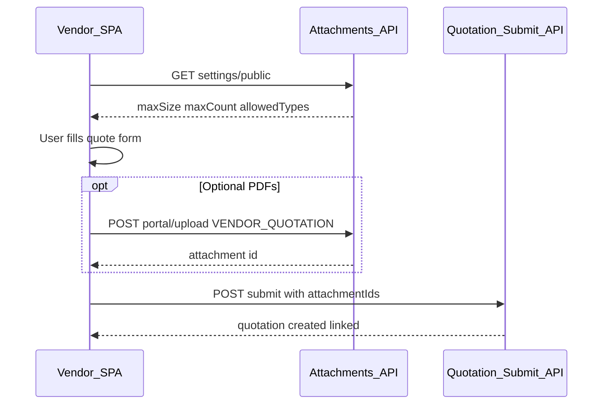
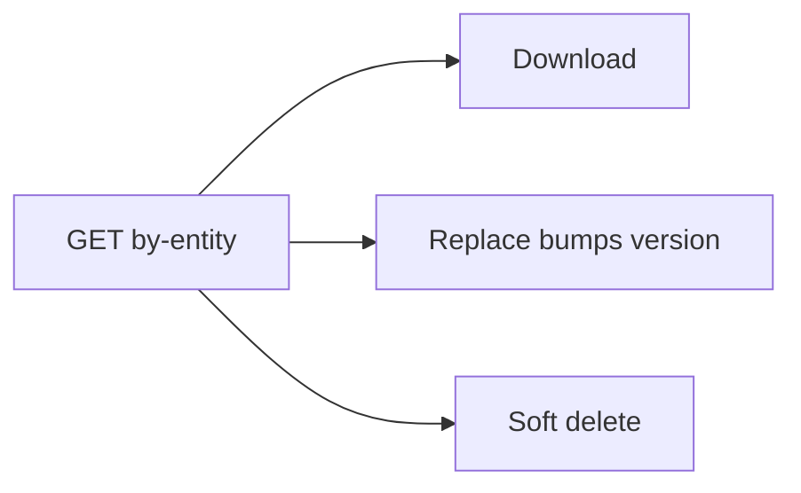
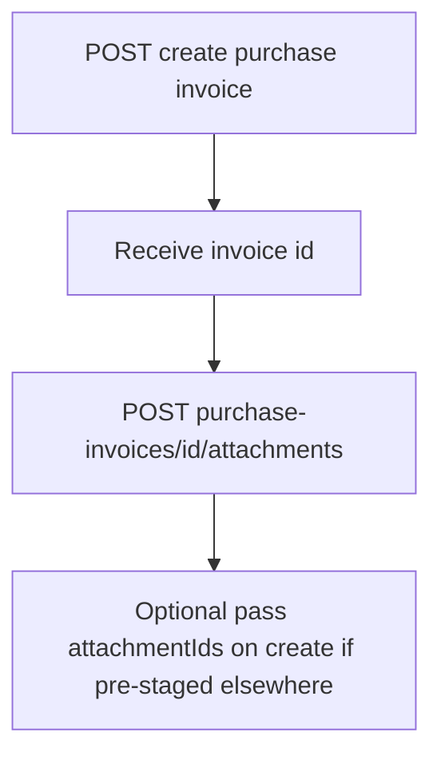

# Scorecard editing & PDF uploads — frontend design session

This document is for **product and frontend implementation**. It covers two **Phase 2** features that are **already implemented on the backend**:

1. **Scorecard editing** — manual correction of qualitative sections on persisted performance scorecards
2. **PDF uploads** — unified vendor document attachments for quotations and invoices

Wire screens to the live API contracts in Swagger tags **Phase two Scorecard Editing** and **Phase two PDF uploads**, or the source files listed in [Related documents](#related-documents).

---

## How to use this document

- Each feature has its own section: purpose, IA, screens, flows, roles, fields, and edge cases.
- **Backend alignment notes** reflect **current server behaviour** — the backend is built; the frontend is not in this repo.
- Scorecard **numeric** matrix (KPI actuals, targets, weights, scores) is **read-only** on the scorecard edit screen; weight/target changes use separate goal-config screens.

---

# Part A — Scorecard editing

## A.1 Purpose and audience

### What this feature is

Phase 2 scorecard editing lets authorised users **correct qualitative evaluation grids** on an already-generated, **persisted** scorecard (`DRAFT` or `FINAL`). It does **not** let users edit computed KPI numbers, matrix rows, weights, or final scores through the scorecard edit API — those come from goal progress tracking and scorecard generation.

A separate but related UX path is **scorecard configuration** (pillar weights, per-goal `scorecardWeight` and `targetValue`) — upstream of generation, on goal/config screens.

### Who uses it

| Role | Typical tasks |
|------|----------------|
| Line manager | Edit employee qualitative grid after calibration |
| HR | Edit employee scorecards; support qualitative corrections |
| CEO | Edit department, CEO, and board qualitative sections |
| Admin | Full access to all scorecard types |
| Employee (self) | **View only** — cannot edit own scorecard via this API |
| M&E / Compliance | Department scorecard view-only |

### Scorecard types in scope

| Type | Lookup for edit screen |
|------|----------------------|
| `EMPLOYEE` | `employeeId` + period |
| `DEPARTMENT` | Department name or `departmentId` + period |
| `CEO` | Period only (singleton org scorecard) |
| `BOARD` | Period only (singleton org scorecard) |

---

## A.2 Information architecture

### Placement

- **Performance → Scorecards** → select scope (Employee / Department / CEO / Board)
- Sub-routes:
  - **Generate / preview** — live recompute (existing flow)
  - **View persisted** — read-only document view
  - **Edit qualitative** — Phase 2 correction form (this feature)
  - **Finalize** — lock scorecard (`FINAL`, `isLocked: true`)

### Related screens (not scorecard edit API)

| Screen | Nav suggestion | API area |
|--------|----------------|----------|
| Goal weight & target editor | Performance → Goals → [goal] → Scorecard config | `/api/performance/config/goals/:goalId` |
| Pillar weight editor | Performance → BSC → Pillar weights | `/api/performance/scorecard-pillars` |
| Company goal line weights | Performance → BSC → [pillar] → Goal weights | `.../company-goal-weights` |

After config changes, user **regenerates** the scorecard to refresh the numeric matrix.

---

## A.3 Two editing layers (critical for design)



| Layer | What user edits | API |
|-------|-----------------|-----|
| **Qualitative correction (Phase 2)** | Personal attributes grid, training & development tables | `PUT .../edit` with `editReason` |
| **Goal / pillar config** | Weights, targets, BSC pillar mapping | Config + pillar routes |
| **Never on edit form** | Matrix rows, actuals, targets, raw ratings, computed scores | Read-only display |

**Backend alignment note:** `PUT .../edit` returns **400** if the client sends `matrixRowPatches`, `scores`, or `sectionBlendMode`.

---

## A.4 Screen inventory

| Screen | Primary user | Key elements |
|--------|--------------|--------------|
| Persisted scorecard view | Manager, HR, employee (self view) | Read-only matrix, scores, qualitative sections, lifecycle banner |
| Qualitative edit form | Manager, HR, CEO, admin | Personal attributes grid, training tables, mandatory edit reason |
| First-time qualitative save | Manager, HR (pre-finalize) | Same grids; no `editReason`; blocked if FINAL exists |
| Goal scorecard config | HR, admin | Weight %, target value, change reason fields |
| Pillar weights | HR, admin | Four BSC pillars summing to 100% |

---

## A.5 Qualitative edit form — fields and layout

### Header context (read-only)

Load from `GET .../persisted` (or `GET /api/performance/scorecards/:scorecardId`):

| Field | Source | Display |
|-------|--------|---------|
| Subject name | `employee` / `department` metadata | Page title |
| Period | `periodLabel`, `periodStart`, `periodEnd` | Subtitle |
| Status | `savedRecord.status` | Badge: `DRAFT` / `FINAL` |
| Locked | `savedRecord.isLocked` | Lock icon when true |
| Scores | `scores` | **Read-only** — results delivery, budget, final |
| Matrix | `matrixRows` | **Read-only** KPI table |
| Lifecycle | `lifecycle.phase`, `lifecycle.bannerMessage` | Info banner |
| Warnings | `warnings[]` | Includes post-edit audit line |

### Editable section 1 — Personal attributes grid

**10 fixed attributes** (employee / department / CEO / board use same column set):

1. Judgement in decision making  
2. Leadership and Management  
3. Ethics  
4. Teamwork  
5. Communication Skills  
6. Creativity and Innovation  
7. Knowledge of Standard Operating Procedures  
8. Quality of Work  
9. Interpersonal Relations  
10. Technical Skills  

**5 rating columns per row** (radio-style — at most **one** selected per row):

| Excellent | Very Good | Satisfactory | Requires Improvement | Unsatisfactory |

**UI behaviour:**

- Render as a table: attribute name (sticky left) + 5 tick columns
- Partial completion allowed (not every row must be rated)
- Client-side guard: max one `selected: true` per row before submit
- Bind from `qualitativeSections.personalAttributes` or `document.qualitativeSections.personalAttributes`

### Editable section 2 — Training and development

Three sub-tables with add/remove row actions:

| Sub-section | Key fields | Required |
|-------------|------------|----------|
| **Beginning of cycle** | `courseOrProgram`, `provider`, `plannedStartDate`, `plannedEndDate`, `status`, `notes` | `courseOrProgram` |
| **End of cycle** | Same shape | `courseOrProgram` |
| **Interventions** | `type`, `description`, `startDate`, `endDate`, `outcome` | `type`, `description` |

**`status` enum (training rows):** `Planned`, `In Progress`, `Completed`

**`type` enum (interventions):** `Coaching`, `Mentoring`, `Performance Improvement Plan`, `Training`, `Other`

### Mandatory edit reason (Phase 2 save only)

| Field | Required | Notes |
|-------|----------|-------|
| `editReason` | **Yes** on `PUT .../edit` | Free text; e.g. "Corrected Teamwork rating after calibration" |
| Not required | On first-time `PUT .../qualitative-evaluation` (pre-FINAL workflow) | |

Show edit reason as a prominent text area above Save; block submit if empty on Phase 2 edit.

### Save response — show correction audit

After successful `PUT .../edit`, display `manualCorrection`:

- Who edited (`byName`), when (`at`), reason
- `previousFinalScore` → `newFinalScore` (scores themselves are not user-editable; may change if qualitative affects blend — show as info only)
- Append to warnings list on reload

---

## A.6 User flows

### Flow 1 — Generate → finalize → later correct (Phase 2)



### Flow 2 — First-time qualitative (pre-finalize)

Use `PUT .../qualitative-evaluation` routes (employee / department / CEO / board) when scorecard is still being built and **no FINAL** exists yet.

- **No** `editReason` required
- Returns **409** if a FINAL scorecard already exists for the period → redirect user to Flow 1 (`PUT .../edit`)

### Flow 3 — Configure weights → regenerate matrix



---

## A.7 API surface (frontend wiring)

Base path: `/api/performance/scorecards`

### Phase 2 edit (Swagger-documented)

| Method | Path | Purpose |
|--------|------|---------|
| GET | `/employee/:employeeId/persisted` | Load employee scorecard for edit |
| PUT | `/employee/:employeeId/edit` | Save qualitative correction |
| GET | `/department/:department/persisted` | Load by department **name** |
| PUT | `/department/:department/edit` | Save dept correction |
| GET | `/ceo/persisted` | Load CEO scorecard |
| PUT | `/ceo/edit` | Save CEO correction |
| GET | `/board/persisted` | Load Board scorecard |
| PUT | `/board/edit` | Save Board correction |

**Period params:** `periodLabel`, `periodStart`, `periodEnd` (query on GET; body or query on PUT).

### Live routes (not in Phase 2 Swagger tag — still available)

| Method | Path | Purpose |
|--------|------|---------|
| GET | `/department/by-id/:departmentId/persisted` | Load by department ID |
| PUT | `/department/by-id/:departmentId/edit` | Edit by department ID |
| GET | `/:scorecardId` | Universal load |
| PUT | `/:scorecardId/edit` | Universal edit |
| POST | `/:scorecardId/finalize` | Lock to FINAL |

### Goal / weight config (upstream)

| Method | Path | Key body fields |
|--------|------|-----------------|
| PUT | `/api/performance/config/goals/:goalId` | `scorecardWeight`, `targetValue`, `targetChangeReason`, `scorecardPillar` |
| PUT | `/api/performance/scorecard-pillars/:id/company-goal-weights` | `goalWeights` map, `weightChangeReason` |
| PUT | `/api/performance/scorecard-pillars/weights` | All pillar weights (must sum 100%) |

---

## A.8 Roles and permissions

**Important:** Phase 2 `PUT .../edit` is **authenticate-only** on the backend — **no server role check**. The frontend **must** enforce gates using the same rules as `performanceScorecardSupport.ts`.

| Action | Who may do it |
|--------|----------------|
| Edit employee qualitative (Phase 2) | Line manager, HR, CEO, admin — **not** the employee themselves |
| First-time employee qualitative | Same as above |
| Edit department qualitative | Admin or CEO only |
| Edit CEO / Board qualitative | Admin or CEO only |
| View employee scorecard | Above editors + **employee self** (read-only) |
| View department scorecard | Editors + M&E / Compliance (read-only) |
| Finalize | Per existing generate/finalize rules for scope |

Hide Edit / Save when user lacks permission; do not rely on API to return 403 for role.

---

## A.9 States and edge cases

| State | UI treatment |
|-------|--------------|
| No persisted scorecard for period | 404 — "Generate scorecard first" CTA |
| Terminated employee | Block edit; show message from API |
| FINAL + locked | Edit still allowed for **qualitative** (Phase 2); show lock badge but enable qualitative form |
| Missing `editReason` | 400 — inline validation before submit |
| Multiple ticks per attribute row | 400 — highlight row |
| Forbidden payload (`scores`, etc.) | 400 — should never happen if UI is read-only for matrix |
| FINAL exists, user on qualitative-evaluation route | 409 — redirect to Phase 2 edit flow |

---

## A.10 Goal config form — fields (related UI)

When building the weight/target editor (separate from qualitative edit):

| Field | Validation | Notes |
|-------|------------|-------|
| `scorecardWeight` | 0–100; siblings in pillar must total 100% | Cannot set on goal **create** — config route only |
| `targetValue` / `preciseTargetValue` | Numeric | `targetChangeReason` **required** when target changes |
| `weightChangeReason` | Optional | Audit trail |
| `scorecardPillar` | One of fixed BSC pillars | |

---

# Part B — PDF uploads (vendor document attachments)

## B.1 Purpose and audience

### What this feature is

Unified **PDF attachment** handling for procurement documents:

- Vendor **quotations** (RFQ response)
- Vendor **procurement invoices** (PO invoice submit)
- Staff **purchase invoices** (AP bills)

Attachments are stored in Firebase (`vendor-record-attachments/...`), versioned, checksum-verified, and linked to parent records. **Attachments are optional** on vendor submit unless product adds client-side required rules.

### Who uses it

| Role | Context |
|------|---------|
| Vendor (portal) | Upload PDFs when responding to RFQ or submitting PO invoice |
| Procurement staff | Upload / replace / delete attachments on quotations and invoices |
| Accounts payable staff | Upload PDFs on purchase invoices (staff-only entity type) |
| Procurement admin | Configure max file size, allowed types, max attachments per record |

---

## B.2 Information architecture

### Vendor portal (no JWT — token in URL / body)

| Page | Env path (defaults) | Entity type |
|------|---------------------|-------------|
| RFQ respond | `/vendor-quotations/rfq-respond?token=…` | `VENDOR_QUOTATION` |
| PO vendor invoice | `/procurement/vendor-invoice?token=…` | `PROCUREMENT_INVOICE` |

### Staff app (JWT)

| Area | Nav suggestion |
|------|----------------|
| Quotation detail | Attachments panel on vendor quotation record |
| Procurement invoice detail | Attachments panel |
| Purchase invoice (AP) detail | Attachments panel |
| Settings | Procurement → Document upload settings |

---

## B.3 Entity types and capabilities matrix

| `entityType` | Label | Vendor portal upload | Staff upload | Staged before submit |
|--------------|-------|----------------------|--------------|----------------------|
| `VENDOR_QUOTATION` | RFQ quotation | Yes | Yes | Yes (portal) |
| `PROCUREMENT_INVOICE` | Vendor PO invoice | Yes | Yes | Yes (portal) |
| `PURCHASE_INVOICE` | AP purchase bill | **No** | Yes | **No** — upload after bill created |

**Attachment statuses:** `ACTIVE`, `SUPERSEDED`, `DELETED` (soft delete)

**Upload sources:** `VENDOR_PORTAL`, `STAFF`

---

## B.4 Upload constraints (display in UI)

Load from `GET /api/procurement/document-attachments/settings/public` (portal) or `.../settings` (staff).

| Constraint | Default | Admin range |
|------------|---------|-------------|
| Max file size | **15 MB** | 1 KB – 50 MB |
| Max attachments per record | **5** | 1 – 20 |
| Allowed types | **PDF only** | PDF must remain enabled |
| Multipart field name | `document` | — |
| Optional on submit | **Yes** | — |

**Client-side validation before upload:**

- Extension `.pdf` and/or MIME `application/pdf`
- File size ≤ `maxFileSizeBytes` from settings
- Count ≤ `maxAttachmentsPerRecord`
- Server validates PDF magic bytes (`%PDF-`)

Show human-readable limits under the drop zone: e.g. "PDF only, up to 15 MB, 5 files max".

---

## B.5 Screen inventory

| Screen | User | Key elements |
|--------|------|--------------|
| Portal RFQ respond | Vendor | Quote form + optional PDF dropzone + staged file list |
| Portal PO invoice | Vendor | Invoice form + optional PDF dropzone |
| Staff attachment panel | Staff | List, upload, download, replace, delete |
| Staff upload settings | Admin | Max size, max count, allowed types toggles |
| Purchase invoice create | AP staff | Create bill → then attachment panel (no pre-create staging) |

---

## B.6 Attachment list item — data to display

Each attachment row (from list API):

| Field | UI use |
|-------|--------|
| `originalFileName` | Primary label |
| `fileSizeBytes` | Formatted size (e.g. 240 KB) |
| `version` | Show when > 1 or after replace |
| `status` | `ACTIVE` normal; `SUPERSEDED` greyed in history if shown |
| `uploadSource` | Badge: Portal vs Staff |
| `createdAt` | Upload timestamp |
| `mimeType` | Confirm PDF |

Actions per row (staff only): **Download**, **Replace**, **Delete**

Portal: **Download** only (via portal download URL + token)

---

## B.7 User flows

### Flow 1 — Vendor RFQ quotation with PDFs



1. Open email link → RFQ respond page with `token`, `rfqNumber`
2. Fetch public settings → configure dropzone limits
3. User completes quotation fields
4. Optionally upload PDF(s) → collect `id`s in local state
5. Submit quotation JSON including `attachmentIds: ["att_…"]`
6. Success — show confirmation; attachments linked server-side

**Token kind:** `RFQ_SUBMIT` (embeds `vendorId`, `procurementRfqId`, expiry)

### Flow 2 — Vendor procurement invoice

Same pattern as RFQ with:

- Path: `/procurement/vendor-invoice?token=…`
- `entityType`: `PROCUREMENT_INVOICE`
- Submit: `POST /api/procurement/invoices` with `attachmentIds`
- Token kind: `PO_VENDOR_INVOICE`

### Flow 3 — Staff upload on existing record

No staging — upload directly to record ID:

| Record | Upload endpoint pattern |
|--------|-------------------------|
| Quotation | `POST .../quotations/:quotationId/attachments` |
| Procurement invoice | `POST .../procurement-invoices/:invoiceId/attachments` |
| Purchase invoice | `POST .../purchase-invoices/:invoiceId/attachments` |

Multipart: field `document`, JWT auth.

### Flow 4 — Staff manage attachments



- **Replace:** old file → `SUPERSEDED`, new file `version + 1`
- **Delete:** status → `DELETED`; hidden from active list
- **Download:** staff `GET .../:attachmentId/download`; portal `GET .../portal/:id/download?vendorPortalToken=`

### Flow 5 — Purchase invoice (AP staff)



**Gap:** No vendor portal and no staff staging endpoint for `PURCHASE_INVOICE`. UI must upload **after** bill exists.

---

## B.8 API surface (frontend wiring)

Base path: `/api/procurement/document-attachments`

| Method | Path | Auth | Purpose |
|--------|------|------|---------|
| GET | `/settings/public` | None | Portal constraints |
| GET | `/settings` | JWT | Staff read settings |
| PUT | `/settings` | JWT | Admin update settings |
| POST | `/portal/upload` | Token in body | Vendor staged upload |
| GET | `/portal/:attachmentId/download` | `?vendorPortalToken=` | Vendor download |
| POST | `/quotations/:quotationId/attachments` | JWT | Staff upload |
| POST | `/procurement-invoices/:invoiceId/attachments` | JWT | Staff upload |
| POST | `/purchase-invoices/:invoiceId/attachments` | JWT | Staff upload |
| GET | `/by-entity/:entityType/:entityId` | JWT | List active attachments |
| GET | `/:attachmentId/download` | JWT | Staff download |
| PUT | `/:attachmentId/replace` | JWT | Staff replace |
| DELETE | `/:attachmentId` | JWT | Staff soft-delete |

**Submit endpoints accepting `attachmentIds`:**

| Method | Path | Context |
|--------|------|---------|
| POST | `/api/vendor-quotations/submit` | Portal quotation |
| POST | `/api/procurement/invoices` | Portal or staff invoice |
| POST | `/api/accounting/purchase-invoices` | Staff AP bill |

### Portal upload form fields

| Field | Required | Notes |
|-------|----------|-------|
| `document` | Yes | File (multipart) |
| `vendorPortalToken` | Yes | Alias `token` accepted |
| `entityType` | Yes | `VENDOR_QUOTATION` or `PROCUREMENT_INVOICE` |
| `entityId` | No | Omit for staged upload before submit |

---

## B.9 Roles and permissions

| Action | Vendor portal | Staff |
|--------|---------------|-------|
| Upload | Token-scoped; quotation + proc invoice only | JWT; all three entity types |
| Download | Own uploads via portal URL | Any attachment on accessible record |
| Replace | **Blocked** | Allowed |
| Delete | **Blocked** | Allowed |
| Settings read | Public endpoint only | Full settings GET |
| Settings write | **Blocked** | Admin / procurement config role |

Portal replace/delete attempts return explicit error — do not show those buttons to vendors.

---

## B.10 States and edge cases

| State | UI treatment |
|-------|--------------|
| No attachments | Empty state — "No documents attached (optional)" |
| Upload in progress | Progress bar; disable submit until complete |
| Upload failed (not PDF) | Toast: invalid file type |
| Upload failed (size) | Show limit from settings |
| Max attachments reached | Disable dropzone; show count cap |
| Staged portal files | Show list with remove-before-submit (client-side only) |
| Submit without attachments | Allowed — omit `attachmentIds` or pass `[]` |
| Replaced file | Show latest `version`; optional "previous versions" collapsible |
| Legacy invoice `documentPath` | Staff may still see old single-doc field — prefer new attachment list |
| Expired portal token | 401 — link expired message |

**Deprecated (do not build new UI against):**

- `POST /api/procurement/invoices/upload-document` — legacy single upload returning URL for `documentPath`

---

## B.11 Staff settings form — fields

| Field | Type | Validation |
|-------|------|------------|
| `maxFileSizeBytes` | Integer | 1 KB – 50 MB |
| `maxAttachmentsPerRecord` | Integer | 1 – 20 |
| `allowedFileTypes[]` | Array | Each: `mimeType`, `extensions`, `label`, `enabled`; **PDF must stay enabled** |

Save via `PUT /settings`; refresh public settings cache for portal pages.

---

## B.12 UI component patterns (suggested)

### Shared attachment dropzone

- Drag-and-drop + file picker
- Accept: `.pdf,application/pdf`
- Show queue with filename, size, remove button
- On upload success: append `{ id, originalFileName, fileSizeBytes }` to parent form state

### Staff attachment panel

```
┌─────────────────────────────────────────────┐
│ Attachments (2/5)              [Upload PDF] │
├─────────────────────────────────────────────┤
│ 📄 quotation-supporting.pdf    240 KB  v2   │
│    Portal · 8 Jun 2026    [↓] [↻] [🗑]     │
│ 📄 terms.pdf                   89 KB  v1   │
│    Staff · 7 Jun 2026     [↓] [↻] [🗑]     │
└─────────────────────────────────────────────┘
```

### Portal submit footer

- Primary: Submit quotation / invoice
- Secondary: attachment count badge ("2 PDFs attached")
- Attachments optional — do not block submit on empty list

---

# Cross-feature notes

| Topic | Note |
|-------|------|
| Swagger | Use merged OpenAPI tags **Phase two Scorecard Editing** and **Phase two PDF uploads** |
| UAT | PDF attachments: `npm run uat:procurement:3.2` |
| Scorecard tests | `src/tests/performanceScorecardManualEdit.test.ts` |
| Data flow | Scorecards: [`docs/performance-contracts-scorecards-data-flow.md`](../docs/performance-contracts-scorecards-data-flow.md) |

---

## Related documents

| Document | Path |
|----------|------|
| Scorecard Swagger paths | `src/config/phase-two-scorecard-editing-swagger-paths.ts` |
| PDF Swagger paths | `src/config/phase-two-pdf-uploads-swagger-paths.ts` |
| Scorecard manual edit service | `src/services/performanceScorecardManualEdit.ts` |
| RBAC helpers | `src/services/performanceScorecardSupport.ts` |
| Attachment service | `src/services/VendorDocumentAttachmentService.ts` |
| Attachment constants | `src/constants/vendorDocumentAttachment.ts` |
| Performance scorecard routes | `src/routes/performanceScorecardRoutes.ts` |
| Attachment routes | `src/routes/vendorDocumentAttachmentRoutes.ts` |
| Forecasting design (same folder) | [`design-sessions/forecasting-engine.md`](forecasting-engine.md) |
