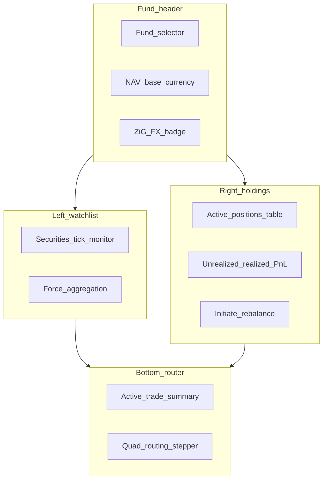

# Stock Price Collector & Multi-Module Transaction Router — frontend design session

This document is for **product and frontend implementation**. It describes **what users should see and do** in the Arcus **Stock Price Collector & Multi-Module Transaction Router** module (Phase 2, Sections 3.4 and 5.4): navigation, roles, the unified valuation dashboard, watchlist monitor, holdings P&L, and real-time routing status bar. It intentionally **does not** list API routes or request bodies; wire screens to the backend contract in [`docs/stock-price-collector-backend-requirements.md`](../docs/stock-price-collector-backend-requirements.md).

---

## How to use this document

- Use this in a **design session** with the frontend developer before or alongside backend implementation.
- Each section mixes **user stories** with **UI expectations** and **roles**.
- **Backend alignment notes** flag where today’s codebase has related but separate features (short-term investments, private-equity valuations) so labels stay honest.
- **Numeric display** uses monospaced fonts and high information density; price direction and P&L use semantic colour (see Design tokens).
- Acceptance criteria traceability: see [Section 10](#10-acceptance-criteria--frontend-mapping) (mirrors backend matrix in the requirements doc).

---

## 1. Purpose and audience

### What this module is

The **Stock Price Collector & Multi-Module Transaction Router** is the real-time valuation, automated settlement, and downstream routing core for **listed securities** in Arcus. It connects:

- Domestic official prices (SECZIM, ZSE, VFEX) and international feeds (LSE, NYSE, NASDAQ)
- Portfolio holdings with Weighted Average Cost (WAC) and dual-currency P&L (USD and ZiG)
- Automated trade routing to **Broker**, **Custodian**, **Core Banking**, and **General Ledger**

The UI is split into **three workspaces** that match Swagger sections **Market Data** (Section A), **Portfolio** (Section B), and **Trade Router** (Section C).

### Who uses it

| Role | Typical tasks |
|------|----------------|
| Asset Management Operations Lead | Monitor scrape jobs, approve outlier prices, configure sources |
| Global Fund Manager | Watch live ticks, review holdings P&L, initiate trades |
| Trade Operations Officer | Execute trades, track routing hops, retry failed dispatches |
| Institutional Portfolio Manager | Review NAV, unrealized/realized P&L, currency exposure |
| Fund Accountant | Confirm GL posting badges, settlement documents |
| System Administrator | Broker/custodian profiles, signing keys, cron health |

### Scope — three workspaces in one terminal

1. **Workspace A — Price Collector Console** — securities watchlist, tick monitor, validation queue, ingest batch integrity.
2. **Workspace B — Portfolio Valuation** — holdings grid, WAC, dual-currency P&L, NAV header, force valuation run.
3. **Workspace C — Trade Router** — trade blotter, quad-target routing status bar, settlement PDF.

**Backend alignment note:** This module is **net-new**. **Finance → Short-Term Investments** covers money-market instruments only — do not merge UI. **Portfolio → Quarterly Valuations** covers private-equity workflows — keep separate nav entry.

---

## 2. Design tokens

From product spec Section 6.1 — apply consistently across all workspaces.

| Token | Value | Usage |
|-------|-------|-------|
| Font (numeric columns) | **JetBrains Mono** | Prices, qty, WAC, P&L, NAV, trade IDs |
| Panel base background | `#070A13` | App shell, outer frame |
| Card / panel surface | `#0E1626` | Watchlist cards, holdings table, routing bar |
| Positive delta / gain | `#10B981` | Price up, positive P&L, CONFIRMED hop |
| Negative delta / loss | `#EF4444` | Price down, negative P&L, FAILED hop |
| Neutral / unchanged | Grey (`#6B7280`) | Flat day, STAGED hop |
| Warning | Amber (system) | PENDING_REVIEW price, RETRYING hop |
| Accent / primary action | `#6366F1` | Execute trade, Force aggregation, Approve tick |

**Density:** High-density layout — padding **4px–8px** between cells; 32–36px row height on tables; maximise visible metrics on 1920×1080.

---

## 3. Information architecture

### Placement

- Primary nav: **Investments → Market Terminal** (unified dashboard — Workspaces A+B+C on one screen)
- Admin sibling: **Investments → Market Data Admin** (validation queue, ingest batches, source config)
- Settings: **Investments → Routing Config** (brokers, custodians, signing keys — admin only)

### Sub-areas

| Area | Route suggestion | Workspace |
|------|------------------|-----------|
| Unified terminal | `/investments/terminal` | A + B + C combined |
| Watchlist & ticks | `/investments/terminal` (left pane) | A |
| Holdings & P&L | `/investments/terminal` (right pane) | B |
| Routing status | `/investments/terminal` (bottom pane) | C |
| Trade blotter | `/investments/trades` | C |
| Trade detail | `/investments/trades/:id` | C |
| Validation queue | `/investments/market-data/validation` | A |
| Ingest batches | `/investments/market-data/batches` | A |
| Securities master | `/investments/securities` | A |

---

## 4. Unified dashboard layout (primary screen)

Product wireframe Section 6.2 — implement as a **three-pane** layout with sticky fund context header.

```text
┌──────────────────────────────────────────────────────────────────────────────┐
│ [ARCUS ASSET]  Fund: IMARA ABSOLUTE RETURN | Base: USD | NAV: $2,841,920.50  │
├──────────────────────────────┬───────────────────────────────────────────────┤
│ LEFT: Watchlist & Collector  │ RIGHT: Holdings & P&L                         │
│                              │                                               │
│ Sym     Exch   Price  Chg    │ Asset      Qty    Avg Cost  Valuation         │
│ ECO.ZW  ZSE   12.85  +3.21% │ OMIG.VF  10,000   1.2000    15,428.00       │
│ OMIG.VF VFEX   1.54  +0.45% │ TSLA.US     150  182.1000    27,315.00       │
│ TSLA.US NASDAQ 182.10 -1.12%│                                               │
│ LSE.LN  LSE    84.50  +0.00%│ Unrealized P&L:  +$3,428.00                  │
│                              │ Realized P&L:     +$1,245.00                  │
│ [Force Aggregation Run]      │ [Initiate Rebalance Run]                      │
├──────────────────────────────┴───────────────────────────────────────────────┤
│ BOTTOM: Real-Time Multi-Module Transaction Routing Status                    │
│ Trade TXN-8a31e24c | OMIG.VF | Qty 25,000 | Total $31,250.00               │
│ [Broker] ===> [Custodian] ===> [Core Banking] ===> [Acct Register]           │
│ CONFIRMED      SENT TO BANK       LOCKED              POSTED                 │
└──────────────────────────────────────────────────────────────────────────────┘
```



### Header bar

- **Fund selector** — dropdown scoped to user’s accessible funds (row-level RBAC).
- **Base currency** — read-only badge (usually USD).
- **NAV** — monospaced, refreshes after valuation run or validated price tick (show “stale” amber dot if > 24h).
- **ZiG FX** — tooltip: rate source + timestamp used for ZiG leg ([Eq. 4](../docs/stock-price-collector-backend-requirements.md#74-mixed-currency-valuation-conversions)).

---

## 5. Screen specifications

### 5.1 Securities tick monitor (Workspace A)

**User story:** As Operations Lead, I need a live watchlist showing official and streaming prices with direction indicators.

| Column | Format |
|--------|--------|
| Symbol | `ECO.ZW` monospaced |
| Exchange | Badge: ZSE, VFEX, NASDAQ, … |
| Price | 2–4 dp by instrument |
| Change % | Colour: green/red/grey |
| Direction | Icon: up / down / flat |

**States:**

| Tick state | UI |
|------------|-----|
| `APPROVED` | Normal row |
| `PENDING_REVIEW` | Amber left border + “Review” chip (>15% deviation) |
| `FALLBACK` | Dashed price + tooltip “Fallback to prior close” |
| `LIVE` vs `DELAYED_15M` | Small badge on international symbols |

**Actions:**

- **Force Aggregation Run** — admin only; confirmation modal; spinner on header NAV.
- **Click row** — opens [Security config modal](#58-security-config-modal).

### 5.2 Active positions & P&L (Workspace B)

**User story:** As Portfolio Manager, I want holdings with WAC, market value, and split P&L lines.

| Column | Notes |
|--------|-------|
| Asset | Symbol + exchange |
| Qty | Monospaced; 0 dp for whole shares |
| Avg Cost | WAC in fund base currency |
| Valuation | `qty × P_current` |
| Unrealized P&L | Sub-column optional; green/red |
| ZiG leg | Toggle or sub-row for dual-currency funds |

**Footer summary:**

- **Unrealized P&L** — sum across holdings; USD primary, ZiG secondary line.
- **Realized P&L** — period selector (MTD, QTD, YTD).

**Initiate Rebalance Run** — Phase 2 placeholder or link to trade draft wizard (product decision).

### 5.3 Quad routing status bar (Workspace C)

**User story:** As Trade Operations, I need to see each downstream hop for the active trade without opening four systems.

**Layout:** Horizontal stepper with four nodes:

1. Broker Gateway  
2. Custodian Network  
3. Core Banking  
4. Acct Register (GL)

**Per-node badge:**

| Status | Colour | Label |
|--------|--------|-------|
| `STAGED` | Grey | Staged |
| `DISPATCHED` | Blue | Dispatched |
| `CONFIRMED` | Green | Confirmed |
| `RETRYING` | Amber | Retrying (n/5) |
| `FAILED` | Red | Failed |

**Micro-interaction (Section 6.3):** Hover tooltip shows `dispatchedAt`, `attemptCount`, `externalRef`, expandable “View payload” (JSON snippet, read-only).

**Trade selector:** When multiple active trades, use tabs or dropdown above stepper.

### 5.4 Trade blotter

**Route:** `/investments/trades`

| Column | Example |
|--------|---------|
| Trade ID | `TXN-8a31e24c` |
| Security | OMIG.VF |
| Side | BUY / SELL pill |
| Qty | 25,000 |
| Price | 1.25 |
| Total | $31,250.00 |
| Status | ROUTING, SETTLED, … |
| GL | Link icon if posted |

**Row click** → trade detail with full hop timeline + settlement PDF download.

### 5.5 Validation queue (admin)

**Route:** `/investments/market-data/validation`

- Table of ticks `PENDING_REVIEW` with deviation %, previous close, proposed price.
- Side-by-side diff panel.
- **Approve** / **Reject** with mandatory reject reason.
- Bulk approve disabled (each outlier must be explicit).

### 5.6 Ingest batches (admin)

**Route:** `/investments/market-data/batches`

- List batches with source, date, record count, SHA-256 (truncated + copy).
- **Verify integrity** action compares stored checksum to re-hash (shows pass/fail).

### 5.7 Execute trade modal

**Triggered from:** holdings row action or blotter “New trade”.

| Field | Control |
|-------|---------|
| Fund | Pre-filled from header |
| Security | Searchable select |
| Side | BUY / SELL segmented control |
| Quantity | Numeric |
| Execution price | Numeric; default latest tick |
| Fees | Optional |

**Execute** → confirmation showing quad-target preview → on success, bottom routing bar animates to new trade.

**Guards:** Disable execute if price tick `PENDING_REVIEW` for selected security (tooltip explains).

### 5.8 Security config modal

**Triggered from:** watchlist row click (Section 6.3).

- Custom price alert thresholds (above/below).
- Notification channels (in-app, email — if configured).
- Broker execution parameters (default broker profile).
- Vendor symbol mappings (read-only for non-admin).

---

## 6. Screen inventory

| Screen | Primary user | Key elements |
|--------|--------------|--------------|
| **Unified terminal** | Fund Manager, Ops | Three-pane layout, NAV header, routing bar |
| **Trade blotter** | Trade Ops | Filterable list, status badges |
| **Trade detail** | Trade Ops, Accountant | Hop timeline, PDF, JE link, retry buttons |
| **Validation queue** | Ops Lead | Approve/reject outliers |
| **Ingest batches** | Ops Lead, Admin | SHA-256 verify |
| **Securities master** | Admin | CRUD, exchange assignment |
| **Routing config** | Admin | Broker URLs, custodian SMTP/SFTP, signing keys |

---

## 7. Key flows

### 7.1 Daily domestic price ingest

1. 09:00 / 16:00 CAT — scraper runs (no user action).
2. Ops reviews validation queue if amber ticks appear.
3. Approved ticks refresh watchlist + holdings valuation.
4. NAV header updates; “last valued at” timestamp shown.

### 7.2 Execute buy trade (happy path)

1. Fund Manager opens Execute modal → BUY → Execute.
2. Bottom bar: Broker **CONFIRMED** → Custodian **DISPATCHED** → Banking **LOCKED** → GL **STAGED**.
3. Custodian confirms → Banking **CONFIRMED** (hold released) → GL **POSTED**.
4. Holdings qty increases; WAC recalculated; trade status **SETTLED**.

### 7.3 Failed custodian dispatch

1. Custodian hop → **RETRYING** (tooltip shows error).
2. After max attempts → **FAILED**; trade **SETTLEMENT_FAILED**.
3. Trade Ops opens detail → **Retry hop** button.
4. Audit log entry visible in admin audit feed (link optional).

### 7.4 International live tick

1. Webhook receives NASDAQ tick → watchlist updates without full page reload.
2. `LIVE` badge on symbol; unrealized P&L recalculates (debounced 2s).

---

## 8. States & guards (what to disable)

| Condition | UI behaviour |
|-----------|--------------|
| Price `PENDING_REVIEW` | Execute trade disabled for that security |
| Price `FX_MISSING` | ZiG P&L shows “—”; amber banner on header |
| Trade not `EXECUTED` | Routing bar hidden or greyed |
| Hop `FAILED` | Show Retry; GL hop locked until custodian confirmed |
| User lacks fund access | Fund not in selector; 403 on deep link |
| NAV stale (> 24h) | Amber dot on NAV; prompt Force Aggregation |
| Signing key missing | Custodian dispatch shows config warning (admin) |

---

## 9. Backend alignment notes (summary)

| Feature | Today | Target |
|---------|-------|--------|
| Listed security prices | ❌ | Scraper + webhook pipelines |
| Holdings + WAC | ❌ | Portfolio holdings registry |
| Trade routing | ❌ | Quad dispatcher with hop status |
| GL on trade settle | ❌ | Listed-equity JE service |
| Cash holds | ⚠️ Cashbook exists | Bridge service for trust holds |
| FX ZiG/USD | ✅ `UsdZwgRateResolver` | Log rate per valuation |
| Short-term investments | ✅ Separate module | Do not merge UI |
| PE quarterly valuations | ✅ `PortfolioValuation` | Separate nav |

Use **“Coming”** labels until backend phase ships (see [implementation phases](../docs/stock-price-collector-backend-requirements.md#17-implementation-phases)).

---

## 10. Acceptance criteria — frontend mapping

Each product acceptance criterion and the **primary screen** where the user sees it. Backend behaviour is in the [traceability matrix](../docs/stock-price-collector-backend-requirements.md#5-acceptance-criteria-traceability-matrix).

| ID | User-visible outcome | Primary screen |
|----|----------------------|----------------|
| US-3.4.1-A1 | Prices refresh after market open/close | Watchlist monitor |
| US-3.4.1-A2 | Fallback indicator when source down | Watchlist row tooltip |
| US-3.4.1-A3 | >15% deviation → review queue | Validation queue + amber tick |
| US-3.4.1-A4 | Batch SHA-256 verify | Ingest batches |
| US-3.4.2-A1 | Live international ticks | Watchlist with LIVE badge |
| US-3.4.3-A1 | Broker dispatch status | Routing bar node 1 |
| US-3.4.3-A2 | Custodian sent + PDF available | Routing bar node 2 + trade detail |
| US-3.4.3-A3 | STAGED / DISPATCHED / CONFIRMED badges | Routing stepper |
| US-3.4.4-A1 | Banking LOCKED on buy | Routing bar node 3 |
| US-3.4.4-A2 | GL POSTED on settle | Routing bar node 4 + JE link |
| US-3.4.4-A3 | Holdings qty updates after settle | Holdings table |
| US-3.4.5-A1 | Avg Cost column reflects WAC | Holdings table |
| US-3.4.5-A2 | Unrealized P&L updates on tick | Holdings footer + row |
| US-3.4.5-A3 | Realized P&L on sell settle | Trade detail + P&L footer |
| US-3.4.5-A4 | USD + ZiG P&L lines | Holdings footer + FX tooltip |
| QA-7.2-A4 | Unauthorized access blocked | Toast 403 + audit (admin) |

---

## 11. Interactive micro-interactions

From product spec Section 6.3:

1. **Routing hop hover** — tooltip: timestamp, retry count, payload preview (collapsed JSON).
2. **Watchlist click** — security config modal (alerts, broker params).
3. **Price flash** — on tick update, brief background pulse green/red (respect `prefers-reduced-motion`).
4. **Stepper animation** — when hop advances to CONFIRMED, connector line fills left-to-right (300ms).

---

## 12. Accessibility & density

- Monospaced numerics: JetBrains Mono for all prices, quantities, P&L, NAV.
- Direction indicators: not colour-only — include +/- % text and aria-label (“up 3.21 percent”).
- Routing stepper: keyboard-focusable nodes; Enter opens hop detail drawer.
- High-density tables: sticky headers; horizontal scroll on narrow viewports.
- Contrast: green `#10B981` and red `#EF4444` on `#0E1626` — verify WCAG AA for text sizes used.

---

## 13. Open questions for design session

1. **Rebalance run:** wizard in v1 or defer to trade blotter only?
2. **Live updates:** websocket push vs polling interval (5s / 15s) for watchlist?
3. **CGT line:** show on trade detail only or also in realized P&L footer breakdown?
4. **Mobile:** is the unified terminal desktop-only for v1?
5. **Multi-fund:** single fund per terminal session or split-screen compare?

---

*Document version: 1.0 — 2026-06-16*
