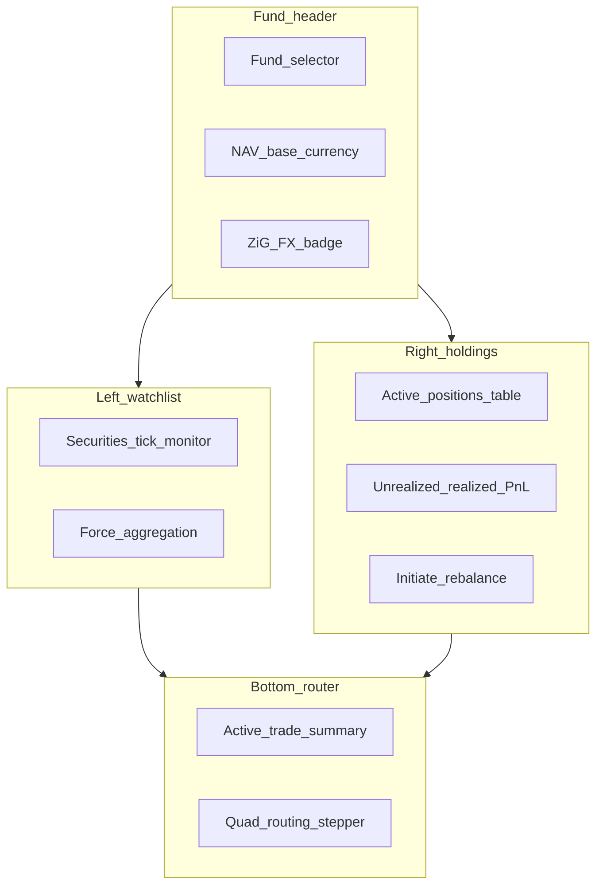

# Stock Price Collector & Multi-Module Transaction Router — frontend design session

This document is for **product and frontend implementation**. It describes **what users should see and do** in the Arcus **Stock Price Collector & Multi-Module Transaction Router** module (Phase 2, Sections 3.4 and 5.4): navigation, roles, the unified valuation dashboard, watchlist monitor, holdings P&L, and real-time routing status bar. It intentionally **does not** list API routes or request bodies; wire screens to the backend contract in [`docs/stock-price-collector-backend-requirements.md`](../docs/stock-price-collector-backend-requirements.md).

---

## How to use this document

- Use this in a **design session** with the frontend developer before or alongside backend implementation.
- Each section mixes **user stories** with **UI expectations** and **roles**.
- **Backend alignment notes** flag where today’s codebase has related but separate features (short-term investments, private-equity valuations) so labels stay honest.
- **Numeric display** uses monospaced fonts and high information density; price direction and P&L use semantic colour (see Design tokens).
- Acceptance criteria traceability: see [Section 10](#10-acceptance-criteria--frontend-mapping) (mirrors backend matrix in the requirements doc).

---

## 1. Purpose and audience

### What this module is

The **Stock Price Collector & Multi-Module Transaction Router** is the real-time valuation, automated settlement, and downstream routing core for **listed securities** in Arcus. It connects:

- Domestic official prices (SECZIM, ZSE, VFEX) and international feeds (LSE, NYSE, NASDAQ)
- Portfolio holdings with Weighted Average Cost (WAC) and dual-currency P&L (USD and ZiG)
- Automated trade routing to **Broker**, **Custodian**, **Core Banking**, and **General Ledger**

The UI is split into **five user-story workspaces** (client sections **2.1.1–2.3.1**, IDs **US-3.4.1–US-3.4.5**). All backend APIs live under one Swagger module: **Stock Price Collector** (same pattern as **Forecasting Engine**). See [Section 14](#14-api-contract-summary-frontend-handoff).

### Who uses it

| Role | Typical tasks |
|------|----------------|
| Asset Management Operations Lead | Monitor scrape jobs, approve outlier prices, configure sources |
| Global Fund Manager | Watch live ticks, review holdings P&L, initiate trades |
| Trade Operations Officer | Execute trades, track routing hops, retry failed dispatches |
| Institutional Portfolio Manager | Review NAV, unrealized/realized P&L, currency exposure |
| Fund Accountant | Confirm GL posting badges, settlement documents |
| System Administrator | Broker/custodian profiles, signing keys, cron health |

### Scope — workspaces mapped to user stories

| Client section | User story | UI workspace |
|----------------|------------|--------------|
| **2.1.1** | US-3.4.1 — Domestic scraping (ZSE/VFEX/SECZIM) | Price Collector Console |
| **2.1.2** | US-3.4.2 — International market feeds | Watchlist / tick monitor |
| **2.2.1** | US-3.4.3 — Broker & custodian dispatch | Trade Router + routing bar |
| **2.2.2** | US-3.4.4 — Core banking & GL sync | Routing bar (bank + GL nodes) |
| **2.3.1** | US-3.4.5 — Multi-currency P&L | Holdings & P&L pane |

The **unified terminal** (`/investments/terminal`) combines all five on one screen (left = 2.1.x, right = 2.3.1, bottom = 2.2.x).

1. **Workspace A — Price Collector Console (US-3.4.1 + US-3.4.2)** — securities watchlist, tick monitor, validation queue, ingest batch integrity.
2. **Workspace B — Portfolio Valuation (US-3.4.5)** — holdings grid, WAC, dual-currency P&L, NAV header, force valuation run.
3. **Workspace C — Trade Router (US-3.4.3 + US-3.4.4)** — trade blotter, quad-target routing status bar, settlement PDF.

**Backend alignment note:** This module is **net-new**. **Finance → Short-Term Investments** covers money-market instruments only — do not merge UI. **Portfolio → Quarterly Valuations** covers private-equity workflows — keep separate nav entry.

---

## 2. Design tokens

From product spec Section 6.1 — apply consistently across all workspaces.

| Token | Value | Usage |
|-------|-------|-------|
| Font (numeric columns) | **JetBrains Mono** | Prices, qty, WAC, P&L, NAV, trade IDs |
| Panel base background | `#070A13` | App shell, outer frame |
| Card / panel surface | `#0E1626` | Watchlist cards, holdings table, routing bar |
| Positive delta / gain | `#10B981` | Price up, positive P&L, CONFIRMED hop |
| Negative delta / loss | `#EF4444` | Price down, negative P&L, FAILED hop |
| Neutral / unchanged | Grey (`#6B7280`) | Flat day, STAGED hop |
| Warning | Amber (system) | PENDING_REVIEW price, RETRYING hop |
| Accent / primary action | `#6366F1` | Execute trade, Force aggregation, Approve tick |

**Density:** High-density layout — padding **4px–8px** between cells; 32–36px row height on tables; maximise visible metrics on 1920×1080.

---

## 3. Information architecture

### Placement

- Primary nav: **Investments → Market Terminal** (unified dashboard — Workspaces A+B+C on one screen)
- Admin sibling: **Investments → Market Data Admin** (validation queue, ingest batches, source config)
- Settings: **Investments → Routing Config** (brokers, custodians, signing keys — admin only)

### Sub-areas

| Area | Route suggestion | Workspace |
|------|------------------|-----------|
| Unified terminal | `/investments/terminal` | A + B + C combined |
| Watchlist & ticks | `/investments/terminal` (left pane) | A |
| Holdings & P&L | `/investments/terminal` (right pane) | B |
| Routing status | `/investments/terminal` (bottom pane) | C |
| Trade blotter | `/investments/trades` | C |
| Trade detail | `/investments/trades/:id` | C |
| Validation queue | `/investments/market-data/validation` | A |
| Ingest batches | `/investments/market-data/batches` | A |
| Securities master | `/investments/securities` | A |

---

## 4. Unified dashboard layout (primary screen)

Product wireframe Section 6.2 — implement as a **three-pane** layout with sticky fund context header.

```text
┌──────────────────────────────────────────────────────────────────────────────┐
│ [ARCUS ASSET]  Fund: IMARA ABSOLUTE RETURN | Base: USD | NAV: $2,841,920.50  │
├──────────────────────────────┬───────────────────────────────────────────────┤
│ LEFT: Watchlist & Collector  │ RIGHT: Holdings & P&L                         │
│                              │                                               │
│ Sym     Exch   Price  Chg    │ Asset      Qty    Avg Cost  Valuation         │
│ ECO.ZW  ZSE   12.85  +3.21% │ OMIG.VF  10,000   1.2000    15,428.00       │
│ OMIG.VF VFEX   1.54  +0.45% │ TSLA.US     150  182.1000    27,315.00       │
│ TSLA.US NASDAQ 182.10 -1.12%│                                               │
│ LSE.LN  LSE    84.50  +0.00%│ Unrealized P&L:  +$3,428.00                  │
│                              │ Realized P&L:     +$1,245.00                  │
│ [Force Aggregation Run]      │ [Initiate Rebalance Run]                      │
├──────────────────────────────┴───────────────────────────────────────────────┤
│ BOTTOM: Real-Time Multi-Module Transaction Routing Status                    │
│ Trade TXN-8a31e24c | OMIG.VF | Qty 25,000 | Total $31,250.00               │
│ [Broker] ===> [Custodian] ===> [Core Banking] ===> [Acct Register]           │
│ DISPATCHED    SKIPPED (int.)      CONFIRMED           CONFIRMED              │
│              (or CONFIRMED when custodian enabled)                           │
└──────────────────────────────────────────────────────────────────────────────┘
```



### Header bar

- **Fund selector** — dropdown scoped to user’s accessible funds (row-level RBAC).
- **Base currency** — read-only badge (usually USD).
- **NAV** — monospaced, refreshes after valuation run or validated price tick (show “stale” amber dot if > 24h).
- **ZiG FX** — tooltip: rate source + timestamp used for ZiG leg ([Eq. 4](../docs/stock-price-collector-backend-requirements.md#74-mixed-currency-valuation-conversions)).

---

## 5. Screen specifications

### 5.1 Securities tick monitor (Workspace A)

**User story:** As Operations Lead, I need a live watchlist showing official and streaming prices with direction indicators.

| Column | Format |
|--------|--------|
| Symbol | `ECO.ZW` monospaced |
| Exchange | Badge: ZSE, VFEX, NASDAQ, … |
| Price | 2–4 dp by instrument |
| Change % | Colour: green/red/grey |
| Direction | Icon: up / down / flat |

**States:**

| Tick state | UI |
|------------|-----|
| `APPROVED` | Normal row |
| `PENDING_REVIEW` | Amber left border + “Review” chip (>15% deviation) |
| `FALLBACK` | Dashed price + tooltip “Fallback to prior close” |
| `LIVE` vs `DELAYED_15M` | Small badge on international symbols |

**Actions:**

- **Force Aggregation Run** — admin only; confirmation modal; spinner on header NAV.
- **Click row** — opens [Security config modal](#58-security-config-modal).

### 5.2 Active positions & P&L (Workspace B)

**User story:** As Portfolio Manager, I want holdings with WAC, market value, and split P&L lines.

| Column | Notes |
|--------|-------|
| Asset | Symbol + exchange |
| Qty | Monospaced; 0 dp for whole shares |
| Avg Cost | WAC in fund base currency |
| Valuation | `qty × P_current` |
| Unrealized P&L | Sub-column optional; green/red |
| ZiG leg | Toggle or sub-row for dual-currency funds |

**Footer summary:**

- **Unrealized P&L** — sum across holdings; USD primary, ZiG secondary line.
- **Realized P&L** — period selector (MTD, QTD, YTD).

**Initiate Rebalance Run** — Phase 2 placeholder or link to trade draft wizard (product decision).

### 5.3 Quad routing status bar (Workspace C)

**User story:** As Trade Operations, I need to see each downstream hop for the active trade without opening four systems.

**Layout:** Horizontal stepper with four nodes:

1. Broker Gateway  
2. Custodian Network  
3. Core Banking  
4. Acct Register (GL)

**Per-node badge:**

| Status | Colour | Label |
|--------|--------|-------|
| `STAGED` | Grey | Staged |
| `DISPATCHED` | Blue | Dispatched |
| `CONFIRMED` | Green | Confirmed |
| `RETRYING` | Amber | Retrying (n/5) |
| `FAILED` | Red | Failed |
| `SKIPPED_INTERNAL` | Grey dashed | Skipped (custodian off) |

**Custodian node (v1 default — internal settlement mode):**

When `LISTED_EQUITY_CUSTODIAN_ENABLED` is **not** set (production default today), the custodian hop auto-confirms as **`SKIPPED_INTERNAL`** on execute. Show:

- Badge: **Skipped** (grey dashed border) with tooltip: *“Custodian dispatch disabled — internal settlement mode. Holdings and GL updated automatically.”*
- Do **not** show a Confirm button on custodian in this mode.
- Re-enable custodian UI (PDF download, Confirm, DISPATCHED state) when ops sets `LISTED_EQUITY_CUSTODIAN_ENABLED=true`.

**Broker node:** May stay `DISPATCHED` while settlement completes — broker email is best-effort; JSON payload is always saved server-side. Optional **Confirm** for Trade Ops when external ACK received.

**Bank + GL nodes:** In internal settlement mode, both advance to **CONFIRMED** automatically on execute (no manual confirm required).

**Micro-interaction (Section 6.3):** Hover tooltip shows `dispatchedAt`, `attemptCount`, `externalRef`, expandable “View payload” (JSON snippet, read-only).

**Trade selector:** When multiple active trades, use tabs or dropdown above stepper.

### 5.4 Trade blotter

**Route:** `/investments/trades`

| Column | Example |
|--------|---------|
| Trade ID | `TXN-8a31e24c` |
| Security | OMIG.VF |
| Side | BUY / SELL pill |
| Qty | 25,000 |
| Price | 1.25 |
| Total | $31,250.00 |
| Status | ROUTING, SETTLED, … |
| GL | Link icon if posted |

**Row click** → trade detail with full hop timeline + settlement PDF download.

### 5.5 Validation queue (admin)

**Route:** `/investments/market-data/validation`

- Table of ticks `PENDING_REVIEW` with deviation %, previous close, proposed price.
- Side-by-side diff panel.
- **Approve** / **Reject** with mandatory reject reason.
- Bulk approve disabled (each outlier must be explicit).

### 5.6 Ingest batches (admin)

**Route:** `/investments/market-data/batches`

- List batches with source, date, record count, SHA-256 (truncated + copy).
- **Verify integrity** action compares stored checksum to re-hash (shows pass/fail).

### 5.7 Execute trade modal

**Triggered from:** holdings row action or blotter “New trade”.

| Field | Control |
|-------|---------|
| Fund | Pre-filled from header |
| Security | Searchable select |
| Side | BUY / SELL segmented control |
| Quantity | Numeric |
| Execution price | Numeric; default latest tick |
| Fees | Optional |

**Execute** → confirmation showing quad-target preview → on success:

- **Internal settlement (default):** trade moves to **SETTLED** immediately; routing bar animates all hops to green except broker (may stay blue DISPATCHED).
- **Full custodian mode:** trade stays **ROUTING** until manual confirms on broker/custodian hops.

Success toast (internal mode): *“Trade executed and settled — GL posted.”*

**Guards:** Disable execute if price tick `PENDING_REVIEW` for selected security (tooltip explains).

### 5.8 Security config modal

**Triggered from:** watchlist row click (Section 6.3).

- Custom price alert thresholds (above/below).
- Notification channels (in-app, email — if configured).
- Broker execution parameters (default broker profile).
- Vendor symbol mappings (read-only for non-admin).

---

## 6. Screen inventory

| Screen | Primary user | Key elements |
|--------|--------------|--------------|
| **Unified terminal** | Fund Manager, Ops | Three-pane layout, NAV header, routing bar |
| **Trade blotter** | Trade Ops | Filterable list, status badges |
| **Trade detail** | Trade Ops, Accountant | Hop timeline, PDF, JE link, retry buttons |
| **Validation queue** | Ops Lead | Approve/reject outliers |
| **Ingest batches** | Ops Lead, Admin | SHA-256 verify |
| **Securities master** | Admin | CRUD, exchange assignment |
| **Routing config** | Admin | Broker URLs, custodian SMTP/SFTP, signing keys |

---

## 7. Key flows

### 7.1 Daily domestic price ingest

1. 09:00 / 16:00 CAT — scraper runs (no user action).
2. Ops reviews validation queue if amber ticks appear.
3. Approved ticks refresh watchlist + holdings valuation.
4. NAV header updates; “last valued at” timestamp shown.

### 7.2 Execute buy trade (happy path — internal settlement mode, v1 default)

**As an** Investment Officer / Fund Accountant — one **Execute** action settles the trade end-to-end using in-system modules (cashbook, holdings, GL). Custodian dispatch is **skipped** until external integration is ready.

1. Fund Manager opens Execute modal → BUY → **Execute**.
2. Backend runs quad routing automatically:
   - **Broker** → `DISPATCHED` (JSON payload saved; email optional)
   - **Custodian** → `CONFIRMED` / `SKIPPED_INTERNAL` (holdings WAC updated)
   - **Core Banking** → `CONFIRMED` (cash hold placed then released on trust account)
   - **Acct Register (GL)** → `CONFIRMED` (balanced journal posted)
3. Trade status → **`SETTLED`** without manual hop confirms.
4. Holdings qty increases; WAC recalculated; NAV/P&L refresh on next valuation run or price tick.

**UI copy for execute success toast:** *“Trade TXN-… executed and settled. Cash hold released, GL posted.”*

### 7.2b Execute buy trade (full custodian mode — when enabled)

When `LISTED_EQUITY_CUSTODIAN_ENABLED=true`:

1. Execute → Broker **DISPATCHED** → await **Confirm** (or auto if configured).
2. Custodian PDF generated → **DISPATCHED** → await custodian **Confirm**.
3. Banking hold released → GL **POSTED** after custodian + bank confirmed.
4. Manual **Confirm** actions required on broker/custodian hops (`POST .../routing-hops/:hopId/confirm`).

### 7.3 Failed custodian dispatch

1. Custodian hop → **RETRYING** (tooltip shows error).
2. After max attempts → **FAILED**; trade **SETTLEMENT_FAILED**.
3. Trade Ops opens detail → **Retry hop** button.
4. Audit log entry visible in admin audit feed (link optional).

### 7.4 International live tick

1. Webhook receives NASDAQ tick → watchlist updates without full page reload.
2. `LIVE` badge on symbol; unrealized P&L recalculates (debounced 2s).

---

## 8. States & guards (what to disable)

| Condition | UI behaviour |
|-----------|--------------|
| Price `PENDING_REVIEW` | Execute trade disabled for that security |
| Price `FX_MISSING` | ZiG P&L shows “—”; amber banner on header |
| Trade not `EXECUTED` | Routing bar hidden or greyed |
| Hop `FAILED` | Show Retry; GL hop locked until upstream hops recover |
| Custodian `SKIPPED_INTERNAL` | Custodian node grey-dashed; no Confirm button |
| Internal settlement (default) | Bank + GL auto-CONFIRMED on execute — hide redundant Confirm buttons |
| User lacks fund access | Fund not in selector; 403 on deep link |
| NAV stale (> 24h) | Amber dot on NAV; prompt Force Aggregation |
| Signing key missing | Only relevant when custodian routing enabled |

---

## 9. Backend alignment notes (summary)

*Updated 2026-06-20 — reflects implemented backend + UAT status.*

| Feature | Status | Notes |
|---------|--------|-------|
| Domestic scrape (ZSE/VFEX) | ✅ Shipped | Mansa (ZSE), VFEX price sheet; cron via `POST .../cron/scrape-domestic` |
| SECZIM scrape | ⚠️ Partial | Requires `SECZIM_PRICE_URL`; no dedicated parser yet |
| International feeds (NASDAQ/NYSE) | ⚠️ Dev scrape | Yahoo + FastBull (`DELAYED_15M`); webhook ingress ready for licensed feeds |
| LSE | ❌ Not wired | Enum in schema only |
| SHA-256 ingest batches | ✅ Shipped | `GET /ingest/batches/:id` → `checksumValid` |
| >15% validation queue | ✅ Shipped | Admin approve/reject |
| Holdings + WAC + lots | ✅ Shipped | Multi-lot `ListedEquityHoldingLot` |
| Dual-currency P&L (USD + ZiG) | ✅ Shipped | `GET /funds/:id/pnl`, valuation snapshots |
| CGT accrual | ❌ Schema only | `cgtAmount` column unused; no statutory engine |
| Trade quad routing | ✅ Shipped | BROKER → CUSTODIAN → CORE_BANKING → ACCOUNTING_GL |
| Internal settlement (custodian skip) | ✅ **Default** | `LISTED_EQUITY_CUSTODIAN_ENABLED=true` to restore custodian gate |
| Cash holds (trust account) | ✅ Shipped | `CoreBankingBridgeService` + cashbook entry |
| GL on settle | ✅ Shipped | Balanced JE; fail-closed on imbalance |
| Broker/custodian live dispatch | ⚠️ On hold | JSON/PDF saved locally; SMTP often fails in dev; no SFTP/PGP/signing yet |
| Frontend UI | ❌ Not started | This design doc + Swagger are the handoff |

**Do not merge UI with:** Finance → Short-Term Investments (money market) or Portfolio → Quarterly Valuations (private equity).

---

## 10. Acceptance criteria — frontend mapping

Each product acceptance criterion, the **user story section**, and the **primary screen** where the user sees it. Backend behaviour and Swagger descriptions mirror the same story IDs.

| Section | ID | User-visible outcome | Primary screen | Backend status |
|---------|-----|----------------------|----------------|----------------|
| 2.1.1 | US-3.4.1-A1 | Prices refresh after market open/close | Watchlist monitor | ⚠️ Cron external (09:00/16:00 CAT) |
| 2.1.1 | US-3.4.1-A2 | Fallback indicator when source down | Watchlist row tooltip (`sourceStatus: FALLBACK`) | ✅ |
| 2.1.1 | US-3.4.1-A3 | >15% deviation → review queue | Validation queue + amber tick | ✅ |
| 2.1.1 | US-3.4.1-A4 | Batch SHA-256 verify | Ingest batches | ✅ |
| 2.1.2 | US-3.4.2-A1 | Near-live international ticks | Watchlist with `DELAYED_15M` / `LIVE` badge | ⚠️ Scrape not streaming |
| 2.1.2 | — | Direction + last tick timestamp | Watchlist Chg% column | ❌ UI; API has `pricedAt` |
| 2.1.2 | — | Stale warning + last close fallback | Watchlist row banner | ⚠️ API only |
| 2.2.1 | US-3.4.3-A1 | Broker dispatch status | Routing bar node 1 | ⚠️ Payload saved; email best-effort |
| 2.2.1 | US-3.4.3-A2 | Custodian PDF + secure delivery | Routing bar node 2 | ❌ Skipped by default |
| 2.2.1 | US-3.4.3-A3 | STAGED / DISPATCHED / CONFIRMED badges | Routing stepper | ✅ |
| 2.2.2 | US-3.4.4-A1 | Banking hold on buy | Routing bar node 3 | ✅ Auto on execute |
| 2.2.2 | US-3.4.4-A2 | GL posted + holdings update | Routing bar node 4 + JE link | ✅ Auto on execute |
| 2.2.2 | US-3.4.4-A3 | Balanced DR asset / CR clearing | Trade detail JE lines | ✅ UAT verified |
| 2.3.1 | US-3.4.5-A1 | Avg Cost column reflects WAC | Holdings table | ✅ |
| 2.3.1 | US-3.4.5-A2 | Unrealized P&L updates on tick | Holdings footer + row | ✅ On ingest approve |
| 2.3.1 | US-3.4.5-A3 | Realized P&L on sell settle | Trade detail + P&L footer | ✅ CGT not wired |
| 2.3.1 | US-3.4.5-A4 | USD + ZiG P&L lines | Holdings footer + FX tooltip | ✅ |
| QA | QA-7.2-A4 | Unauthorized access blocked | Toast 403 + audit (admin) | ✅ Fund scoping |

---

## 11. Interactive micro-interactions

From product spec Section 6.3:

1. **Routing hop hover** — tooltip: timestamp, retry count, payload preview (collapsed JSON).
2. **Watchlist click** — security config modal (alerts, broker params).
3. **Price flash** — on tick update, brief background pulse green/red (respect `prefers-reduced-motion`).
4. **Stepper animation** — when hop advances to CONFIRMED, connector line fills left-to-right (300ms).

---

## 12. Accessibility & density

- Monospaced numerics: JetBrains Mono for all prices, quantities, P&L, NAV.
- Direction indicators: not colour-only — include +/- % text and aria-label (“up 3.21 percent”).
- Routing stepper: keyboard-focusable nodes; Enter opens hop detail drawer.
- High-density tables: sticky headers; horizontal scroll on narrow viewports.
- Contrast: green `#10B981` and red `#EF4444` on `#0E1626` — verify WCAG AA for text sizes used.

---

## 13. Open questions for design session

1. **Rebalance run:** wizard in v1 or defer to trade blotter only?
2. **Live updates:** websocket push vs polling interval (5s / 15s) for watchlist?
3. **CGT line:** show on trade detail only or also in realized P&L footer breakdown?
4. **Mobile:** is the unified terminal desktop-only for v1?
5. **Multi-fund:** single fund per terminal session or split-screen compare?
6. **Internal vs full custodian UI:** show custodian node as collapsed/hidden when `SKIPPED_INTERNAL`, or always visible with dashed “Skipped” badge?

---

## 14. API contract summary (frontend handoff)

Wire screens to the single Swagger module **Stock Price Collector** at `/api-docs` (same pattern as **Forecasting Engine** — one tag, all endpoints grouped together).

Each endpoint **summary** is prefixed with the user story ID (e.g. `US-3.4.1 — List securities`). Each **description** includes:

- **User story header** (section + ID + title)
- **As a / I want / so that**
- **Acceptance criteria (this endpoint)**
- **What happens when you call this**

Source: `src/config/stock-price-collector-swagger-paths.ts`

### Swagger module

| Swagger tag | Scope |
|-------------|--------|
| **Stock Price Collector** | All market-data, portfolio, and trade-router endpoints (`/api/investments/*`) |

The tag description lists all five user stories (2.1.1–2.3.1). Endpoint ordering in Swagger follows path groups: `market-data` → `portfolio` → `trades`.

Full spec: [`docs/stock-price-collector-backend-requirements.md`](../docs/stock-price-collector-backend-requirements.md).

### Base paths

| User story | Base path |
|------------|-----------|
| US-3.4.1 / US-3.4.2 | `/api/investments/market-data` |
| US-3.4.5 | `/api/investments/portfolio` |
| US-3.4.3 / US-3.4.4 | `/api/investments/trades` |

### Primary endpoints by user story

**2.1.1 · US-3.4.1 — Domestic scraping**

- `GET /securities`, `POST /securities`, `PUT /securities/:id`
- `POST /ingest/run` (sourceCode: `ZSE` | `VFEX` | `SECZIM`)
- `GET /ingest/batches`, `GET /ingest/batches/:id` (SHA-256 `checksumValid`)
- `GET /validation-queue`, `POST /validation-queue/:tickId/approve|reject`
- `POST /cron/scrape-domestic`, `POST /cron/retry-failed-ingest`

**2.1.2 · US-3.4.2 — International feeds**

- `POST /webhooks/:providerCode` (HMAC — no JWT)
- `POST /ingest/run` (sourceCode: `NASDAQ` | `NYSE`)
- `GET /prices/latest`, `GET /securities/:id/prices`
- `GET|PUT /portfolio/watchlist`

**2.2.1 · US-3.4.3 — Broker & custodian dispatch**

- `POST /trades` (draft), `POST /trades/:id/execute`, `GET /trades/:id`
- `GET /trades/:id/routing-hops`, `POST /trades/:id/routing-hops/:hopId/retry`
- `POST /trades/:id/routing-hops/:hopId/confirm` (when custodian/broker ACK needed)
- `GET /trades/:id/settlement-document` (PDF — when custodian enabled)
- `POST /trades/cron/retry-failed-routing`

**2.2.2 · US-3.4.4 — Core banking & GL** *(triggered by execute — same endpoints)*

- Execute chains: cash hold → release → holdings update → balanced GL JE
- Trade detail returns `cashHolds`, `settlement.journalEntryId`, `settlement.realizedPnl`
- GL hop `externalRef` / `confirmedAt` on success; `SETTLEMENT_FAILED` if JE imbalanced

**2.3.1 · US-3.4.5 — Multi-currency P&L**

- `GET /portfolio/funds`, `GET /portfolio/funds/:fundId/holdings`
- `GET /portfolio/funds/:fundId/pnl`, `GET /portfolio/funds/:fundId/valuations`
- `POST /portfolio/funds/:fundId/valuations/run`

### Environment flags (ops / frontend behaviour)

| Variable | Default | Effect on UI |
|----------|---------|--------------|
| `LISTED_EQUITY_CUSTODIAN_ENABLED` | **off** | Custodian hop = `SKIPPED_INTERNAL`; auto-settle on execute |
| `LISTED_EQUITY_AUTO_CONFIRM_STAKEHOLDER` | off | Dev/UAT: auto-confirms broker/custodian after dispatch |
| `MARKET_DATA_CRON_SECRET` | — | Cron scrape auth |
| `TRADE_ROUTER_CRON_SECRET` | — | Cron routing retry auth |

See [`docs/stock-price-collector-ubuntu-cron-setup.md`](../docs/stock-price-collector-ubuntu-cron-setup.md).

### Status enums (UI badges)

| Entity | Values |
|--------|--------|
| Price tick `validationStatus` | `APPROVED`, `PENDING_REVIEW`, `REJECTED` |
| Trade `status` | `DRAFT`, `EXECUTED`, `ROUTING`, `SETTLED`, `SETTLEMENT_FAILED`, `CANCELLED` |
| Routing hop `status` | `STAGED`, `DISPATCHED`, `CONFIRMED`, `RETRYING`, `FAILED` |
| Routing hop `target` | `BROKER`, `CUSTODIAN`, `CORE_BANKING`, `ACCOUNTING_GL` |
| Custodian hop `externalRef` (internal mode) | `SKIPPED_INTERNAL` |
| Ingest `sourceStatus` | `OK`, `FALLBACK` |
| Tick `tickFrequency` | `LIVE`, `DELAYED_15M`, `EOD` |

### Broker / custodian hops (v1 behaviour)

**Internal settlement mode (default):** Custodian skipped; bank + GL auto-complete on execute. Show custodian node as **Skipped** — no Confirm button.

**Full dispatch mode** (`LISTED_EQUITY_CUSTODIAN_ENABLED=true`): Backend generates JSON payloads + PDF settlement instructions, emails configured contacts, and exposes **manual confirm** (`POST .../routing-hops/:hopId/confirm`) for Trade Ops when the stakeholder acknowledges. Show **Confirm** on `DISPATCHED` broker/custodian hops.

Broker payload path (dev): `storage/local-upload-mock/listed-equity-dispatch/{tradeId}-BROKER.json`

### Execute flow (what frontend should expect)

```
POST /trades/:id/execute
  → trade.status: SETTLED (internal mode)
  → routingHops:
      BROKER: DISPATCHED (or CONFIRMED if auto-confirm)
      CUSTODIAN: CONFIRMED, externalRef: SKIPPED_INTERNAL
      CORE_BANKING: CONFIRMED
      ACCOUNTING_GL: CONFIRMED
  → settlement.journalEntryId: set
  → cashHolds: PLACED → RELEASED
```

Poll `GET /trades/:id` after execute; no multi-step confirm wizard needed in v1 default mode.

### Response shape

Standard envelope: `{ success: boolean, data?: T, message?: string }`. List endpoints return arrays in `data`. Trade detail includes nested `routingHops`, `settlement`, `cashHolds`.

### Auth

Bearer JWT for all routes except webhooks (`HMAC` via `X-Market-Data-Signature`) and cron (`X-Market-Data-Cron-Secret` / `X-Trade-Router-Cron-Secret`). Fund-scoped lists filter by user's `FundManager` assignments; admin bypasses scope.

### Errors

- `403` + `FORBIDDEN_FUND_ACCESS` — user lacks fund scope (logged as security alert).
- `LISTED_EQUITY_JE_IMBALANCED` — trade stays `SETTLEMENT_FAILED`; show GL hop `FAILED` with `lastError`.

### UAT scripts (backend verification)

| Script | npm command |
|--------|-------------|
| Sell settlement + auto routing | `npm run uat:investments:sell-settlement` |
| Full trade router HTTP | `npm run uat:investments:trade-router` (if present) |

---

*Document version: 1.3 — 2026-06-20*
