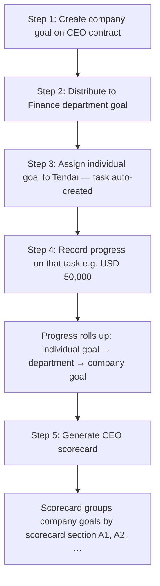

# Horizon Development Fund (HDF) — Performance walkthrough (2026)

**Purpose:** A simple story you can follow in Arcus, screen by screen, and then compare to the **CEO scorecard** the system generates.  
**Not loaded into the database** — enter the numbers yourself for training or UAT.

**Company:** Horizon Development Fund (HDF)  
**CEO:** Alex Nkomo  
**Period:** 1 January 2026 – 31 December 2026  
**Simulation date:** 25 May 2026 (year in progress → scorecard shows **Live**)

---

## Who is involved

| Role | Name | What they do in this example |
|------|------|------------------------------|
| CEO | Alex Nkomo | Owns the **company goal** on the CEO performance contract |
| Finance head | Tendai M | Gets the **individual goal** (system auto-creates the linked **task**); records revenue there |
| Board reviewer | Dr. Chipo Moyo | Reviewer on the CEO contract (avoids “missing reviewer” warnings) |

---

## How the system fits together (plain language)

**Important**

- The **CEO scorecard** only scores goals that are on the **CEO performance contract** (company / organisational goals).
- Department and **individual** goals are **children** linked with **parent goal**. An **individual goal** for a user **automatically creates a linked task** in Arcus — you do not create the task separately.
- When the user **records progress on the task**, the system updates the individual goal’s achieved value, then **rolls up** to the department goal, then to the **company goal**.
- For **revenue**, roll-up **adds up** money achieved on child goals (it does not average percentages).

---

## CEO contract (create once in Performance → Contracts)

| Field | Value |
|-------|--------|
| Type | CEO |
| CEO | Alex Nkomo |
| Period label | 2026 |
| Reviewer | Dr. Chipo Moyo |
| Section weights (example) | A1 **50%**, A2 **30%**, D **20%** (B and C left empty for this short demo) |
| Budget (optional) | Allocated ZWL 12,000,000 — Spent ZWL 11,100,000 (92% utilisation) |

---

## Step 1 — Create the company goal (organisational goal)

**Where in Arcus:** Performance → Goals → **Create goal**  
**Type:** Company (organisational)  
**Link to:** CEO performance contract (2026)

This is the goal the CEO scorecard will score for revenue.

| Field | What to enter |
|-------|----------------|
| Title | Annual revenue |
| KPI | Revenue (financial KPI) |
| Scorecard section | **A1** — shown in the UI as “Outcomes” |
| Weight within section | **100%** (only revenue in A1 for this demo) |
| Target | **USD 100,000** |
| Current / achieved | **0** (start at zero) |
| Allowable variance | **10%** (0.1) |
| Reverse KPI? | **No** (more revenue is better) |
| Period | 1 Jan 2026 – 31 Dec 2026 |
| Formula | Direct (or leave as stored actual) |

**After save — you should see**

| Measure | Value |
|---------|--------|
| Target | $100,000 |
| Achieved | $0 |
| Progress | 0% |

### How does the system “know” A1 (Outcomes)?

When you pick **Scorecard section** on the goal form, Arcus saves a short code on that goal — **`A1`**. You do not type “Outcomes” into a separate field; the label is for people only.

| What you see in the UI | What is stored on the goal | How the CEO scorecard uses it |
|------------------------|---------------------------|-------------------------------|
| **A1 — Outcomes** | `scorecardSection = "A1"` | Puts this indicator under the **A1** block on the scorecard |
| **A2 — Outputs** | `A2` | A2 block |
| **B, C, D** | `B`, `C`, `D` | Matching blocks |

The **CEO performance contract** also has **section weights** (e.g. A1 = 50% of the final score). At generate time, the system:

1. Loads all **company goals** on that CEO contract.  
2. Groups them by **`scorecardSection`** (A1, A2, B, C, D).  
3. Scores each indicator (1–6), then blends section scores using the contract weights.

If you leave scorecard section blank, the goal lands in **Unassigned** and will not appear in the normal A1–D tables (you will see a warning).

---

## Step 2 — Distribute the goal to Finance (department breakdown)

**Where in Arcus:** Open the **company goal** → **Distribute / breakdown** → select **Finance**

Creates a **department goal** linked as a **child** (`parent goal` = the company revenue goal).

| Field | What to enter |
|-------|----------------|
| Department | Finance |
| Title | Finance contribution — annual revenue |
| Target | **USD 100,000** (same as company for this simple demo) |
| Current / achieved | **0** |
| Contribution weight | **100%** (only Finance in this demo) |
| Same KPI as parent | Revenue |
| Same period | 2026 |

**After save — you should see**

| Level | Target | Achieved | Progress |
|-------|--------|----------|----------|
| Company (CEO goal) | $100,000 | $0 | 0% |
| Finance (department) | $100,000 | $0 | 0% |

---

## Step 3 — Assign an individual goal (task is created automatically)

**Where in Arcus:** From the Finance department goal → **break down to users** / assign individual goal to **Tendai M**

You only create the **individual goal**. Arcus then **creates the linked task automatically** (same target, same assignee). In day-to-day work, Tendai works from **Tasks**; behind the scenes it stays tied to that individual goal.

| Field | What to enter |
|-------|----------------|
| Type | Individual |
| Parent goal | Finance contribution — annual revenue |
| Assignee | Tendai M |
| Target | **USD 100,000** (or **USD 50,000** if you want each collection to “fill” the task — see below) |
| Current | **0** |

**After save — you should see**

- An **individual goal** for Tendai under Finance.  
- A **task** for Tendai (auto-created, linked to that goal). Open **Tasks** to record progress.

---

## Step 4 — Record progress on the task (the “moment of truth”)

**Where in Arcus:** Tasks → Tendai’s task → **Record progress** / add activity  
**Enter:** Monetary value achieved = **USD 50,000**

### What the system does automatically

1. **Task** — achieved updates (e.g. **$50,000**).  
2. **Individual goal** — achieved updates to match (same linked record).  
3. **Finance department goal** — achieved becomes **$50,000** (sum of child goals for revenue).  
4. **Company CEO goal** — achieved becomes **$50,000** (rolls up to the organisational goal on the CEO contract).

### Roll-up snapshot after first collection

| Level | Target | Achieved | Progress |
|-------|--------|----------|----------|
| Individual goal / task (linked) | $100,000 | **$50,000** | **50%** |
| Finance department | $100,000 | **$50,000** | **50%** |
| **Company (CEO) goal** | $100,000 | **$50,000** | **50%** |

### Optional second collection (reach full target)

Record **another USD 50,000** on the same task (or a second task linked to the same individual goal).

| Level | Achieved after 2 × $50k |
|-------|-------------------------|
| Company (CEO) goal | **$100,000** (100% progress) |

---

## Step 5 — Other CEO indicators (keep the demo small)

Only **two** more company goals on the **same CEO contract** so the scorecard is easy to check. Enter achieved values directly (no tasks).

| Section | Title | Target | Achieved | Notes |
|---------|-------|--------|----------|--------|
| **A2** | Statutory reports on time | 12 reports | 12 | 100% — “Meets target” |
| **D** | Integrity & anti-corruption | 100% | 98% | Slightly below target — “Within variance” |

**Weights within each section:** 100% on each (one indicator per section).

You now have **three** CEO indicators total: one driven by **task roll-up** (revenue), two entered **manually**.

---

## Step 6 — Generate the CEO scorecard

**Where in Arcus:** Performance → Scorecards → **CEO scorecard** → Generate  
**Period:** 2026

The system:

1. Loads **company goals** on the CEO contract.  
2. Uses each goal’s **achieved** value (for revenue, that is the rolled-up **$50,000** or **$100,000** from Step 4).  
3. Converts each indicator to a **rating 1–6** (with 10% allowable variance).  
4. Blends **section scores** using contract section weights.  
5. Optionally blends **budget utilisation** (10% of final score if budget is set on the contract).

### Scoring scale (for the client)

| Rating | Meaning |
|--------|---------|
| 6 | Exceeds — well above target |
| 5 | Exceeds — within variance band |
| 4 | Meets target |
| 3 | Within variance (below target but not far) |
| 2 | Requires improvement |
| 1 | Unsatisfactory |

### Revenue indicator — ratings at a glance

Target **$100,000**, variance **10%** (not a reverse KPI).

| Achieved (after tasks) | Progress | Typical rating | Label |
|------------------------|----------|----------------|--------|
| $0 | 0% | 1 | Unsatisfactory |
| **$50,000** | **50%** | **2** | Requires improvement |
| $90,000 – $99,999 | 90–99% | 3 | Within variance |
| **$100,000** | **100%** | **4** | Meets target |
| Above $110,000 | >110% | 6 | Exceeds (beyond variance) |

### Example CEO scorecard result — after **one** $50,000 collection

| Section | Indicator | Achieved | Target | Rating (1–6) |
|---------|-----------|----------|--------|----------------|
| A1 | Annual revenue | **50,000** | 100,000 | **2** |
| A2 | Statutory reports | 12 | 12 | **4** |
| D | Integrity | 98 | 100 | **3** |

**Section scores** (each section = weighted average of its indicators):

| Section | Weight on contract | Section score |
|---------|-------------------|---------------|
| A1 | 50% | **2.00** |
| A2 | 30% | **4.00** |
| D | 20% | **3.00** |

**Results blend (sections only, before budget):**  
(50% × 2.00) + (30% × 4.00) + (20% × 3.00) = **2.80** → label **Requires improvement**

If **budget** is included (92% spend vs 100% cap, reverse KPI → rating **5**):

**Final score** ≈ 90% × 2.80 + 10% × 5.00 = **3.02** → still **Requires improvement** until revenue improves.

### Example CEO scorecard result — after **two** $50,000 collections ($100,000 achieved)

| Section | Indicator | Rating |
|---------|-----------|--------|
| A1 | Annual revenue | **4** (meets target) |
| A2 | Statutory reports | **4** |
| D | Integrity | **3** |

**Section blend:** (50% × 4) + (30% × 4) + (20% × 3) = **3.80** → **Meets expectations** band  
**With budget (10%):** final ≈ 0.9 × 3.80 + 0.1 × 5.00 = **3.92** → **Meets expectations**

---

## What you should see on screen (checklist)

Use this when presenting or doing UAT.

- [ ] CEO contract 2026 exists and is **Active**, with a **reviewer** assigned.  
- [ ] **One** company revenue goal on that contract (section **A1**).  
- [ ] Finance department goal is a **child** of the company goal.  
- [ ] **Individual goal** assigned to Tendai under Finance; **task appears automatically**.  
- [ ] After recording **$50,000** on the task, **company goal achieved = 50,000**.  
- [ ] CEO scorecard shows revenue **actual 50,000**, rating **2**, and a **live** period banner.  
- [ ] After a second **$50,000**, company achieved **100,000**, revenue rating **4**, final score in the **~3.9** range (with budget on).

---

## CEO scorecard vs other dashboards (one sentence for the client)

| Screen | What it shows |
|--------|----------------|
| **CEO scorecard** | Formal **1–6** ratings and section weights for the board / CEO review. |
| **Goals list / KPI analytics** | Operational **progress %** and achieved amounts — good for monitoring; not the same formula as the CEO final score. |
| **Accounting dashboard** | **Ledger revenue** (signed GL totals) — can differ from goal achieved if not all income is captured through goals/tasks. |

---

## Appendix — Technical reference (optional)

Original multi-goal simulation, API fields, and full 8-indicator CEO worksheet

The first version of this file contained a fuller fictional data set (8 CEO indicators, three departments, five employees, and a target final score of **4.24**). That content is still valid for advanced UAT but is **not** required for the simple revenue walkthrough above.

**Backend references (for developers):**

- Task progress → goals: `TaskService` → `PerformanceGoalProgressBridge` → `PerformanceGoalService.updateParentGoalProgress`
- Revenue roll-up: additive sum of child `currentValue` (`isAdditiveMonetaryParentRollup` in `performanceGoalRollupUtils.ts`)
- CEO scorecard: `PerformanceScorecardService.getCEOScorecard` — goals where `performanceContractId` = CEO contract
- Ratings: `computeRawRating` in `performanceScorecardSupport.ts` (10% variance, scale 1–6)

**Generate API:** `POST /api/performance/scorecards/ceo/generate` with `periodLabel: "2026"`.

---

*Document: HDF 2026 client walkthrough — aligned with Arcus performance module behaviour as of May 2026.*
