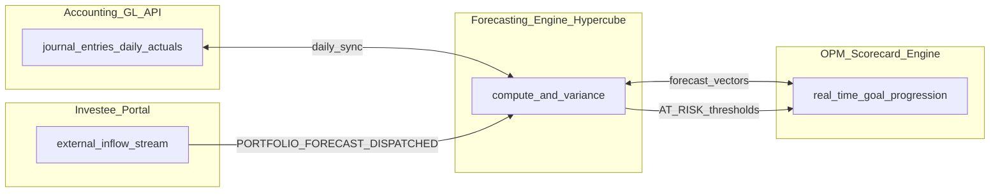
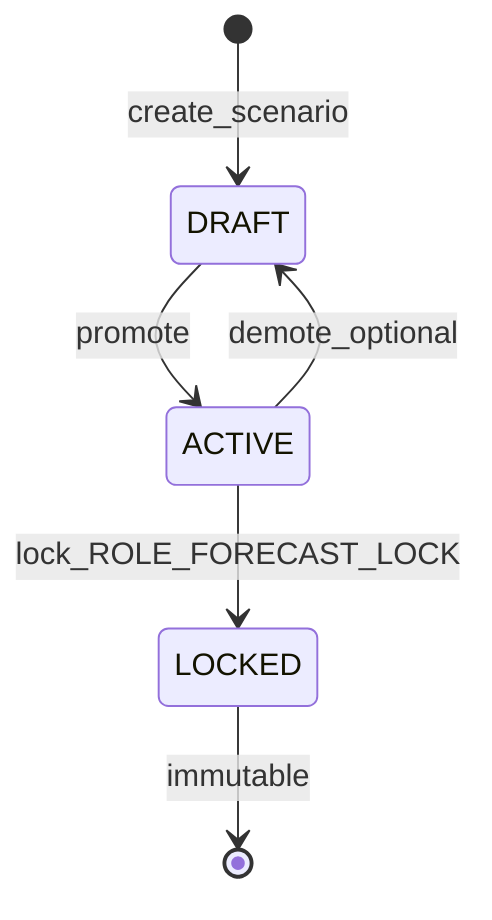
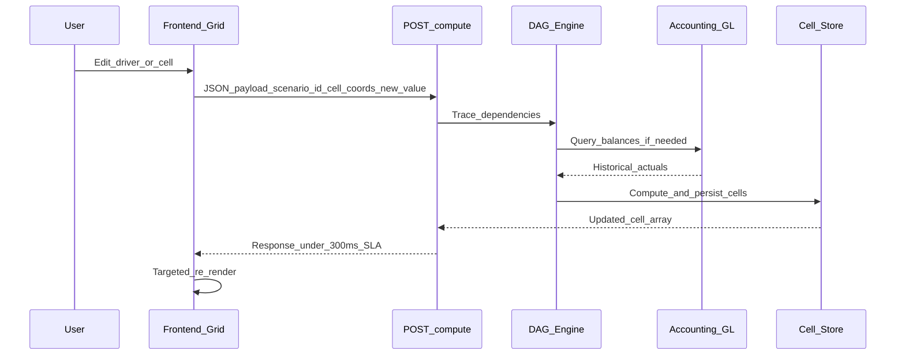

# Forecasting Engine — backend requirements specification

Full backend specification for the **Arcus Autonomous Multi-Dimensional Forecasting Engine**. Frontend design session companion: [`design-sessions/forecasting-engine.md`](../design-sessions/forecasting-engine.md).

**Status:** Greenfield — no forecast/scenario/driver/hypercube models exist in the codebase today. This document defines what must be built.

---

## Table of contents

1. [Executive summary](#1-executive-summary)
2. [Architectural goals and system context](#2-architectural-goals-and-system-context)
3. [Dimensional model (hypercube)](#3-dimensional-model-hypercube)
4. [Functional requirements — four epics](#4-functional-requirements--four-epics)
5. [Process workflow — micro-level event execution](#5-process-workflow--micro-level-event-execution)
6. [Mathematical formulations and engine logic](#6-mathematical-formulations-and-engine-logic)
7. [Proposed data model](#7-proposed-data-model)
8. [API specification](#8-api-specification)
   - [8.11 Scenario Query APIs](#811-scenario-query-apis-listing-retrieval-filtering)
   - [8.12 Cell Edit API](#812-cell-edit-api-inline-grid-updates)
   - [8.13 Compute API](#813-compute-api-for-recalculations)
   - [8.14 Version Snapshots and Forecast Versioning](#814-version-snapshots-and-forecast-versioning)
   - [8.15 Audit Logging](#815-audit-logging)
9. [Calculation engine internals](#9-calculation-engine-internals)
10. [Multi-module integration specifications](#10-multi-module-integration-specifications)
11. [Security and RBAC](#11-security-and-rbac)
12. [Auditing and compliance](#12-auditing-and-compliance)
13. [Non-functional requirements](#13-non-functional-requirements)
14. [Relationship to existing modules](#14-relationship-to-existing-modules)
15. [Implementation phases](#15-implementation-phases)
16. [Testing and UAT checklist](#16-testing-and-uat-checklist)
17. [Migration and operations](#17-migration-and-operations)

---

## 1. Executive summary

### 1.1 Problem statement

Traditional ERP systems isolate accounting ledgers from prospect modeling. Financial teams export GL records into offline spreadsheets. This fragmentation:

- Destroys compliance and auditability
- Breaks data integrity between actuals and projections
- Limits responsiveness of strategic scorecard metrics

### 1.2 Core philosophy — unified financial dimensions

Arcus unifies **historical actuals** and **future projections** within a single multi-dimensional processing framework (hypercube model). Every data cell is indexed by the dimensional tuple:

$$\text{Cell Address} = \{\text{Period}, \text{Legal Entity}, \text{Fund Pool}, \text{Portfolio Company}, \text{Account ID}, \text{Analytical Tag}, \text{Version}\} \tag{1}$$

Whenever:

- A new double-entry journal is posted to the General Ledger (Accounting Module), or
- A startup updates revenue forecasts through the Investee Portal,

the forecasting engine **instantly recalculates** variances, trend directions, and run-rates across affected dashboards and strategic scorecard metrics.

### 1.3 Two primary business domains

The engine serves **both** domains **without bifurcating database models**:

| Domain | Use cases |
|--------|-----------|
| **Operational** | Internal OpEx, department overheads, payroll growth, cash runway vs cashbook |
| **Investment** | Portfolio company growth rates, dilution via cap tables, fund-level IRR, valuation adjustment simulations |

### 1.4 Zimbabwe multi-currency constraint

Every calculated cell must support **simultaneous USD and ZIG tracking**. Transaction currency values and official ZIG base values are stored together (see [Section 6.1](#61-multi-currency-translation-matrix)).

---

## 2. Architectural goals and system context

### 2.1 Arcus ERP Core Bus

The forecasting engine acts as a **central analytic hub** coordinating data across Accounting, Investee Portal, and OPM without manual intervention.


| Module | Integration role |
|--------|------------------|
| **Accounting GL API** | Daily actuals ingestion from `journal_entries` |
| **Forecasting Engine (Hypercube)** | Scenario storage, driver execution, variance computation |
| **Investee Portal** | External inflow stream — portfolio company financial submissions |
| **OPM Scorecard Engine** | Real-time goal progression — receives forecast vectors and variance |



### 2.2 Codebase baseline (what exists today)

| Existing asset | Path | Relevance |
|----------------|------|-----------|
| Flat org budgets | `prisma/schema.prisma` — `Budget`, `BudgetItem` | Optional seed import; not the hypercube |
| Budget management API | `src/services/BudgetManagementService.ts`, `src/routes/budgetManagementRoutes.ts` | Separate workflow |
| GL / journal entries | `JournalEntry`, `JournalEntryLine` | Actuals source |
| GL period aggregates | `src/services/AccountingGlPeriodTotalsService.ts` | Primary actuals aggregation API |
| GL ledger detail | `src/services/GLLedgerDetailService.ts` | Account-level drill-down |
| Multi-currency | `Currency`, `ExchangeRate`; `usdZwgRateSnapshot` on JEs | FX translation |
| Investee financial reports | `financial_reports` (raw SQL table) | `src/services/FinancialReportService.ts` |
| Portfolio KPIs | `portfolio_companies.financialKpis` JSON | Post-ACCEPT snapshots |
| OPM goals | `PerformanceGoal`, `PerformanceContract` | Scorecard linkage |
| GL → goal sync | `src/services/AccountingGoalSyncService.ts` | Pattern for progress events |
| Goal progress bridge | `src/services/PerformanceGoalProgressBridge.ts` | Event + optional JE posting |
| Events budget | `Event`, `EventBudgetItem`, `src/services/EventService.ts` | Accrual reconciliation target |
| Audit logs | `AuditLog` model, `src/routes/auditRoutes.ts` | Pattern for forecast audit extension |

**Critical GL rule for actuals ingestion:** When aggregating from `journal_entries`, **exclude** reference numbers matching `PERF-GOAL-*` and `KPI-GOAL-*` to avoid double-counting performance mirror journals (same rule as `AccountingGlPeriodTotalsService`).

---

## 3. Dimensional model (hypercube)

### 3.1 Dimensions

| Dimension | Description | Source |
|-----------|-------------|--------|
| **Period** | Month / quarter / year bucket within scenario horizon | Computed from `horizon_start_date`, `granularity` |
| **Legal Entity** | Internal subsidiary or external portfolio company | Entity master / `PortfolioCompany` |
| **Fund Pool** | Investment fund scope | Fund entity (`fund_id` on capital calls, etc.) |
| **Portfolio Company** | Startup under fund (nullable for pure operational scenarios) | `PortfolioCompany` |
| **Account ID** | Chart of Accounts line | `ChartOfAccounts` — dynamic pull per entity |
| **Analytical Tag** | Optional GL analytical dimension | Journal line tags / custom tag registry |
| **Version** | Scenario version label (e.g. `DRAFT`, `FY2026_BOARD_APPROVED`) | `forecast_scenarios.version_label` + status |

### 3.2 Granularity rules

| Granularity | Period key format | Column count (12-month horizon) |
|-------------|-------------------|--------------------------------|
| `MONTHLY` | `YYYY-MM` | 12 |
| `QUARTERLY` | `YYYY-Qn` | 4 |
| `ANNUALLY` | `YYYY` | 1 |

Configurable horizons: **12 months**, **24 months**, **5 years** (60 months at monthly granularity).

### 3.3 Scenario status lifecycle



| Status | Mutability |
|--------|------------|
| `DRAFT` | Full edit (per RBAC) |
| `ACTIVE` | Full edit (per RBAC) |
| `LOCKED` | **Strictly read-only** — all drivers, formulas, cells immutable |

On creation, scenario defaults to **`DRAFT`** with **empty cell structures** (no pre-calculated values unless seeded).

### 3.4 Chart of Accounts binding

- On scenario create, backend **dynamically pulls** the active `ChartOfAccounts` tree for the selected `entity_id`.
- Dimension payload includes account ranges, e.g. `{ "type": "ACCOUNT", "value_id": "COA_RANGE_REVENUE" }` mapping to account codes 4000–4999.
- CoA changes in Accounting after scenario creation do **not** auto-mutate locked scenarios; ACTIVE scenarios may offer “refresh CoA mapping” as admin action (Phase 2).

---

## 4. Functional requirements — four epics

### Epic 1: Multi-Dimensional Scenario Modeler

#### User Story US-3.3.1

**As a** Corporate Financial Analyst or Fund Manager,  
**I want to** define a new forecasting scenario by selecting specific time horizons, target legal entities, investment funds, and underlying Chart of Accounts (CoA) ranges,  
**So that** I can isolate our operational planning models from specific portfolio company valuations.

#### Acceptance criteria

- [ ] Users can configure timeframes: rolling **12 months**, **24 months**, or **5 years** with granularities **Monthly**, **Quarterly**, **Annually**.
- [ ] Database supports multi-entity scope: internal legal subsidiaries **or** external startup companies.
- [ ] System dynamically pulls the exact active Chart of Accounts configuration from the Accounting Module based on selected entity profile.
- [ ] On creation, scenario defaults to **`DRAFT`** status with **empty cell structures**.

---

### Epic 2: Driver-Based Calculation Core

#### User Story US-3.3.2

**As an** Authorized Finance Administrator,  
**I want to** bind mathematical drivers (such as headcount growth coefficients, inflation multipliers, or exchange rate scalars) to specific target ledger lines,  
**So that** the system can automatically calculate prospective financial entries across future periods.

#### Acceptance criteria

- [ ] UI exposes inline mathematical formula editor supporting: standard arithmetic, conditional logic (`IF`/`THEN`/`ELSE`), and time-shifted variables (e.g. `t-12` for seasonal comparisons).
- [ ] Modifying a single driver parameter triggers **cascade calculation** across all dependent cells in the active hypercube.
- [ ] Backend validates formula expressions before saving to **prevent circular reference compilation loops**.

#### Supported driver types (minimum)

| `driver_type` | Description | Example parameters |
|---------------|-------------|-------------------|
| `CAGR_DRIVEN` | Compound growth from historical base | `cagr_scalar`, `historical_months_lookback` |
| `HEADCOUNT_GROWTH` | Payroll / overhead scaling | `headcount_coefficient`, `base_per_head` |
| `INFLATION_MULTIPLIER` | CPI-style escalation | `inflation_rate`, `base_period` |
| `FX_SCALAR` | Exchange rate projection | `rate_scalar`, `from_currency`, `to_currency` |
| `LINEAR_REGRESSION` | Auto trend from historical actuals | `lookback_periods` (uses Section 6.3) |
| `MANUAL_OVERRIDE` | Direct cell entry, no formula | — |

---

### Epic 3: Actuals vs. Projection Variance Analysis

#### User Story US-3.3.3

**As a** Chief Financial Officer (CFO) or Venture Capital Partner,  
**I want to** view a unified grid comparing historical actual entries against original forecast models, complete with absolute variance and percentage deviation indicators,  
**So that** I can detect budget overruns and operational baseline drift early.

#### Acceptance criteria

- [ ] Engine pulls real-time historical data from Accounting module's `journal_entries` table for **elapsed** time periods.
- [ ] Absolute Variance calculates dynamically: **Variance = Actual − Forecast** (Eq. 2).
- [ ] Percentage Deviation calculates dynamically: **% Deviation = ((Actual − Forecast) / Forecast) × 100%** (Eq. 3).
- [ ] UI applies visual indicators: green for positive variances (e.g. actual revenue exceeding forecast, expenses falling below budget); red for negative variances.

---

### Epic 4: Immutable Auditing & Version Control

#### User Story US-3.3.4

**As an** Executive Board Member,  
**I want to** lock completed forecast models as immutable versions (e.g. `FY2026_BOARD_APPROVED`),  
**So that** no user can modify past forecasting assumptions, preserving a clean and dependable historical audit trail.

#### Acceptance criteria

- [ ] Version locking restricted to users with explicit **`ROLE_FORECAST_LOCK`** permission.
- [ ] Once scenario status transitions to **`LOCKED`**, all driver records, formulas, and calculated cell values become **strictly read-only**.
- [ ] Any attempt to mutate a locked cell via UI or API returns **403 Forbidden** and triggers a **high-priority** system audit log entry.
- [ ] Audit log records: `timestamp`, `user_id`, `action_type`, `scenario_id`, `delta_payload`.

---

## 5. Process workflow — micro-level event execution

### 5.1 Event execution loop (Section 3.1)

When an authorised analyst modifies a forecasting model:

| Step | Actor | Action |
|------|-------|--------|
| 1 | User | Edits a driver field or cell (e.g. monthly employee overhead 1.5% → 1.8%) in the interactive grid |
| 2 | Frontend | Grid interceptor holds event, structures edit details, dispatches async JSON to compute endpoint |
| 3 | Backend | Captures payload, traces dependent cells along scenario time dimension using a **Directed Acyclic Graph (DAG)** |
| 4 | Backend | If calculations rely on historical financial states, queries active GL balances from Accounting database |
| 5 | Backend | Hypercube engine computes revised projection coordinates, updates transient data store, returns calculated cell array |
| 6 | Frontend | Grid performs targeted re-render of affected cells in **< 300 ms** |



### 5.2 Compute endpoint

- **Endpoint:** `POST /api/v1/forecasting/compute`
- See [Section 8.4](#84-post-apiv1forecastingcompute) for payload schema.

### 5.3 Post-compute side effects

After successful compute cycle:

1. Persist changed cells to `forecast_cells`
2. Emit internal event `FORECAST_COMPUTE_COMPLETED` with scenario_id and affected account ranges
3. OPM listener updates linked `PerformanceGoal` current values and variance vectors ([Section 10.3](#103-performance-management-integration-opm))
4. Write audit log entry for cell/driver mutations

---

## 6. Mathematical formulations and engine logic

### 6.1 Multi-currency translation matrix

Every calculated projection cell is stored in **both** local transaction currency and official **ZIG** base currency.

Let $A_{tx}$ = calculated value in transaction currency.  
Let $R_f$ = projected exchange rate scalar for target period.

**Base value (Eq. 4):**

$$A_{base} = A_{tx} \times R_f$$

**Currency drift component (Eq. 5)** — separates transaction-level deviation from FX fluctuation when comparing past periods:

$$\text{Currency Drift Component} = A_{tx} \times (R_{act} - R_f)$$

Where $R_{act}$ = actual exchange rate for the elapsed period.

**Storage requirement:** Each `forecast_cells` row stores:

- `tx_currency` (e.g. `USD`)
- `tx_currency_value` (Decimal 15,3)
- `base_currency_value` (ZIG, Decimal 15,3)
- `projected_rate` ($R_f$)
- `actual_rate` ($R_{act}$, nullable for future periods)

**Rate source:** `ExchangeRate` table + `usdZwgRateSnapshot` on posted journal entries for historical $R_{act}$.

---

### 6.2 Variance analytics engine

**Absolute variance (Eq. 6):**

$$\Delta = \text{Actual Value} - \text{Forecast Value}$$

**Percentage variance (Eq. 7):**

$$\% \Delta = \begin{cases} \left(\dfrac{\text{Actual Value} - \text{Forecast Value}}{\text{Forecast Value}}\right) \times 100 & \text{if Forecast Value} \neq 0 \\ 100 & \text{if Forecast Value} = 0 \text{ and Actual Value} > 0 \\ 0 & \text{otherwise} \end{cases}$$

**Semantic sign for UI** (consumed by frontend, computed server-side optional `variance_sentiment` field):

| Account class | Favourable condition |
|---------------|---------------------|
| Revenue | $\Delta > 0$ |
| Expense | $\Delta < 0$ |
| Other | Signed $\Delta$ with neutral band ±tolerance |

---

### 6.3 Trend modeling and extrapolation

#### 6.3.1 Linear regression extrapolation

For predictable OpEx lines (utilities, stable overheads), automated rolling linear regression.

Let $t$ = historical time indexes, $Y_t$ = historical actual values, $N$ = count of lookback points.

**Slope (Eq. 8):**

$$m = \frac{N\sum(t \cdot Y_t) - \sum t \sum Y_t}{N\sum(t^2) - (\sum t)^2}$$

**Intercept (Eq. 9):**

$$b = \frac{\sum Y_t - m \sum t}{N}$$

**Future projection (Eq. 10):**

$$f(x) = m \cdot x + b$$

Where $x$ = target upcoming period index.

**Driver binding:** `driver_type: LINEAR_REGRESSION` with `parameters.lookback_periods` ≥ 3.

#### 6.3.2 CAGR driver

For `CAGR_DRIVEN`:

$$\text{Forecast}_{t+k} = \text{HISTORICAL\_BASE} \times (1 + \text{cagr\_scalar})^k$$

Where `HISTORICAL_BASE` = average actual over `historical_months_lookback`.

#### 6.3.3 Time-shift variables

Formula parser must support:

| Token | Meaning |
|-------|---------|
| `t` | Current period index |
| `t-1`, `t-12` | Prior period / year-ago period value for same account+dimension |
| `HISTORICAL_BASE` | Aggregated lookback actuals |
| `IF(cond, a, b)` | Conditional |

---

## 7. Proposed data model

All tables created via idempotent TypeScript migration script in `scripts/` (project convention — **not** `prisma migrate dev`). Add models to `prisma/schema.prisma` after DDL for type generation.

### 7.1 `forecast_scenarios`

| Column | Type | Notes |
|--------|------|-------|
| `id` | VARCHAR PK | cuid |
| `name` | VARCHAR NOT NULL | |
| `description` | TEXT NULL | |
| `entity_id` | VARCHAR NOT NULL | Legal entity or portfolio company scope |
| `fund_id` | VARCHAR NULL | Fund pool |
| `base_currency` | VARCHAR(3) NOT NULL | `USD` or `ZIG` |
| `horizon_start_date` | DATE NOT NULL | |
| `horizon_end_date` | DATE NOT NULL | |
| `granularity` | ENUM | `MONTHLY`, `QUARTERLY`, `ANNUALLY` |
| `status` | ENUM | `DRAFT`, `ACTIVE`, `LOCKED` |
| `version_label` | VARCHAR NULL | e.g. `FY2026_BOARD_APPROVED` when locked |
| `locked_at` | DATETIME NULL | |
| `locked_by_id` | VARCHAR NULL FK users | |
| `created_by_id` | VARCHAR NOT NULL FK users | |
| `created_at` | DATETIME | |
| `updated_at` | DATETIME | |

**Indexes:** `(entity_id, status)`, `(fund_id, status)`, `(created_by_id)`.

### 7.2 `forecast_dimensions`

| Column | Type | Notes |
|--------|------|-------|
| `id` | VARCHAR PK | |
| `scenario_id` | VARCHAR FK forecast_scenarios | |
| `dimension_type` | VARCHAR | `ACCOUNT`, `DEPT`, `TAG`, `PORTFOLIO_COMPANY` |
| `value_id` | VARCHAR | e.g. `COA_RANGE_REVENUE`, `DEPT_ALL` |
| `range_start` | INT NULL | Account code range start |
| `range_end` | INT NULL | Account code range end |

**Unique:** `(scenario_id, dimension_type, value_id)`.

### 7.3 `forecast_cells`

Composite natural key via unique index on dimensional tuple + period.

| Column | Type | Notes |
|--------|------|-------|
| `id` | VARCHAR PK | |
| `scenario_id` | VARCHAR FK | |
| `period_key` | VARCHAR | `YYYY-MM`, `YYYY-Qn`, `YYYY` |
| `account_id` | VARCHAR FK chart_of_accounts | |
| `entity_id` | VARCHAR | Denormalized for query speed |
| `fund_id` | VARCHAR NULL | |
| `portfolio_company_id` | VARCHAR NULL | |
| `analytical_tag` | VARCHAR NULL | |
| `forecast_value` | DECIMAL(15,3) | |
| `actual_value_override` | DECIMAL(15,3) NULL | Populated by GL cron |
| `tx_currency` | VARCHAR(3) | |
| `tx_currency_value` | DECIMAL(15,3) | |
| `base_currency_value` | DECIMAL(15,3) | ZIG |
| `projected_rate` | DECIMAL(18,8) NULL | $R_f$ |
| `actual_rate` | DECIMAL(18,8) NULL | $R_{act}$ |
| `variance_absolute` | DECIMAL(15,3) NULL | Computed |
| `variance_percent` | DECIMAL(8,4) NULL | Computed |
| `is_manual_override` | BOOLEAN DEFAULT false | |
| `last_edited_by_id` | VARCHAR NULL | |
| `last_edited_at` | DATETIME NULL | |

**Unique index:** `(scenario_id, period_key, account_id, entity_id, fund_id, portfolio_company_id, analytical_tag)`.

**Indexes:** `(scenario_id, period_key)`, `(scenario_id, account_id)`.

### 7.4 `forecast_drivers`

| Column | Type | Notes |
|--------|------|-------|
| `id` | VARCHAR PK | |
| `scenario_id` | VARCHAR FK | |
| `target_account_range_start` | INT NOT NULL | |
| `target_account_range_end` | INT NOT NULL | |
| `driver_type` | VARCHAR NOT NULL | See Epic 2 table |
| `formula_expression` | TEXT NOT NULL | |
| `parameters` | JSON NOT NULL | Driver coefficients |
| `created_at` | DATETIME | |
| `updated_at` | DATETIME | |

### 7.5 `forecast_versions`

Immutable snapshot when scenario transitions to `LOCKED`.

| Column | Type | Notes |
|--------|------|-------|
| `id` | VARCHAR PK | |
| `scenario_id` | VARCHAR FK | |
| `version_label` | VARCHAR NOT NULL | |
| `snapshot_payload` | JSON NOT NULL | Full cells + drivers at lock time |
| `locked_by_id` | VARCHAR FK users | |
| `locked_at` | DATETIME NOT NULL | |

### 7.6 `forecast_audit_logs`

| Column | Type | Notes |
|--------|------|-------|
| `id` | VARCHAR PK | |
| `scenario_id` | VARCHAR FK | |
| `user_id` | VARCHAR NULL FK users | |
| `action_type` | VARCHAR NOT NULL | `CELL_UPDATE`, `DRIVER_UPDATE`, `LOCK`, `LOCK_VIOLATION`, `COMPUTE`, etc. |
| `delta_payload` | JSON NOT NULL | Before/after or attempt details |
| `priority` | ENUM | `NORMAL`, `HIGH` — `HIGH` for forbidden mutations |
| `created_at` | DATETIME NOT NULL | |

**Indexes:** `(scenario_id, created_at)`, `(action_type, priority)`.

### 7.7 `forecast_compute_jobs` (optional)

| Column | Type | Notes |
|--------|------|-------|
| `id` | VARCHAR PK | |
| `scenario_id` | VARCHAR FK | |
| `status` | ENUM | `PENDING`, `RUNNING`, `COMPLETED`, `FAILED` |
| `trigger_type` | VARCHAR | `CELL_EDIT`, `DRIVER_CHANGE`, `GL_SYNC`, `WEBHOOK` |
| `affected_cell_count` | INT NULL | |
| `duration_ms` | INT NULL | SLA monitoring |
| `error_message` | TEXT NULL | |
| `created_at` | DATETIME | |

### 7.8 `forecast_goal_links` (OPM bridge)

| Column | Type | Notes |
|--------|------|-------|
| `id` | VARCHAR PK | |
| `scenario_id` | VARCHAR FK | |
| `performance_goal_id` | VARCHAR FK performance_goals | |
| `account_id` | VARCHAR NULL | Mapped CoA line |
| `threshold_value` | DECIMAL(15,3) NULL | AT_RISK trigger |

---

## 8. API specification

Base path: `/api/forecasting` (except compute at `/api/v1/forecasting/compute` per product spec).

All endpoints require `Authorization: Bearer <JWT_TOKEN>` unless noted.

### 8.1 POST `/api/forecasting/scenarios`

Create forecast scenario.

**Headers:** `Authorization`, `Content-Type: application/json`

**Request body:**

```json
{
  "name": "Q3 Strategic Growth Runway",
  "description": "Model reflecting 5% expansion in software sales assets with volatile ZIG adjustments.",
  "entity_id": "8f3b2c14-2947-4eab-92bb-1873cf1a9012",
  "fund_id": "11a0c2d3-1982-4211-a833-00921cbfa811",
  "base_currency": "ZIG",
  "horizon_start_date": "2026-07-01",
  "horizon_end_date": "2027-06-30",
  "granularity": "MONTHLY",
  "dimensions": [
    { "type": "ACCOUNT", "value_id": "COA_RANGE_REVENUE" },
    { "type": "DEPT", "value_id": "DEPT_ALL" }
  ]
}
```

**Response 201:**

```json
{
  "success": true,
  "data": {
    "id": "clx...",
    "status": "DRAFT",
    "name": "Q3 Strategic Growth Runway",
    "horizon_start_date": "2026-07-01",
    "horizon_end_date": "2027-06-30",
    "granularity": "MONTHLY",
    "cell_count": 0
  }
}
```

**Errors:** `400` invalid horizon, unknown entity/fund, invalid dimension.

---

### 8.2 GET `/api/forecasting/scenarios`

List scenarios with filters.

**Query params:** `entity_id`, `fund_id`, `status`, `page`, `limit`, `search`

**Response 200:** Paginated list of scenario summaries.

---

### 8.3 GET `/api/forecasting/scenarios/{id}`

Scenario detail + dimension metadata + driver count + last sync timestamp.

---

### 8.4 PUT `/api/forecasting/scenarios/{id}/drivers`

Update scenario driver definitions.

**Request body:**

```json
{
  "drivers": [
    {
      "target_account_range_start": 4000,
      "target_account_range_end": 4500,
      "driver_type": "CAGR_DRIVEN",
      "formula_expression": "HISTORICAL_BASE * (1 + cagr_scalar)",
      "parameters": {
        "cagr_scalar": 0.045,
        "historical_months_lookback": 6
      }
    }
  ]
}
```

**Behaviour:**

1. Validate formula AST
2. Detect circular references → **409 Conflict**
3. Replace or merge drivers per product rule (recommend: full replace array)
4. Trigger cascade compute
5. Return updated drivers + affected cell count

**Errors:** `400` invalid formula, `403` scenario LOCKED, `409` circular reference.

---

### 8.5 POST `/api/v1/forecasting/compute`

Execute cell/driver change cascade.

**Request body:**

```json
{
  "scenario_id": "clx...",
  "edit_type": "CELL",
  "coordinates": {
    "period_key": "2026-09",
    "account_id": "coa_4100",
    "entity_id": "8f3b2c14-2947-4eab-92bb-1873cf1a9012",
    "fund_id": "11a0c2d3-1982-4211-a833-00921cbfa811",
    "portfolio_company_id": null,
    "analytical_tag": null
  },
  "new_value": 125000.50,
  "tx_currency": "USD"
}
```

**Response 200:**

```json
{
  "success": true,
  "data": {
    "updated_cells": [
      {
        "period_key": "2026-09",
        "account_id": "coa_4100",
        "forecast_value": 125000.50,
        "base_currency_value": 3375013.50,
        "variance_absolute": null,
        "variance_percent": null
      }
    ],
    "duration_ms": 142
  }
}
```

**Errors:** `403` LOCKED, `400` invalid coordinates, `409` circular dependency mid-compute.

**SLA:** Target p95 **< 300 ms** for typical single-cell edit with < 500 dependent cells.

---

### 8.6 GET `/api/forecasting/scenarios/{id}/grid`

Paginated hypercube slice for Ag-Grid.

**Query params:**

| Param | Description |
|-------|-------------|
| `period_start` | Filter period range |
| `period_end` | Filter period range |
| `account_range_start` | CoA filter |
| `account_range_end` | CoA filter |
| `portfolio_company_id` | Dimension filter |
| `include_actuals` | boolean, default true |
| `include_variance` | boolean, default true |
| `page`, `limit` | Pagination |

**Response:** Rows keyed by account hierarchy with nested period columns.

---

### 8.7 POST `/api/forecasting/scenarios/{id}/lock`

Lock scenario as immutable version.

**Required role:** `ROLE_FORECAST_LOCK`

**Request body:**

```json
{
  "version_label": "FY2026_BOARD_APPROVED"
}
```

**Behaviour:**

1. Verify status is `ACTIVE` or `DRAFT` (product decision — recommend ACTIVE only)
2. Snapshot all cells + drivers to `forecast_versions`
3. Set `status = LOCKED`, `locked_at`, `locked_by_id`, `version_label`
4. Audit log `action_type: LOCK`

**Response 200:** Locked scenario summary.

**Errors:** `403` missing role or already LOCKED.

---

### 8.8 GET `/api/forecasting/scenarios/{id}/audit`

Paginated audit trail from `forecast_audit_logs`.

**Query params:** `action_type`, `priority`, `from`, `to`, `page`, `limit`

---

### 8.9 PATCH `/api/forecasting/scenarios/{id}`

Update metadata (name, description, promote DRAFT → ACTIVE). **Blocked when LOCKED.**

---

### 8.10 Internal / webhook endpoints (service-to-service)

| Event / endpoint | Direction | Purpose |
|------------------|-----------|---------|
| `PORTFOLIO_FORECAST_DISPATCHED` | Investee → Forecasting | Ingest portfolio company submission |
| `FORECAST_COMPUTE_COMPLETED` | Forecasting → OPM | Push actual/forecast/variance vectors |
| `PREPAID_EVENT_ACCRUAL` | Events → Forecasting | Tentative OpEx from event budget |
| `FORECAST_BUDGET_EXCEEDED` | Forecasting → Events/Finance | Block event approval |

These may be implemented as internal service calls initially; webhook HTTP optional Phase 2.

---

### 8.11 Scenario Query APIs (listing, retrieval, filtering)

Dedicated read APIs for scenario discovery, workspace bootstrap, and CFO dashboards. All require `Authorization: Bearer <JWT_TOKEN>`.

#### 8.11.1 GET `/api/forecasting/scenarios` — list and filter

**Purpose:** Paginated scenario index for the scenario list screen and fund-planning views.

**Query parameters:**

| Param | Type | Description |
|-------|------|-------------|
| `entity_id` | string | Filter by legal entity |
| `fund_id` | string | Filter by fund pool |
| `portfolio_company_id` | string | Scenarios scoped to a portfolio company |
| `status` | enum | `DRAFT`, `ACTIVE`, `LOCKED` (comma-separated allowed) |
| `base_currency` | string | `USD` or `ZIG` |
| `granularity` | enum | `MONTHLY`, `QUARTERLY`, `ANNUALLY` |
| `horizon_start_from` | date | Scenarios whose horizon starts on or after |
| `horizon_end_to` | date | Scenarios whose horizon ends on or before |
| `version_label` | string | Partial match on locked version label |
| `created_by_id` | string | Owner filter |
| `search` | string | Case-insensitive match on `name` or `description` |
| `sort` | string | `updated_at`, `created_at`, `name`, `horizon_start_date` (prefix `-` for desc) |
| `page` | int | Default `1` |
| `limit` | int | Default `25`, max `100` |

**Response 200:**

```json
{
  "success": true,
  "data": {
    "items": [
      {
        "id": "clx...",
        "name": "Q3 Strategic Growth Runway",
        "description": "Model reflecting 5% expansion...",
        "entity_id": "8f3b2c14-2947-4eab-92bb-1873cf1a9012",
        "entity_name": "NVCCZ Operations Ltd",
        "fund_id": "11a0c2d3-1982-4211-a833-00921cbfa811",
        "fund_name": "Growth Fund I",
        "base_currency": "ZIG",
        "horizon_start_date": "2026-07-01",
        "horizon_end_date": "2027-06-30",
        "granularity": "MONTHLY",
        "status": "DRAFT",
        "version_label": null,
        "driver_count": 3,
        "cell_count": 1248,
        "last_gl_sync_at": "2026-06-08T02:15:00Z",
        "created_by_id": "cml7...",
        "created_by_name": "Nyasha K",
        "updated_at": "2026-06-08T10:22:00Z"
      }
    ],
    "pagination": {
      "page": 1,
      "limit": 25,
      "total": 42,
      "total_pages": 2
    }
  }
}
```

**RBAC:** Analysts see scenarios they own or are shared with; Finance Admin / CFO / Partner see all within their entity/fund scope.

---

#### 8.11.2 GET `/api/forecasting/scenarios/{id}` — single scenario retrieval

**Purpose:** Load scenario header, dimensions, and workspace metadata before grid render.

**Path params:** `id` — scenario cuid.

**Query params (optional):**

| Param | Type | Description |
|-------|------|-------------|
| `include_dimensions` | boolean | Default `true` |
| `include_driver_summary` | boolean | Default `true` |
| `include_lock_metadata` | boolean | Default `true` |

**Response 200:**

```json
{
  "success": true,
  "data": {
    "id": "clx...",
    "name": "Q3 Strategic Growth Runway",
    "description": "Model reflecting 5% expansion in software sales assets with volatile ZIG adjustments.",
    "entity_id": "8f3b2c14-2947-4eab-92bb-1873cf1a9012",
    "fund_id": "11a0c2d3-1982-4211-a833-00921cbfa811",
    "base_currency": "ZIG",
    "horizon_start_date": "2026-07-01",
    "horizon_end_date": "2027-06-30",
    "granularity": "MONTHLY",
    "status": "ACTIVE",
    "version_label": null,
    "locked_at": null,
    "locked_by_id": null,
    "period_keys": ["2026-07", "2026-08", "2026-09"],
    "dimensions": [
      { "type": "ACCOUNT", "value_id": "COA_RANGE_REVENUE", "range_start": 4000, "range_end": 4999 },
      { "type": "DEPT", "value_id": "DEPT_ALL" }
    ],
    "driver_count": 3,
    "cell_count": 1248,
    "last_gl_sync_at": "2026-06-08T02:15:00Z",
    "last_compute_at": "2026-06-08T10:20:00Z",
    "is_editable": true,
    "created_at": "2026-06-01T09:00:00Z",
    "updated_at": "2026-06-08T10:22:00Z"
  }
}
```

**Errors:** `404 SCENARIO_NOT_FOUND`, `403` if user lacks view permission for entity scope.

---

#### 8.11.3 GET `/api/forecasting/scenarios/{id}/summary` — aggregated KPIs

**Purpose:** CFO / partner dashboard cards without loading full grid.

**Response 200:** Totals and variance rollups for revenue, OpEx, net, cash runway proxy — by elapsed vs future period split.

---

#### 8.11.4 GET `/api/forecasting/scenarios/counts` — facet counts for filters

**Purpose:** Power filter chips on list UI (`DRAFT: 5`, `ACTIVE: 12`, `LOCKED: 3` per entity).

**Query params:** Same filters as list (except `status`) — returns count grouped by `status`.

---

### 8.12 Cell Edit API (inline grid updates)

Dedicated endpoint for **Ag-Grid double-click inline edits**. Separates user intent (persist cell override) from the DAG **Compute API** (Section 8.13), which may be invoked internally after a successful cell write.

#### 8.12.1 PATCH `/api/forecasting/scenarios/{id}/cells`

**Purpose:** Commit a single cell edit from the interactive grid (future forecast periods only unless product allows current-period override).

**Headers:** `Authorization`, `Content-Type: application/json`

**Request body:**

```json
{
  "period_key": "2026-09",
  "account_id": "coa_4100",
  "entity_id": "8f3b2c14-2947-4eab-92bb-1873cf1a9012",
  "fund_id": "11a0c2d3-1982-4211-a833-00921cbfa811",
  "portfolio_company_id": null,
  "analytical_tag": null,
  "forecast_value": 125000.50,
  "tx_currency": "USD",
  "is_manual_override": true,
  "client_edit_id": "uuid-for-idempotency",
  "expected_last_edited_at": "2026-06-08T10:15:00Z"
}
```

| Field | Required | Notes |
|-------|----------|-------|
| `forecast_value` | Yes | New numeric value |
| `tx_currency` | Yes | Transaction currency code |
| `is_manual_override` | No | Default `true` — marks cell as manual vs driver-calculated |
| `client_edit_id` | No | Idempotency key; duplicate within 60s returns same result |
| `expected_last_edited_at` | No | Optimistic lock — `409 STALE_CELL_EDIT` if mismatch |

**Behaviour:**

1. `assertScenarioEditable(scenarioId)` — reject if `LOCKED` → **403** + audit `LOCK_VIOLATION`
2. Validate `period_key` is within scenario horizon and in **editable** period set (future periods)
3. Validate `account_id` belongs to scenario CoA / dimension scope
4. Upsert `forecast_cells` row; set `last_edited_by_id`, `last_edited_at`
5. Recompute `base_currency_value` via translation matrix (Section 6.1)
6. Write audit log `action_type: CELL_UPDATE` with `delta_payload` before/after
7. **Invoke Compute API internally** (sync) for dependent cells — return merged cell set in response
8. Emit `FORECAST_COMPUTE_COMPLETED` if cascade affects OPM-linked accounts

**Response 200:**

```json
{
  "success": true,
  "data": {
    "edited_cell": {
      "period_key": "2026-09",
      "account_id": "coa_4100",
      "forecast_value": 125000.50,
      "tx_currency_value": 125000.50,
      "base_currency_value": 3375013.50,
      "is_manual_override": true,
      "last_edited_at": "2026-06-08T10:22:01Z"
    },
    "cascade": {
      "compute_job_id": "fcj_...",
      "updated_cell_count": 14,
      "updated_cells": [],
      "duration_ms": 128
    }
  }
}
```

**Errors:**

| HTTP | Code | When |
|------|------|------|
| 400 | `INVALID_PERIOD` | Period outside horizon or not editable |
| 400 | `INVALID_ACCOUNT` | Account outside scenario dimensions |
| 403 | `FORECAST_LOCKED` | Scenario status LOCKED |
| 409 | `STALE_CELL_EDIT` | Optimistic lock conflict |
| 422 | `INVALID_CURRENCY` | Unknown or disallowed tx currency |

---

#### 8.12.2 PATCH `/api/forecasting/scenarios/{id}/cells/batch`

**Purpose:** Paste or bulk-fill a rectangular selection (optional Phase 1b).

**Request body:** `{ "edits": [ /* same shape as single cell */ ], "atomic": true }`

**Behaviour:** All-or-nothing transaction; single compute cascade at end. Max **500** cells per batch.

---

#### 8.12.3 DELETE `/api/forecasting/scenarios/{id}/cells/override`

**Purpose:** Clear manual override on a cell and revert to driver-calculated value.

**Query params:** Full cell coordinates (period_key, account_id, entity_id, etc.)

**Behaviour:** Remove `is_manual_override`, trigger compute to repopulate from drivers.

---

### 8.13 Compute API for recalculations

The **Compute API** runs the DAG hypercube engine. It is invoked by:

- Cell Edit API (after inline commit)
- Driver PUT (after formula save)
- GL daily sync cron
- Manual “Recalculate scenario” action
- Investee / Events webhooks

**Base endpoint:** `POST /api/v1/forecasting/compute`

#### 8.13.1 Request modes

**`edit_type` values:**

| `edit_type` | Trigger | Required payload fields |
|-------------|---------|-------------------------|
| `CELL` | Single cell change (also used when Cell Edit API delegates here) | `coordinates`, `new_value`, `tx_currency` |
| `DRIVER` | Driver parameter or formula change | `driver_id` or full driver definition |
| `SCENARIO_RECALC` | Full scenario refresh | `scenario_id` only |
| `ACCOUNT_RANGE` | Recompute account slice | `account_range_start`, `account_range_end` |
| `PERIOD_RANGE` | Recompute period slice | `period_start`, `period_end` |
| `GL_SYNC` | System cron (no user JWT — service token) | `scenario_id`, `sync_batch_id` |

**Full request example — scenario-wide recalc:**

```json
{
  "scenario_id": "clx...",
  "edit_type": "SCENARIO_RECALC",
  "options": {
    "include_elapsed_variance": true,
    "skip_manual_overrides": false
  }
}
```

**Full request example — driver cascade:**

```json
{
  "scenario_id": "clx...",
  "edit_type": "DRIVER",
  "driver_id": "fd_...",
  "parameters": {
    "cagr_scalar": 0.05
  }
}
```

#### 8.13.2 Processing pipeline (mandatory)

1. Load scenario; abort if `LOCKED` and `edit_type` is mutating (GL_SYNC may still refresh actuals on LOCKED read-only scenarios per product rule)
2. Build or load cached DAG for scenario
3. Determine **affected cell set** from `edit_type` + coordinates
4. Topological sort of dependent nodes
5. Fetch GL actuals for elapsed periods if needed (`AccountingGlPeriodTotalsService` pattern)
6. Evaluate formulas and translation matrix per cell
7. Batch upsert `forecast_cells`; record `forecast_compute_jobs`
8. Recompute variance columns (Eq. 6, 7) for elapsed periods
9. Return `updated_cells` array + `duration_ms`

#### 8.13.3 Response 200

```json
{
  "success": true,
  "data": {
    "compute_job_id": "fcj_...",
    "scenario_id": "clx...",
    "edit_type": "SCENARIO_RECALC",
    "updated_cell_count": 1248,
    "updated_cells": [
      {
        "period_key": "2026-09",
        "account_id": "coa_4100",
        "forecast_value": 125000.50,
        "actual_value_override": null,
        "tx_currency": "USD",
        "tx_currency_value": 125000.50,
        "base_currency_value": 3375013.50,
        "variance_absolute": null,
        "variance_percent": null,
        "is_manual_override": false
      }
    ],
    "duration_ms": 245,
    "warnings": []
  }
}
```

#### 8.13.4 GET `/api/v1/forecasting/compute/{compute_job_id}` — async status (optional)

For `SCENARIO_RECALC` or large batches exceeding 300 ms SLA:

**Response:** `{ "status": "PENDING" | "RUNNING" | "COMPLETED" | "FAILED", "progress_percent", "updated_cell_count", "error_message" }`

Frontend polls until `COMPLETED`, then calls `GET .../grid` with `compute_job_id` filter for delta merge.

#### 8.13.5 Errors and SLA

| HTTP | Code | When |
|------|------|------|
| 400 | `INVALID_COORDINATES` | Cell not in hypercube |
| 403 | `FORECAST_LOCKED` | Mutating compute on LOCKED scenario |
| 409 | `CIRCULAR_REFERENCE` | DAG cycle detected |
| 409 | `COMPUTE_IN_PROGRESS` | Concurrent full recalc already running |
| 504 | `COMPUTE_TIMEOUT` | Exceeds `FORECAST_COMPUTE_TIMEOUT_MS` |

**SLA:** p95 **< 300 ms** for `CELL` and `DRIVER` edits with &lt; 500 affected cells. Full `SCENARIO_RECALC` may use async job pattern.

#### 8.13.6 POST `/api/v1/forecasting/compute/validate`

**Purpose:** Dry-run formula/driver validation without persisting — used by driver editor “Test formula” button.

**Request:** `{ "scenario_id", "formula_expression", "parameters", "sample_coordinates" }`

**Response:** `{ "valid": true, "sample_result": 12345.67 }` or `{ "valid": false, "errors": [...] }`

---

### 8.14 Version Snapshots and Forecast Versioning

Immutable **forecast versioning** preserves board-approved assumptions. Distinct from scenario `status` — a scenario may accumulate **multiple historical version snapshots** over time (each lock event).

#### 8.14.1 Version model

| Concept | Storage | Description |
|---------|---------|-------------|
| **Working copy** | `forecast_scenarios` + `forecast_cells` + `forecast_drivers` | Editable while `DRAFT` or `ACTIVE` |
| **Version snapshot** | `forecast_versions` | Immutable JSON snapshot at lock time |
| **Version label** | `forecast_scenarios.version_label` + `forecast_versions.version_label` | Human label e.g. `FY2026_BOARD_APPROVED` |

**Snapshot payload schema (`forecast_versions.snapshot_payload`):**

```json
{
  "scenario_metadata": { },
  "dimensions": [ ],
  "drivers": [ ],
  "cells": [ ],
  "captured_at": "2026-06-08T15:00:00Z",
  "captured_by_id": "cml7...",
  "cell_count": 1248,
  "driver_count": 3,
  "checksum_sha256": "abc123..."
}
```

#### 8.14.2 POST `/api/forecasting/scenarios/{id}/lock` — create version (see also 8.7)

Creates new `forecast_versions` row and sets scenario `status = LOCKED`.

**Validation:**

- `version_label` required, unique per entity+fund scope (or globally — product decision)
- Recommend only `ACTIVE` scenarios may lock
- Cannot lock already `LOCKED` scenario without `POST .../unlock` admin action (Phase 2)

#### 8.14.3 GET `/api/forecasting/scenarios/{id}/versions` — list version history

**Purpose:** Version history panel in UI.

**Response 200:**

```json
{
  "success": true,
  "data": {
    "items": [
      {
        "id": "fv_...",
        "version_label": "FY2026_BOARD_APPROVED",
        "locked_at": "2026-06-08T15:00:00Z",
        "locked_by_id": "cml7...",
        "locked_by_name": "Board Secretary",
        "cell_count": 1248,
        "checksum_sha256": "abc123..."
      },
      {
        "id": "fv_...",
        "version_label": "FY2025_BOARD_APPROVED",
        "locked_at": "2025-06-10T12:00:00Z",
        "locked_by_id": "cml8...",
        "locked_by_name": "CFO",
        "cell_count": 1100,
        "checksum_sha256": "def456..."
      }
    ]
  }
}
```

#### 8.14.4 GET `/api/forecasting/scenarios/{id}/versions/{versionId}` — retrieve snapshot

**Purpose:** Read-only grid render of a locked historical version.

**Query params:**

| Param | Description |
|-------|-------------|
| `format` | `metadata` (default) or `full` (entire snapshot_payload) |
| `period_start`, `period_end` | Slice filter |
| `account_range_start`, `account_range_end` | CoA filter |

**Response:** Version metadata or paginated cells from snapshot (never live `forecast_cells` for LOCKED historical versions).

#### 8.14.5 GET `/api/forecasting/scenarios/{id}/versions/compare`

**Purpose:** Side-by-side variance between two versions or version vs current working copy.

**Query params:** `base_version_id`, `compare_version_id` (or `compare_to=WORKING`)

**Response:** Per-cell deltas across shared period/account keys.

#### 8.14.6 POST `/api/forecasting/scenarios/{id}/versions/{versionId}/duplicate`

**Purpose:** Create new `DRAFT` scenario from a locked snapshot (new planning cycle).

**Behaviour:** Copy snapshot cells/drivers into new scenario row; new `id`; status `DRAFT`; audit `VERSION_DUPLICATED`.

#### 8.14.7 Version immutability rules

- No `UPDATE` or `DELETE` on `forecast_versions` rows after insert
- No mutation of `snapshot_payload` — append-only version table
- `forecast_cells` for LOCKED scenario: read-only; actuals sync may still update `actual_value_override` and variance on elapsed periods without changing locked **forecast** values (product decision — document chosen behaviour in implementation)

---

### 8.15 Audit Logging

Comprehensive **audit trail** for compliance (Epic 4). Stored in `forecast_audit_logs`; exposed via query API. Optionally mirror high-priority events to platform `audit_logs` table.

#### 8.15.1 Audited actions

| `action_type` | Trigger | `priority` | `delta_payload` minimum |
|---------------|---------|------------|-------------------------|
| `SCENARIO_CREATE` | POST scenarios | NORMAL | Full scenario metadata |
| `SCENARIO_UPDATE` | PATCH scenario | NORMAL | Changed fields before/after |
| `SCENARIO_PROMOTE` | DRAFT → ACTIVE | NORMAL | `{ "from": "DRAFT", "to": "ACTIVE" }` |
| `CELL_UPDATE` | PATCH cells | NORMAL | Coordinates, before/after values, currency |
| `CELL_BATCH_UPDATE` | PATCH cells/batch | NORMAL | Edit count, first/last coordinates |
| `CELL_OVERRIDE_CLEAR` | DELETE override | NORMAL | Coordinates, reverted value |
| `DRIVER_UPDATE` | PUT drivers | NORMAL | Driver id, formula/parameters diff |
| `COMPUTE` | POST compute | NORMAL | `edit_type`, `updated_cell_count`, `duration_ms` |
| `GL_SYNC` | Cron actuals | NORMAL | `sync_batch_id`, periods synced, cell count |
| `LOCK` | POST lock | NORMAL | `version_label`, `version_id`, snapshot checksum |
| `LOCK_VIOLATION` | Any forbidden mutation on LOCKED | **HIGH** | Attempted action, user, coordinates |
| `VERSION_DUPLICATED` | POST duplicate from version | NORMAL | Source `version_id`, new `scenario_id` |
| `PORTFOLIO_DISPATCH` | Investee webhook | NORMAL | `portfolio_company_id`, report period |
| `OPM_AT_RISK` | Threshold breach | NORMAL | `goal_id`, threshold, projected value |

#### 8.15.2 GET `/api/forecasting/scenarios/{id}/audit` — scenario audit trail

**Query parameters:**

| Param | Type | Description |
|-------|------|-------------|
| `action_type` | string | Filter single or comma-separated types |
| `priority` | enum | `NORMAL`, `HIGH` |
| `user_id` | string | Filter by actor |
| `from` | ISO datetime | Inclusive start |
| `to` | ISO datetime | Inclusive end |
| `period_key` | string | Filter CELL_UPDATE payloads containing period |
| `account_id` | string | Filter cell-related entries |
| `page` | int | Default 1 |
| `limit` | int | Default 50, max 200 |
| `sort` | string | Default `-created_at` |

**Response 200:**

```json
{
  "success": true,
  "data": {
    "items": [
      {
        "id": "fal_...",
        "scenario_id": "clx...",
        "user_id": "cml7...",
        "user_name": "Nyasha K",
        "action_type": "CELL_UPDATE",
        "priority": "NORMAL",
        "delta_payload": {
          "period_key": "2026-09",
          "account_id": "coa_4100",
          "before": { "forecast_value": 120000.00 },
          "after": { "forecast_value": 125000.50 },
          "tx_currency": "USD"
        },
        "created_at": "2026-06-08T10:22:01Z"
      }
    ],
    "pagination": { "page": 1, "limit": 50, "total": 312 }
  }
}
```

#### 8.15.3 GET `/api/forecasting/audit` — cross-scenario audit feed (admin)

**Purpose:** Finance admin / compliance dashboard across all scenarios.

**Query params:** Same as 8.15.2 plus `scenario_id`, `entity_id`, `fund_id`.

**RBAC:** Finance Admin, CFO, compliance role only.

#### 8.15.4 GET `/api/forecasting/audit/high-priority` — security/compliance alerts

**Purpose:** Surface `LOCK_VIOLATION` and other HIGH entries for monitoring.

**Response:** Unresolved HIGH items with scenario name, user, timestamp, attempted action.

#### 8.15.5 Write guarantees

- Audit write is **synchronous** in the same database transaction as the mutating operation (cell update, lock, etc.)
- Failed audit write **rolls back** the business transaction
- `LOCK_VIOLATION` audit is written even when the business mutation is rejected (403 path)
- System actions (`GL_SYNC`, cron): `user_id` null; `delta_payload.actor = "system"`

#### 8.15.6 Retention

- `forecast_audit_logs`: retain **indefinitely** for LOCKED scenario history
- Optional archive to cold storage after 7 years (compliance policy)

#### 8.15.7 Relation to platform `audit_logs`

- Mirror `LOCK_VIOLATION` and `LOCK` to global `AuditLog` for unified admin audit UI (pattern: `src/routes/auditRoutes.ts`)
- Forecast-specific detail remains in `forecast_audit_logs.delta_payload`

---

## 9. Calculation engine internals

### 9.1 DAG construction

1. Parse all `forecast_drivers.formula_expression` into AST nodes
2. Extract cell references (account ranges × period dependencies including `t-n` shifts)
3. Build directed graph: driver/cell → dependent cells
4. Add edges for cross-account formulas

### 9.2 Execution order

- **Topological sort** of DAG for evaluation order
- On single-cell edit: compute **transitive closure** of dependents only (incremental cascade)
- Parallelize independent branches where safe

### 9.3 Circular reference detection

Before save (drivers) and before compute:

- Run DFS cycle detection on dependency graph
- If cycle found: reject with `409` and list cycle path in error body

### 9.4 Cascade invalidation scope

When driver parameter changes:

- Invalidate all cells in target account range × all **future** periods (and current if editable)
- Re-query GL actuals for elapsed periods (actuals not overwritten by forecast drivers)
- Recompute variances for elapsed periods

### 9.5 Transient vs persisted store

- **Transient:** In-memory cache of computed cells during cascade (per request)
- **Persisted:** `forecast_cells` table — batch upsert at end of successful compute
- Failed compute rolls back persist batch

### 9.6 Formula AST validation rules

| Rule | Enforcement |
|------|-------------|
| Max formula length | 4096 chars |
| Allowed functions | `IF`, `MIN`, `MAX`, `ABS`, `ROUND`, arithmetic, comparisons |
| Allowed variables | `HISTORICAL_BASE`, `cagr_scalar`, param keys, `t`, `t-n` |
| No dynamic SQL / eval | Sandboxed interpreter only |
| Type coercion | Numeric only; reject string concat |

---

## 10. Multi-module integration specifications

### 10.1 Accounting integration (General Ledger)

**Mechanism:** Daily cron background worker.

**Logic:**

1. Map all `ACTIVE` forecasting scenarios
2. For each elapsed period in scenario horizon:
   - Aggregate `journal_entries` + `journal_entry_lines` grouped by `account_id` and analytical tags
   - **Exclude** JE refs `PERF-GOAL-*`, `KPI-GOAL-*`
   - Filter `status = POSTED`, `transactionDate` within period bounds
3. Upsert `forecast_cells.actual_value_override`
4. Recompute variance columns (Eq. 6, 7)
5. Record `forecast_compute_jobs` with `trigger_type: GL_SYNC`

**Services to reuse:**

- `AccountingGlPeriodTotalsService` — period P&L totals pattern
- `GLLedgerDetailService` — account drill-down
- `FinancialKpiGlValueService` — KPI sync strategies as reference

**Cron schedule:** Daily at 02:00 Africa/Harare (configurable `FORECAST_GL_SYNC_CRON`).

**Idempotency:** Same period + account + scenario → overwrite actual with latest aggregate; no duplicate rows.

---

### 10.2 Portfolio management integration (Investee Portal)

**Mechanism:** Webhook / internal event on investee financial submit.

**Event:** `PORTFOLIO_FORECAST_DISPATCHED`

**Trigger points:**

- `FinancialReportService.reviewReport` with status `ACCEPT` — extend to emit forecast dispatch
- Applicant portal submit — optional on `PENDING` for early preview (product decision)

**Payload (example):**

```json
{
  "event": "PORTFOLIO_FORECAST_DISPATCHED",
  "portfolio_company_id": "pc_...",
  "fund_id": "fund_...",
  "reporting_period_end": "2026-03-31",
  "parsed_snapshot": { },
  "total_revenue": 500000,
  "net_profit": 75000,
  "currency": "USD"
}
```

**Logic:**

1. Forecasting engine receives payload
2. Run **translation matrix** (Section 6.1) to fund presentation currency (ZIG base)
3. Map revenue/expense lines to parent fund scenario cells via `forecast_dimensions`
4. Append/update portfolio-level tracking scenario rows
5. Trigger compute cascade for dependent fund aggregates

**Data sources:**

- `financial_reports` table (`parsedSnapshot`, `totalRevenue`, `netProfit`)
- `portfolio_companies.financialKpis` JSON after ACCEPT
- `InvestmentMonitoringKpiService` — derived KPI recompute pattern

---

### 10.3 Performance management integration (OPM)

**Mechanism:** Internal event handler on `FORECAST_COMPUTE_COMPLETED`.

**Logic:**

1. Executive configures organisational goal in BSC (e.g. “Achieve ZIG 500,000 in software revenue entries”)
2. `forecast_goal_links` maps goal → scenario account range
3. On each compute cycle completion:
   - Engine pushes data map: `{ actual_total, forecast_total, variance_absolute, variance_percent, period_key }`
   - `PerformanceGoal.currentValue` updated from `actual_total` for elapsed periods
   - Forecast projection stored in goal metadata or `PerformanceGoalProgressEvent` with `source: forecast_sync`
4. If projected value drops below `threshold_value`: set goal `status` or `stage` to **`AT_RISK`**
5. Log notification to manager dashboards via existing notification service

**Services to extend (not replace):**

- `EnhancedGoalTrackingService` — add `dataSourceModule: Forecasting` option
- `PerformanceGoalProgressBridge` — record progress events
- `AccountingGoalSyncService` — parallel pattern for GL sync

**Do not** post mirror JEs for forecast updates (avoid GL pollution).

---

### 10.4 Events module budget reconciliation

**Mechanism:** Accrual validation and settlement webhooks.

**Logic:**

1. Event coordinator updates active budget matrix (`EventBudgetItem` changes)
2. Events module emits `PREPAID_EVENT_ACCRUAL` with tentative operational expense amount
3. Forecasting engine logs accrual against active operational scenario (OpEx account mapping)
4. If event total exceeds predefined scenario cost boundaries:
   - Set flag `budget_exceeded: true` on event
   - **Block** `EventService.approveBudget` path — return `403` with finance review message
   - Send budget variance notification to finance team

**Current codebase gap:** `docs/events-uat.md` documents Events → OPM `external_data` ETL as **not fully implemented**. Forecasting integration should use `Event.estimatedBudget`, `EventBudgetItem`, and `EventExpense` sums directly.

**Reference:** `src/services/EventService.ts` — `approveBudget`, `recordExpense`, `getEventAnalytics`.

---

## 11. Security and RBAC

### 11.1 New permission

| Permission code | Description |
|---------------|-------------|
| `ROLE_FORECAST_LOCK` | Lock scenarios to immutable versions |

Add to role seed / admin role management UI.

### 11.2 Role matrix

| Action | Analyst | Finance Admin | CFO/Partner | ROLE_FORECAST_LOCK |
|--------|---------|---------------|-------------|-------------------|
| Create scenario | Yes | Yes | Yes | — |
| Edit cells (non-LOCKED) | Yes | Yes | Read-only | — |
| Edit drivers | No | Yes | No | — |
| View all scenarios | Scoped | Yes | Yes | Yes |
| Compute | Yes | Yes | No | — |
| Lock version | No | No | No | **Yes** |
| View audit log | Own scenarios | Yes | Yes | Yes |

### 11.3 Enforcement layers

1. **Middleware** — JWT + role check per route
2. **Service layer** — `assertScenarioEditable(scenarioId)` throws `403` if `LOCKED`
3. **Database** — optional trigger preventing UPDATE on `forecast_cells` where scenario status = LOCKED (defence in depth)

### 11.4 LOCKED mutation attempt

```json
{
  "success": false,
  "message": "Scenario is locked and cannot be modified",
  "code": "FORECAST_LOCKED",
  "scenario_id": "clx...",
  "version_label": "FY2026_BOARD_APPROVED"
}
```

HTTP **403** + `forecast_audit_logs` entry with `action_type: LOCK_VIOLATION`, `priority: HIGH`.

---

## 12. Auditing and compliance

> **Full API and action-type specification:** See [Section 8.15 — Audit Logging](#815-audit-logging) for endpoints, query filters, write guarantees, and the complete `action_type` catalogue.

### 12.1 Audit log fields (Epic 4)

Every mutating action writes to `forecast_audit_logs`:

| Field | Required | Example |
|-------|----------|---------|
| `timestamp` | Yes | `2026-06-08T14:30:00Z` |
| `user_id` | Yes (null for system cron) | `cml7spmbr...` |
| `action_type` | Yes | `CELL_UPDATE`, `DRIVER_UPDATE`, `LOCK`, `LOCK_VIOLATION`, `GL_SYNC` |
| `scenario_id` | Yes | `clx...` |
| `delta_payload` | Yes | `{"before": 100, "after": 125, "period_key": "2026-09"}` |

### 12.2 Immutable version snapshots

> **Full versioning API:** See [Section 8.14 — Version Snapshots and Forecast Versioning](#814-version-snapshots-and-forecast-versioning) for list, retrieve, compare, and duplicate endpoints.

On `LOCK`:

1. Serialize all `forecast_cells` + `forecast_drivers` to `forecast_versions.snapshot_payload` JSON
2. Prevent further UPDATE/DELETE on those rows for the scenario
3. Audit `action_type: LOCK` with `version_label` in payload

### 12.3 High-priority entries

| Trigger | Priority |
|---------|----------|
| LOCK_VIOLATION (403 attempt) | HIGH |
| LOCK action | NORMAL |
| GL_SYNC batch | NORMAL |
| CELL_UPDATE | NORMAL |

Expose HIGH priority entries in admin audit dashboard filter.

---

## 13. Non-functional requirements

| Requirement | Target |
|-------------|--------|
| Compute response time | **< 300 ms** p95 for typical single-cell edit |
| GL daily sync | Complete within 15 minutes for all active scenarios |
| Idempotent cron | Re-run produces identical actuals for closed periods |
| Multi-currency | Every cell stores tx + ZIG base values |
| Concurrent edits | Optimistic locking on cell (`last_edited_at` check) — return `409` on stale edit |
| Availability | Forecasting APIs same SLA as core Finance APIs |
| Data retention | LOCKED versions retained indefinitely (compliance) |

---

## 14. Relationship to existing modules

### 14.1 Budget module (`Budget` / `BudgetItem`)

| Aspect | Relationship |
|--------|--------------|
| Purpose | Flat annual budget with line items and manual actuals |
| Forecasting | **Separate hypercube** — richer dimensions, drivers, versions |
| Import | Optional one-time seed: copy `BudgetItem.budgetedAmount` into forecast cells for matching `accountCode` |
| Merge | No automatic bi-directional sync in Phase 1 |

### 14.2 BSC budget variance (`BscBudgetVarianceReport`)

- Narrative overspend workflow tied to `PerformanceGoal`
- Forecasting feeds OPM via new `forecast_goal_links` bridge
- Does **not** replace `BscBudgetVarianceReport`

### 14.3 Existing variance silos

| Module | Variance type | Coexistence |
|--------|---------------|-------------|
| Income statement budget variance | Actual vs flat budget | Complementary |
| Event analytics `budgetVariance` | Event scope only | Events integration Section 10.4 |
| Procurement PO match variance | Control, not planning | Unrelated |
| KPI `allowableVariance` | Scorecard rating bands | OPM uses forecast for AT_RISK |

---

## 15. Implementation phases

### Phase 1 — Core engine

- [ ] DDL migration script + `prisma/schema.prisma` models
- [ ] Scenario CRUD (Epic 1)
- [ ] Scenario Query APIs — list, retrieve, filter, summary, facet counts (Section 8.11)
- [ ] Cell Edit API — PATCH single cell, batch, clear override (Section 8.12)
- [ ] `forecast_cells` grid API
- [ ] Driver CRUD + formula parser + DAG compute (Epic 2)
- [ ] Compute API — CELL, DRIVER, SCENARIO_RECALC modes + validate dry-run (Section 8.13)
- [ ] Variance calculation (Epic 3)
- [ ] GL daily cron actuals sync (Section 10.1)
- [ ] Version Snapshots — lock, list, retrieve, compare, duplicate (Section 8.14)
- [ ] Audit Logging — scenario trail, admin feed, high-priority alerts (Section 8.15)
- [ ] `ROLE_FORECAST_LOCK` RBAC
- [ ] Swagger paths under new tag `Forecasting Engine`

### Phase 2 — Cross-module

- [ ] `PORTFOLIO_FORECAST_DISPATCHED` handler (Section 10.2)
- [ ] OPM `forecast_goal_links` + AT_RISK (Section 10.3)
- [ ] Events `PREPAID_EVENT_ACCRUAL` + approval block (Section 10.4)
- [ ] Notifications for finance team

### Phase 3 — Investment use cases

- [ ] Cap table / dilution matrix data model
- [ ] Fund IRR simulation scenarios
- [ ] Valuation adjustment modeling linked to `PortfolioCompanyAccountingService`

---

## 16. Testing and UAT checklist

### Scenario modeler (US-3.3.1)

- [ ] Create scenario with 12/24/60 month horizons
- [ ] Monthly, quarterly, annual granularity produces correct period keys
- [ ] CoA pulled dynamically for entity
- [ ] New scenario is DRAFT with empty cells

### Driver core (US-3.3.2)

- [ ] CAGR driver populates future cells from historical base
- [ ] Single parameter change cascades all dependents
- [ ] Circular formula rejected with 409
- [ ] `t-12` reference resolves year-ago cell

### Variance (US-3.3.3)

- [ ] Posted JEs populate actuals for elapsed periods
- [ ] Variance = Actual − Forecast
- [ ] % deviation edge cases: forecast=0, actual>0 → 100%
- [ ] PERF-GOAL JEs excluded from actuals

### Version lock (US-3.3.4)

- [ ] Only ROLE_FORECAST_LOCK can lock
- [ ] LOCKED scenario rejects cell PUT with 403
- [ ] LOCK_VIOLATION audit entry priority HIGH
- [ ] Snapshot in forecast_versions matches pre-lock state

### Multi-currency

- [ ] USD tx cell stores ZIG base via projected rate
- [ ] Currency drift component computable for elapsed periods

### Integrations

- [ ] GL cron idempotent on re-run
- [ ] Investee ACCEPT triggers portfolio scenario update
- [ ] OPM goal moves to AT_RISK when forecast below threshold
- [ ] Event budget exceed blocks approval

### Performance

- [ ] Compute p95 < 300 ms on representative scenario (document seed data)

### Scenario Query APIs (Section 8.11)

- [ ] List with all filter combinations returns correct pagination
- [ ] GET by id includes dimensions, period_keys, is_editable flag
- [ ] Facet counts match list filters
- [ ] RBAC scopes analyst to own scenarios only

### Cell Edit API (Section 8.12)

- [ ] PATCH single cell persists and triggers cascade
- [ ] Optimistic lock returns 409 STALE_CELL_EDIT
- [ ] LOCKED scenario returns 403 + LOCK_VIOLATION audit
- [ ] Idempotent client_edit_id returns same response

### Compute API (Section 8.13)

- [ ] SCENARIO_RECALC refreshes all driver-dependent cells
- [ ] DRIVER edit_type cascades correct dependents
- [ ] validate dry-run detects circular references without persist
- [ ] Async job polling for large recalcs

### Version Snapshots (Section 8.14)

- [ ] Lock creates immutable forecast_versions row with checksum
- [ ] List versions returns chronological history
- [ ] GET version snapshot renders read-only grid slice
- [ ] Compare two versions returns per-cell deltas
- [ ] Duplicate from version creates new DRAFT scenario

### Audit Logging (Section 8.15)

- [ ] Every CELL_UPDATE writes audit in same transaction
- [ ] LOCK_VIOLATION written on 403 attempt with priority HIGH
- [ ] Cross-scenario audit feed restricted to admin roles
- [ ] High-priority feed surfaces LOCK_VIOLATION entries

**Suggested npm script:** `npm run uat:forecasting:core` (to be added with UAT script).

---

## 17. Migration and operations

### 17.1 Database DDL

Follow project convention:

1. Create `scripts/run-forecasting-engine-migration.ts` with idempotent `information_schema` checks
2. Add `npm run db:migrate:forecasting-engine` to `package.json`
3. Run migration once, then `npx prisma generate`
4. Re-run migration to confirm idempotency
5. Run UAT script

**Do not** use `prisma migrate dev` or `prisma db push` as primary DDL path.

### 17.2 Environment variables

| Variable | Purpose | Default |
|----------|---------|---------|
| `FORECAST_GL_SYNC_CRON` | Daily actuals cron | `0 2 * * *` |
| `FORECAST_COMPUTE_TIMEOUT_MS` | Max compute duration | `5000` |
| `FORECAST_MAX_DRIVERS_PER_SCENARIO` | Guard rail | `200` |
| `FORECAST_ENABLED` | Feature flag | `true` |

### 17.3 Suggested file layout (implementation)

```
src/
  services/
    ForecastingScenarioService.ts
    ForecastingComputeService.ts
    ForecastingDriverService.ts
    ForecastingVarianceService.ts
    ForecastingGlSyncCronService.ts
    ForecastingPortfolioDispatchService.ts
    ForecastingOpmBridgeService.ts
    ForecastingEventsBridgeService.ts
  controllers/
    ForecastingController.ts
  routes/
    forecastingRoutes.ts
  config/
    forecasting-swagger-paths.ts
scripts/
  run-forecasting-engine-migration.ts
  uat-forecasting-core.ts
```

### 17.4 Mount routes

Add to `src/app.ts`:

```typescript
app.use('/api/forecasting', forecastingRoutes);
app.use('/api/v1/forecasting', forecastingV1Routes); // compute endpoint
```

---

## Appendix A — Error code reference

| HTTP | Code | Meaning |
|------|------|---------|
| 400 | `INVALID_FORMULA` | Parser rejection |
| 400 | `INVALID_HORIZON` | Date/granularity mismatch |
| 400 | `INVALID_PERIOD` | Cell period outside horizon or not editable |
| 400 | `INVALID_ACCOUNT` | Account outside scenario dimensions |
| 400 | `INVALID_COORDINATES` | Cell not in hypercube |
| 403 | `FORECAST_LOCKED` | Mutation on LOCKED scenario |
| 403 | `FORBIDDEN_ROLE` | Missing ROLE_FORECAST_LOCK |
| 404 | `SCENARIO_NOT_FOUND` | |
| 404 | `VERSION_NOT_FOUND` | |
| 409 | `CIRCULAR_REFERENCE` | DAG cycle detected |
| 409 | `STALE_CELL_EDIT` | Optimistic lock conflict |
| 409 | `COMPUTE_IN_PROGRESS` | Concurrent full recalc running |
| 422 | `INVALID_CURRENCY` | Disallowed transaction currency |
| 422 | `EVENT_BUDGET_EXCEEDED` | Events integration block |
| 504 | `COMPUTE_TIMEOUT` | Exceeds FORECAST_COMPUTE_TIMEOUT_MS |

---

## Appendix B — Related documents

| Document | Path |
|----------|------|
| Frontend design session | [`design-sessions/forecasting-engine.md`](../design-sessions/forecasting-engine.md) |
| Performance scorecard data flow | [`docs/performance-contracts-scorecards-data-flow.md`](performance-contracts-scorecards-data-flow.md) |
| Financial reporting background | [`docs/financial-reporting-background.md`](financial-reporting-background.md) |
| Investee reporting flow | [`docs/investee-reporting-frontend-flow.md`](investee-reporting-frontend-flow.md) |
| Events UAT (gaps) | [`docs/events-uat.md`](events-uat.md) |
