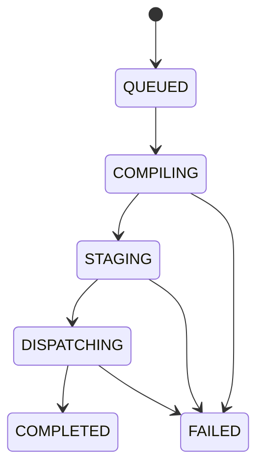

# Automated Fund Performance Reporting & Email Distribution — backend requirements specification

Full backend specification for the **Arcus Automated Fund Performance Reporting & Email Distribution Engine** (US-3.5.1–US-3.5.4). Frontend design session companion: [`design-sessions/fund-performance-reporting.md`](../design-sessions/fund-performance-reporting.md).

**Status:** Incremental — extends existing fund/LP stack (`Client`, capital calls, distributions, `PortfolioDashboardService`). New `fund_report_*` tables; does **not** reuse HR `ReportTemplate` / `GeneratedReport`.

---

## Table of contents

1. [Executive summary](#1-executive-summary)
2. [Architectural pillars](#2-architectural-pillars)
3. [Current codebase baseline](#3-current-codebase-baseline)
4. [Functional requirements — four epics](#4-functional-requirements--four-epics)
5. [Acceptance criteria traceability matrix](#5-acceptance-criteria-traceability-matrix)
6. [Process workflows](#6-process-workflows)
7. [Mathematical formulations](#7-mathematical-formulations)
8. [Proposed data model](#8-proposed-data-model)
9. [API specification](#9-api-specification)
10. [Email & storage integration](#10-email--storage-integration)
11. [Security, RBAC, and auditing](#11-security-rbac-and-auditing)
12. [Non-functional requirements](#12-non-functional-requirements)
13. [Implementation phases](#13-implementation-phases)
14. [Testing and UAT checklist](#14-testing-and-uat-checklist)
15. [Swagger and OpenAPI](#15-swagger-and-openapi)

---

## 1. Executive summary

### 1.1 Problem statement

Manual compilation and email distribution of fund performance packs is labor-intensive, error-prone, and risks data leakage (e.g. board metrics sent to LPs). VC/PE reporting demands computational accuracy, prompt delivery, and privacy isolation per recipient.

### 1.2 Solution

A programmatic pipeline that:

1. **Schedules or on-demand triggers** report compilation runs per fund/template/period.
2. **Compiles** per-recipient PDFs from ledger-sourced metrics (Investor vs Board templates).
3. **Stages** attachments (direct email or secure link when >10MB).
4. **Distributes** via thin wrapper over existing ZeptoMail SMTP transport.
5. **Audits** every list change, send attempt, bounce, and download.

### 1.3 Module split

| Scope | Base path |
|-------|-----------|
| GP console (templates, schedules, lists, runs) | `/api/fund-reporting/*` |
| LP investor UI | **`/api/lp-portal/*`** — see [`docs/lp-portal-backend-requirements.md`](./lp-portal-backend-requirements.md) |
| Ops cron | `/api/cron/fund-reporting/*` (omitted from Swagger) |
| Email webhook stub | `/api/fund-reporting/webhooks/email-delivery` |

**Swagger:** single tag **`Fund Performance Reporting`**.

### 1.4 Arcus adaptations (vs generic spec)

| Spec | Arcus implementation |
|------|---------------------|
| `lp_users` | `Client` + nullable `Client.userId` → `User` (`LIMITED_PARTNER`) |
| Redis queue | DB-backed `fund_report_runs` + in-process worker pool |
| AWS S3 presigned | `RemoteUploadService` + `FundReportDownloadToken` (7-day TTL) |
| AWS SES webhooks | Nodemailer send logging + webhook stub for future provider |
| Jinja2 HTML→PDF | pdfkit (`lpFundPerformancePdf.ts`) + HTML email templates |

---

## 2. Architectural pillars

1. **Decoupled generation & delivery** — `FundReportRunOrchestrator` compiles PDFs; `FundPerformanceEmailService` sends mail only.
2. **Bulletproof multi-tenant isolation** — each `FundReportRecipientJob` compiles metrics for one `clientId`; no shared PDF buffers across recipients.
3. **Frictionless delivery optimization** — `FundReportAssetStager` switches to `SECURE_LINK` when PDF exceeds `FUND_REPORT_ATTACH_MAX_BYTES` (default 10MB).

---

## 3. Current codebase baseline

### 3.1 Existing assets

| Asset | Relevance |
|-------|-----------|
| `Client`, `InvestmentCommitment` | LP identity + fund linkage |
| `CapitalCallAllocation`, `DistributionAllocation` | Paid-in, distributions per LP |
| `PortfolioDashboardService` | Fund-level TVPI/DPI/MOIC/IRR |
| `capitalCallNoticePdf.ts` | pdfkit + letterhead pattern |
| `CapitalCallService.sendNotices` | Batch email pool + per-recipient PDF |
| `email.config.ts` / `emailTransport` | ZeptoMail SMTP |
| `RemoteUploadService` | File upload + public-media proxy |
| `ReportingRemindersCronController` | Cron secret auth pattern |
| `LIMITED_PARTNER` role | `hardcodedRoles.ts` — wire to LP portal |

### 3.2 Gap summary

| Capability | Maturity |
|------------|----------|
| Per-LP TVPI/DPI/NAV/IRR | ❌ |
| Fund performance PDF | ❌ |
| Report run orchestration | ❌ |
| LP portal for reports | ❌ |
| Distribution list + audit | ❌ |
| Schedule cron for fund reports | ❌ |

**Board pack variance sections:** PARTIAL until forecasting + accounting sub-ledger queries are exposed — investor pack ships in P1.

---

## 4. Functional requirements — four epics

### Epic 1 — Schedule & on-demand execution (US-3.5.1)

**Backend must:**

1. CRUD `FundReportSchedule` with period types: MONTHLY, QUARTERLY, SEMI_ANNUAL, ANNUAL.
2. `POST /fund-reporting/runs` — on-demand run (fundId, templateId, periodStart, periodEnd, optional clientIds[]).
3. `POST /api/cron/fund-reporting/schedule-tick` — evaluate due schedules, create runs (cron secret).
4. Parent `FundReportRun` tracks status and progress counters.

### Epic 2 — Template-driven packaging (US-3.5.2)

**Backend must:**

1. CRUD `FundReportTemplate` with `reportLevel`: INVESTOR | BOARD.
2. Resolve all template variables via `LpFundMetricsService` — no hardcoded KPI constants.
3. `buildLpFundPerformancePdf` — investor pack: commitments, paid-in, distributions, holdings summary, DPI, TVPI, Net IRR.
4. Board pack adds variance/overhead sections when data sources available.

### Epic 3 — Permissioned distribution (US-3.5.3)

**Backend must:**

1. CRUD `FundReportDistributionList` bound to fund + sourceType (ROLE | COMMITMENT_COHORT).
2. Resolve recipients from active `Client` rows with verified `User.email` when user-linked.
3. Reject manual email override unless address matches directory.
4. `FundReportAuditEvent` on list/template mutations (author, timestamp, JSON diff).

### Epic 4 — Mail monitoring & failover (US-3.5.4)

**Backend must:**

1. `FundReportDistributionLog` — SENT, DELIVERED, BOUNCE, COMPLAINT, FAILED, DOWNLOAD.
2. Up to 3 SMTP retries with backoff `T = 2^retryCount × 10` seconds on transient errors.
3. >10MB PDF → upload + `FundReportDownloadToken` (7-day expiry) + link in email.
4. Webhook stub updates log; hard bounce may flag client inactive.
5. `GET /runs/:runId/logs` for admin console.

---

## 5. Acceptance criteria traceability matrix

| ID | Requirement | API / component |
|----|-------------|-----------------|
| US-3.5.1-A1 | Cron schedules Quarterly/Monthly/etc. | `FundReportSchedule`, schedule-tick cron |
| US-3.5.1-A2 | On-demand run per fund/cohort | `POST /fund-reporting/runs` |
| US-3.5.1-A3 | Parent `report_runs` record | `FundReportRun` |
| US-3.5.2-A1 | HTML/CSS → PDF rendering | `lpFundPerformancePdf.ts` |
| US-3.5.2-A2 | Investor vs Board structures | `reportLevel` on template |
| US-3.5.2-A3 | Variables from ledger APIs | `LpFundMetricsService` |
| US-3.5.3-A1 | Lists from Client/User records | `FundReportDistributionService` |
| US-3.5.3-A2 | No unverified email override | run validation |
| US-3.5.3-A3 | Audit on list changes | `FundReportAuditEvent` |
| US-3.5.4-A1 | Delivery event tracking | `FundReportDistributionLog` + webhook stub |
| US-3.5.4-A2 | 3 retries exponential backoff | `FundPerformanceEmailService` |
| US-3.5.4-A3 | 10MB → secure link 7 days | `FundReportAssetStager` |

---

## 6. Process workflows

### Run state machine

`QUEUED → COMPILING → STAGING → DISPATCHING → COMPLETED | FAILED`

Per recipient job: `PENDING → COMPILED → STAGED → SENT → DELIVERED | BOUNCED | FAILED`



---

## 7. Mathematical formulations

### 7.1 Cash balance (Eq. 1)

$$S_{closing} = S_{opening} + \sum C_x - \sum D_y$$

### 7.2 FX conversion (Eq. 2)

$$A_{base} = A_{transaction} \times R_d$$

Use transaction-date rate `R_d`, not spot.

### 7.3 TVPI (Eq. 3)

$$TVPI = \frac{\sum D_{dist} + NAV}{\sum C_{called}}$$

Per LP: pro-rata NAV from fund FMV × (LP paid-in / fund paid-in).

### 7.4 DPI (Eq. 4)

$$DPI = \frac{\sum D_{dist}}{\sum C_{called}}$$

### 7.5 RVPI (Eq. 5)

$$RVPI = \frac{NAV}{\sum C_{called}}$$

### 7.6 Retry backoff (Eq. 6)

$$T_{backoff} = 2^{retry\_count} \times 10 \text{ seconds}$$

---

## 8. Proposed data model

### 8.1 Client extension

- `clients.user_id` VARCHAR(191) NULL UNIQUE → `users.id`

### 8.2 New tables

- `fund_report_templates`
- `fund_report_schedules`
- `fund_report_distribution_lists`
- `fund_report_runs`
- `fund_report_recipient_jobs`
- `fund_report_distribution_logs`
- `fund_report_download_tokens`
- `fund_report_audit_events`

Migration: `npm run db:migrate:fund-performance-reporting`

---

## 9. API specification

Base: `/api/fund-reporting`. Auth: Bearer JWT.

### Templates

| Method | Path |
|--------|------|
| GET/POST | `/templates` |
| GET/PUT/DELETE | `/templates/:id` |

### Schedules

| Method | Path |
|--------|------|
| GET/POST | `/schedules` |
| GET/PUT/DELETE | `/schedules/:id` |

### Distribution lists

| Method | Path |
|--------|------|
| GET/POST | `/distribution-lists` |
| GET/PUT/DELETE | `/distribution-lists/:id` |

### Runs

| Method | Path |
|--------|------|
| GET/POST | `/runs` |
| GET | `/runs/:runId` |
| GET | `/runs/:runId/logs` |
| GET | `/runs/:runId/recipients` |

### LP portal

| Method | Path |
|--------|------|
| — | **Moved to LP Portal module** — [`docs/lp-portal-backend-requirements.md`](./lp-portal-backend-requirements.md) (`/api/lp-portal/*`) |

### Public / token

| Method | Path |
|--------|------|
| GET | `/download/:token` | Secure link (email CTA) |

### Webhook

| Method | Path |
|--------|------|
| POST | `/webhooks/email-delivery` |

### Staff — client linkage

| Method | Path |
|--------|------|
| PUT | `/api/clients/:id/link-user` | Body: `{ userId }` |

### Cron (ops only)

| Method | Path |
|--------|------|
| POST | `/api/cron/fund-reporting/schedule-tick` |

---

## 10. Email & storage integration

### FundPerformanceEmailService

Thin wrapper:

```typescript
sendFundPerformanceReportEmail({ to, subject, html, attachments?, jobId })
```

Delegates to `emailTransport.sendMail` + `getFromAddress('finance')`. Logs to `FundReportDistributionLog`.

### Asset stager

- `FUND_REPORT_ATTACH_MAX_BYTES` default `10485760` (10MB)
- `FUND_REPORT_LINK_TTL_DAYS` default `7`
- Upload type: `fund-performance-reports`

---

## 11. Security, RBAC, and auditing

| Route group | Roles |
|-------------|-------|
| GP console | admin, fund_manager, cfo |
| LP portal | LIMITED_PARTNER roles via [`lp-portal` module](./lp-portal-backend-requirements.md) |
| Cron | `FUND_REPORTING_CRON_SECRET` header |
| Webhook | `FUND_REPORTING_WEBHOOK_SECRET` (optional) |

LP download: verify `job.clientId` matches user's linked client.

---

## 12. Non-functional requirements

- Unique PDF per recipient in batch runs (QA: 100 recipients no cross-contamination).
- Email concurrency: `FUND_REPORT_EMAIL_CONCURRENCY` (default 10).
- Idempotent migration script.
- Cron omitted from Swagger.

---

## 13. Implementation phases

| Phase | Deliverable |
|-------|-------------|
| P0 | Design + requirements docs |
| P1 | Migration, metrics engine, investor PDF, template CRUD |
| P2 | Email wrapper, stager, distribution lists + audit |
| P3 | Run orchestrator, on-demand + schedule cron |
| P4 | LP portal + client link-user |
| P5 | Webhook stub, Swagger, UAT |

---

## 14. Testing and UAT checklist

- `npm run uat:fund-reporting:core` — templates, run, LP portal
- `npm run uat:fund-reporting:distribution` — large file fallback, token expiry
- `src/tests/lpFundMetrics.test.ts` — TVPI/DPI/RVPI

Pre-flight QA (from product spec):

- 100 unique PDFs per run without cross-contamination
- >10MB → secure link in email
- Expired token returns 410
- Bounce logged in `fund_report_distribution_logs`

---

## 15. Swagger and OpenAPI

- File: `src/config/fund-performance-reporting-swagger-paths.ts`
- Tag: **`Fund Performance Reporting`**
- Summaries: `US-3.5.1` … `US-3.5.4` prefixes
- Register in `swagger.ts` + `SWAGGER_PROTECTED_TAGS`
- Cron routes **omitted**

Ops: `docs/fund-performance-reporting-ubuntu-cron-setup.md`
