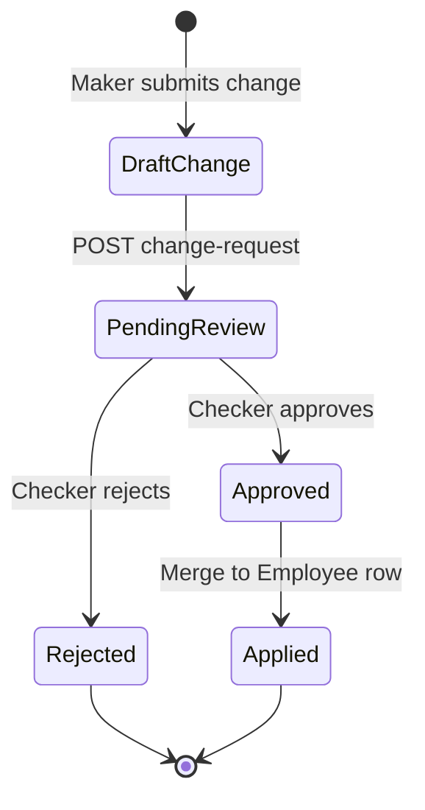
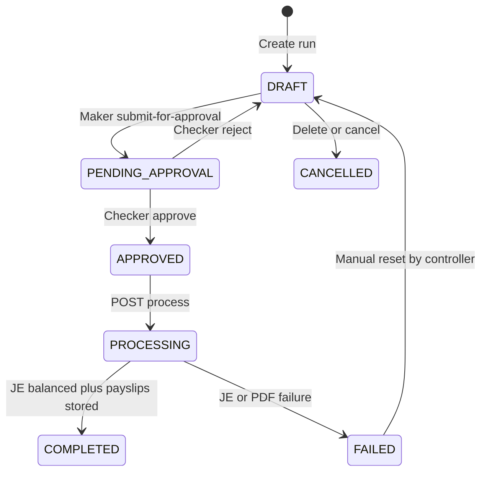

# Payroll, Employment & Training — backend requirements specification

Full backend specification for the **Arcus Payroll, Employment, and Training Records** module (US-3.13.1–US-3.13.4). Frontend design session companion: [`design-sessions/payroll-employment-training.md`](../design-sessions/payroll-employment-training.md).

**Status:** Incremental — extends the existing payroll module (`Employee`, `PayrollRun`, `PayrollService`, `/api/payroll/*`). Section B (Employment & Training / compliance) is largely net-new.

**Related docs:** [Chart of accounts + payroll posting](../payroll-and-coa-spec-verification.md) · [Performance ↔ payroll data flow](../performance-contracts-scorecards-data-flow.md)

---

## Table of contents

1. [Executive summary](#1-executive-summary)
2. [Architectural pillars](#2-architectural-pillars-non-negotiable)
3. [Current codebase baseline](#3-current-codebase-baseline)
4. [Functional requirements — four epics](#4-functional-requirements--four-epics)
5. [Acceptance criteria traceability matrix](#5-acceptance-criteria-traceability-matrix)
6. [Process workflows](#6-process-workflows)
7. [Mathematical formulations and payroll engine](#7-mathematical-formulations-and-payroll-engine)
8. [Proposed data model](#8-proposed-data-model)
9. [API specification — Section A: Payroll](#9-api-specification--section-a-payroll)
10. [API specification — Section B: Employment & Training](#10-api-specification--section-b-employment--training)
11. [General Ledger posting matrix](#11-general-ledger-posting-matrix)
12. [Cross-module integrations](#12-cross-module-integrations)
13. [Security, RBAC, and maker-checker](#13-security-rbac-and-maker-checker)
14. [Auditing and compliance](#14-auditing-and-compliance)
15. [Non-functional requirements](#15-non-functional-requirements)
16. [Implementation phases](#16-implementation-phases)
17. [Testing and UAT checklist](#17-testing-and-uat-checklist)
18. [Swagger and OpenAPI](#18-swagger-and-openapi)

---

## 1. Executive summary

### 1.1 Problem statement

In private equity, asset management, and complex enterprise ecosystems, payroll and employee development are not isolated HR tasks — they are critical to **corporate compliance**, **financial auditability**, and **legal standing**. Manual spreadsheets and disconnected HR tools increase the risk of:

- Regulatory failures (ZIMRA PAYE, NSSA, SDL, AIDS Levy)
- Duplicate or unbalanced ledger entries
- Exposure of sensitive salary data
- Operational access by staff with expired compliance certifications

### 1.2 Solution — integrated human capital ledger

The Arcus **Payroll, Employment, and Training Records** module replaces fragmented workflows with a **transaction-aware human capital database** that connects:

- Employment agreements and dual-currency salary splits
- Statutory tax calculations
- Compliance training and certification records
- Automated double-entry postings to the central General Ledger

### 1.3 Module split (Swagger / API sections)

| Section | Scope | Base path (proposed) |
|---------|--------|----------------------|
| **A — Payroll** | Employee roster, runs, statutory engine, payslips, GL | `/api/payroll/*` (existing) |
| **B — Employment & Training** | Courses, certifications, expiry, permission revocation | `/api/payroll/compliance/*` (new) |

Section B is mounted under the payroll router namespace so HR/compliance screens share authentication and audit context with payroll, while Swagger exposes **two dedicated tags** for frontend discovery.

---

## 2. Architectural pillars (non-negotiable)

Developers must preserve these three pillars in every change:

### 2.1 Dual-currency balancing

- Process payroll items natively in **USD** and **ZIG** (ZWG).
- Use **transaction-date exchange rates** (not hardcoded stubs) for cross-currency display and reporting.
- Calculate statutory deductions **separately per currency leg** (see [Section 7](#7-mathematical-formulations-and-payroll-engine)).
- Maintain precise cost bases for tax and corporate reporting.

**Gap today:** `Employee.basicSalary` + single `currencyId`; `PayrollService.convertCurrency` uses a hardcoded 1:40 ratio. Must integrate `UsdZwgRateResolver` (or equivalent) and split-contract model.

### 2.2 Maker-checker governance

- Sensitive employment changes (basic salary, currency split %, bank details, contract terms) enter a **pending** state until a **second-level checker** approves.
- Payroll run **process/finalize** is blocked until the maker-checker approval cycle for that period is complete.
- Maker and checker must be **different users** (segregation of duties).

**Gap today:** `PUT /payroll/employees/:id` applies immediately; `POST …/process` has no approval gate. Reuse patterns from procurement `ApprovalRequest` / `BscStatutorySubmission` where applicable.

### 2.3 Continuous compliance validation

- Training and certification records are **hard security constraints** for system permissions.
- When a compliance certificate (e.g. Anti-Money Laundering) **expires**, the system must **immediately revoke** corresponding operational permissions in other modules.
- Warn employees and compliance managers **30 days** before expiration.

**Gap today:** No certification registry; BSC training counter only increments a performance KPI. Net-new Section B.

---

## 3. Current codebase baseline

### 3.1 Existing models (keep / extend)

| Model | Table | Role |
|-------|-------|------|
| `Employee` | `employees` | Roster linked to `User`; `basicSalary`, `currencyId`, bank fields, `terminated` |
| `PayrollRun` | `payroll_runs` | Period run; `PayrollStatus`: DRAFT → PROCESSING → COMPLETED |
| `EmployeePayroll` | `employee_payrolls` | Per-employee run snapshot |
| `TaxRules` | `tax_rules` | PAYE / NSSA / AIDS_LEVY config (simplified flat logic) |
| `DeductionTypes` | `deduction_types` | Statutory + custom codes (PAYE, NSSA, AIDS_LEVY, PENSION) |
| `Payslip` | `payslips` | Totals; `pdfPath` / `isGenerated` largely unused |
| `SalaryStructure` | `salary_structures` | Recurring allowances per employee |

**Key files:** [`src/services/PayrollService.ts`](../src/services/PayrollService.ts) · [`src/routes/payrollRoutes.ts`](../src/routes/payrollRoutes.ts) · [`src/utils/payslipPdf.ts`](../src/utils/payslipPdf.ts) · [`src/services/payrollGlAccountResolver.ts`](../src/services/payrollGlAccountResolver.ts)

### 3.2 Gap summary by epic

| Epic | Maturity | Primary gaps |
|------|----------|--------------|
| US-3.13.1 Profile & lifecycle | Partial | Split salary, ZIMRA BP, department code, SUSPENDED status, maker-checker |
| US-3.13.2 Statutory payroll | Partial | ZIMRA brackets, AIDS on PAYE, SDL, dual-currency runs, process approval |
| US-3.13.3 Training & certs | Minimal | Full tracker, expiry cron, notifications, permission revocation |
| US-3.13.4 GL + payslips | Partial–good | Fail-closed JE, persisted PDF, SHA-256, SDL liability account |

---

## 4. Functional requirements — four epics

### Epic 1 — Employee directory & lifecycle management (US-3.13.1)

**As an** HR Operations Manager, **I want** to register employee profiles and configure contract parameters (currency split, bank details), **so that** we maintain a central directory of active employment records.

**Backend must:**

1. Store profile parameters: legal name (via linked `User`), contact details, national ID/passport (`idNumber`), ZIMRA BP number, department code.
2. Support **split-currency salary contracts** (e.g. 70% USD / 30% ZIG) with validation that splits sum to 100%.
3. Support lifecycle statuses: **ACTIVE**, **SUSPENDED**, **TERMINATED** (extend beyond boolean `terminated` / `isActive`).
4. Route sensitive field changes through **maker-checker** (see [Section 6.1](#61-employee-profile-maker-checker)).
5. Expose `lineManagerUserId` on create/update APIs (exists in schema, not fully exposed).

### Epic 2 — Dual-currency payroll calculation engine (US-3.13.2)

**As a** Payroll Officer, **I want** automatic gross pay, statutory deductions (ZIMRA PAYE, AIDS Levy, NSSA Pension, Standards Development Levy), and net salaries across split currencies, **so that** we eliminate calculation errors and ensure legislative compliance.

**Backend must:**

1. Evaluate **ZIMRA progressive tax brackets separately** for USD and ZIG components ([Eq. 1](#71-statutory-paye-tax-calculations-zimra-brackets)).
2. Calculate AIDS Levy as **3% of PAYE** ([Eq. 2](#72-aids-levy-surcharge-calculation)), not % of gross.
3. Apply NSSA pension cap ([Eq. 3](#73-nssa-national-pension-contributions)) and SDL (configurable rate).
4. Block payroll **process** until maker-checker approval cycle is complete for the run and for any pending salary changes affecting included employees.
5. Produce per-currency `EmployeePayroll` breakdown rows (or nested currency legs on one row — see [Section 8](#8-proposed-data-model)).

### Epic 3 — Compliance & certification tracker (US-3.13.3)

**As a** Compliance Officer, **I want** to assign mandatory training, log certification status, and track renewal dates, **so that** we maintain corporate audit policy compliance.

**Backend must:**

1. CRUD **training courses** and assign them to roles and/or department codes.
2. Record **employee certifications**: course ID, issue date, expiration date, verified certificate upload key (+ SHA-256).
3. Cron/job: notify employee + compliance manager **30 days** before expiry.
4. On expiry (or forced recertification): **revoke mapped permissions/roles** immediately; audit HIGH priority.

### Epic 4 — Double-entry ledger posting (US-3.13.4)

**As a** Financial Controller, **I want** balanced journal postings when a payroll period is finalized and tamper-evident pay slip PDFs, **so that** the balance sheet reflects current payroll liabilities accurately.

**Backend must:**

1. On finalize/approve: call Accounting module to post balanced JEs — DR salary expense, CR payroll clearing, PAYE, pension, SDL liabilities ([Section 11](#11-general-ledger-posting-matrix)).
2. **Fail-closed:** if JE is unbalanced or accounts missing, run status must not reach COMPLETED.
3. Generate individual payslip PDFs; **persist** to remote storage; store **SHA-256** hash; expose download + verify endpoints.

---

## 5. Acceptance criteria traceability matrix

Every acceptance criterion from the product spec, mapped to backend behavior, API touchpoint, frontend screen (see design session), and implementation status.

| ID | Acceptance criterion | Backend behavior | API (section) | Frontend screen | Status |
|----|------------------------|------------------|---------------|-----------------|--------|
| US-3.13.1-A1 | Legal name, contact, national ID/passport, tax ID (ZIMRA BP), department code | Extend `Employee` + `User` fields; validate uniqueness | `POST/PUT /payroll/employees` (A) | Employee profile form | **Extend** |
| US-3.13.1-A2 | Split currency allocations (e.g. 70% USD / 30% ZIG) | `salarySplitUsdPct` / `salarySplitZigPct`; gross split per leg | `POST/PUT /payroll/employees` or change-request (A) | Split salary panel | **New** |
| US-3.13.1-A3 | Statuses ACTIVE, SUSPENDED, TERMINATED | `lifecycleStatus` enum; suspend excludes from runs | `PUT …/employees/:id`, `POST …/terminate` (A) | Register status badge | **Extend** |
| US-3.13.1-A4 | Maker-checker on salary, split, bank, contract | `EmployeeChangeRequest` workflow | `POST …/change-requests`, `POST …/approve` (A) | Pending vs live profile | **New** |
| US-3.13.2-A1 | Brackets evaluated separately USD and ZIG | `ZimraTaxBracket` lookup per currency leg | `GET/PUT /payroll/statutory/brackets` (A) | Statutory config admin | **New** |
| US-3.13.2-A2 | AIDS Levy = 3% of PAYE | Fix `calculateAIDSLevy` to use T_base × 0.03 | Internal engine (A) | Deduction lines on slip | **Fix** |
| US-3.13.2-A3 | SDL included in statutory run | `StatutoryLevyConfig` type SDL | Engine + `/statutory/sdl` (A) | SDL line on slip | **New** |
| US-3.13.2-A4 | Block manual salary adjust until maker-checker complete | Reject PATCH if pending change; gate process | `POST …/process` (A) | Disabled Run button | **New** |
| US-3.13.3-A1 | Assign courses to roles/departments | `TrainingAssignment` scope | `POST /payroll/compliance/assignments` (B) | Course assignment UI | **New** |
| US-3.13.3-A2 | Cert: course ID, issue/expiry, upload key | `EmployeeCertification` + file storage | `POST …/certifications` multipart (B) | Cert upload grid | **New** |
| US-3.13.3-A3 | 30-day expiry warnings | Cron + notification service | `POST /cron/payroll/compliance/expiry-check` (B) | Warning banners | **New** |
| US-3.13.3-A4 | Expiry revokes permissions | RBAC sync hook on cert status | Internal + audit (B) | EXPIRED badge + locked modules | **New** |
| US-3.13.4-A1 | Balanced JE on finalize | `createPayrollJournalEntry` fail-closed | `POST …/process` or `…/finalize` (A) | Finalize confirmation | **Extend** |
| US-3.13.4-A2 | DR expense, CR clearing + liabilities | See [Section 11](#11-general-ledger-posting-matrix) | Accounting integration (A) | — | **Partial** |
| US-3.13.4-A3 | Payslip PDF with SHA-256 | Persist PDF + hash on `PayslipDocument` | `GET …/payslips/:id/download` (A) | Slip + integrity badge | **New** |

---

## 6. Process workflows

### 6.1 Employee profile maker-checker



**Sensitive fields (require maker-checker):** `basicSalary`, `salarySplitUsdPct`, `salarySplitZigPct`, `bankName`, `branchCode`, `accountNumber`, `contractEffectiveDate`, `departmentCode`.

**Non-sensitive fields (direct update allowed):** `pictureUrl`, `address`, `nextOfKin`, `nextOfKinContact`.

### 6.2 Payroll run lifecycle



**Extend `PayrollStatus` enum:** add `PENDING_APPROVAL`, `APPROVED`, `FAILED` (or parallel `PayrollRunApproval` table).

### 6.3 Certification expiry and permission revocation

1. Daily cron scans `EmployeeCertification` where `expirationDate <= today + 30 days`.
2. T-30: enqueue notifications (employee, compliance manager, line manager optional).
3. T-0: set status `EXPIRED`; call `CompliancePermissionService.revokeForCert(courseId, employeeId)`.
4. Write HIGH-priority audit log; optional webhook to disable specific module routes.

---

## 7. Mathematical formulations and payroll engine

All monetary calculations use `Decimal` (Prisma) with **3 decimal places** for ZIG sub-cent remainders where needed; USD typically **2 dp** on payslip display, store at full precision internally.

### 7.0 Split salary allocation

Let $B$ be total contractual basic salary (reference currency, usually USD). Let $p_{usd}$ and $p_{zig}$ be split percentages ($p_{usd} + p_{zig} = 1$).

$$G_{usd} = B \cdot p_{usd} + \text{(USD-denominated allowances)} \tag{0a}$$

$$G_{zig} = B \cdot p_{zig} \cdot R_{tx} + \text{(ZIG-denominated allowances)} \tag{0b}$$

Where $R_{tx}$ is the transaction-date USD→ZIG rate when converting the ZIG leg from a USD reference contract. Allowances may already be currency-tagged via `SalaryStructure.currencyId`.

### 7.1 Statutory PAYE tax calculations (ZIMRA brackets)

Let $G$ represent gross monthly salary **in a designated currency** (USD leg or ZIG leg separately). The monthly PAYE tax is computed by locating bracket $i$ such that $G$ falls within statutory bounds. Let $B_i$ be the upper bound of bracket $i$, $r_i$ the marginal rate, and $D_i$ the deduction offset for that bracket.

$$T_{base} = (G \cdot r_i) - D_i \tag{1}$$

If $G$ is below the tax-free threshold, $T_{base} = 0$.

**Implementation:** Replace flat `TaxRules` PAYE with `ZimraTaxBracket` rows:

| Field | Description |
|-------|-------------|
| `currencyCode` | USD or ZIG |
| `effectiveFrom` / `effectiveTo` | Date range |
| `lowerBound` / `upperBound` | Bracket band |
| `marginalRate` | $r_i$ (fraction, e.g. 0.20) |
| `deductionOffset` | $D_i$ |

**Worked example (USD leg, illustrative brackets):**

- $G = 3500$ USD, bracket $r_i = 0.20$, $D_i = 175$
- $T_{base} = (3500 \times 0.20) - 175 = 525$ USD

**Worked example (ZIG leg):**

- $G = 47320$ ZIG, same bracket parameters scaled for ZIG table
- Apply ZIG-specific `ZimraTaxBracket` rows (admin-maintained).

### 7.2 AIDS Levy surcharge calculation

$$L_{aids} = T_{base} \times 0.03 \tag{2}$$

**Critical fix:** Current code applies AIDS as % of **gross** via `calculateAIDSLevy(grossPay, taxRule)`. Must change to % of **PAYE** only.

Using USD example: $L_{aids} = 525 \times 0.03 = 15.75$ USD.

### 7.3 NSSA national pension contributions

Let $G_{pensionable}$ be pensionable earnings, capped by monthly ceiling $C_{nssa}$. Employee rate $r_{nssa} = 0.045$ (4.5%).

$$P_{nssa} = \min(G_{pensionable}, C_{nssa}) \times r_{nssa} \tag{3}$$

**Employer mirror:** $P_{nssa}^{employer} = P_{nssa}$ (same base and rate; post to separate GL sub-account or combined 2160 per local policy).

**Worked example:** $G = 3500$, $C_{nssa} = 700$, $P_{nssa} = 700 \times 0.045 = 31.50$ USD.

### 7.4 Standards Development Levy (SDL)

Referenced in US-3.13.2 but not in original Eq. 4. Model as:

$$L_{sdl} = G \times r_{sdl} \tag{3b}$$

Where $r_{sdl}$ is configured in `StatutoryLevyConfig` (default per Finance Act — store in config, not hard-coded). SDL is typically employer-borne; if employee deduction required, include in $O_{ded}$.

### 7.5 Net monthly salary formulation

$$S_{net} = G_{gross} - T_{base} - L_{aids} - P_{nssa} - L_{sdl} - O_{ded} \tag{4}$$

Calculated **separately for USD and ZIG legs**. Optional benefits and non-statutory deductions sum into $O_{ded}$ per currency.

**Worked example (USD leg):**

| Line | Amount (USD) |
|------|----------------|
| Gross $G$ | 3,500.00 |
| PAYE $T_{base}$ | 425.00 |
| AIDS Levy | 12.75 |
| NSSA | 157.50 |
| SDL (if employee) | 0.00 |
| Other deductions | 0.00 |
| **Net** | **2,904.75** |

(ZIG leg computed independently with ZIG gross and ZIG brackets.)

### 7.6 Rounding policy

| Step | Rule |
|------|------|
| Statutory line items | Round half-up to currency minor units (USD 2 dp, ZIG 2–3 dp) |
| Net pay | Sum rounded lines; store unrounded in `EmployeePayroll` if needed for GL tie-out |
| GL posting | Must tie to sum of employee nets within 0.01 tolerance per currency |

---

## 8. Proposed data model

### 8.1 Extend `Employee`

```prisma
// Proposed fields (migration script — not yet in schema)
lifecycleStatus     String   @default("ACTIVE") // ACTIVE | SUSPENDED | TERMINATED
departmentCode      String?
zimraBpNumber       String?
salarySplitUsdPct   Decimal  @default(1.0)      // 0..1
salarySplitZigPct   Decimal  @default(0.0)      // 0..1; usd + zig = 1
contractEffectiveDate DateTime?
```

Keep existing `terminated` / `terminatedAt` in sync with `lifecycleStatus = TERMINATED`.

### 8.2 New: `EmployeeChangeRequest`

| Field | Type | Notes |
|-------|------|-------|
| `id` | cuid | PK |
| `employeeId` | FK | Target employee |
| `changeType` | enum | SALARY, SPLIT, BANK, CONTRACT, DEPARTMENT |
| `payload` | JSON | Proposed field values |
| `status` | enum | PENDING, APPROVED, REJECTED |
| `makerUserId` | FK | Submitter |
| `checkerUserId` | FK? | Approver |
| `submittedAt` / `resolvedAt` | DateTime | Audit timestamps |

### 8.3 New: `PayrollRunApproval`

| Field | Type | Notes |
|-------|------|-------|
| `payrollRunId` | FK | Unique per run |
| `status` | enum | PENDING, APPROVED, REJECTED |
| `makerUserId` / `checkerUserId` | FK | Segregation |
| `journalEntryId` | FK? | Set on successful finalize |

Add `journalEntryId` on `PayrollRun` when JE succeeds.

### 8.4 New: `ZimraTaxBracket` + `StatutoryLevyConfig`

Replace flat PAYE `TaxRules` for ZIMRA compliance; keep `TaxRules` for legacy/custom levies if needed.

`StatutoryLevyConfig` keys: `NSSA_CEILING_USD`, `NSSA_CEILING_ZIG`, `NSSA_RATE`, `AIDS_RATE` (0.03), `SDL_RATE`, effective dates.

### 8.5 New: Employment & Training (Section B)

**`TrainingCourse`**

| Field | Notes |
|-------|-------|
| `code` | e.g. `AML-SEC-01` |
| `title`, `description` | Display |
| `renewalPeriodMonths` | Default validity |
| `requiredPermissionCodes` | JSON array — permissions revoked on expiry |

**`TrainingAssignment`**

| Field | Notes |
|-------|-------|
| `courseId` | FK |
| `scopeType` | ROLE \| DEPARTMENT \| ALL |
| `scopeValue` | role code or department code |

**`EmployeeCertification`**

| Field | Notes |
|-------|-------|
| `employeeId`, `courseId` | FKs |
| `issuedDate`, `expirationDate` | Required |
| `storagePath`, `fileUrl`, `sha256Checksum` | Upload |
| `status` | VALID \| EXPIRING \| EXPIRED \| REVOKED |
| `verifiedById` | Compliance officer |

### 8.6 Extend `Payslip` / `PayslipDocument`

Add to `Payslip` (or sibling table):

- `sha256Checksum` String
- `storagePath` / `fileUrl`
- `generatedAt`

Populate on process; stop relying on ephemeral email-only PDF buffers.

### 8.7 Dual-currency run shape

**Option A (recommended):** One `PayrollRun` with `currencyMode: DUAL`; each `EmployeePayroll` has child rows `EmployeePayrollLeg` (`currencyCode`, gross, deductions, net).

**Option B:** Two linked runs (USD run + ZIG run) — simpler migration but worse UX.

Spec assumes **Option A** for single period view (matches wireframe JUNE-2026 ZIG/USD Splitting).

---

## 9. API specification — Section A: Payroll

Base: `/api/payroll`. Auth: `Bearer` JWT. Existing routes in [`payrollRoutes.ts`](../src/routes/payrollRoutes.ts).

### 9.1 Employees (extend)

| Method | Path | Change |
|--------|------|--------|
| POST | `/employees` | Add split %, department, ZIMRA BP, lifecycleStatus |
| GET | `/employees` | Filter by status, department; include pending change flag |
| PUT | `/employees/:id` | Non-sensitive only; sensitive → change-request |
| POST | `/employees/:id/terminate` | Set TERMINATED |
| POST | `/employees/:id/suspend` | **New** — SUSPENDED |
| POST | `/employees/:id/reinstate` | **New** — ACTIVE (HR only) |

### 9.2 Maker-checker (new)

| Method | Path | Body |
|--------|------|------|
| POST | `/employees/:id/change-requests` | `{ changeType, payload }` |
| GET | `/employees/:id/change-requests` | List pending/history |
| POST | `/change-requests/:requestId/approve` | Checker only |
| POST | `/change-requests/:requestId/reject` | `{ reason }` |

### 9.3 Payroll runs (extend)

| Method | Path | Change |
|--------|------|--------|
| POST | `/payroll-runs` | Support `dualCurrency: true`, FX rate snapshot id |
| POST | `/payroll-runs/:id/submit-for-approval` | **New** |
| POST | `/payroll-runs/:id/approve` | **New** — checker |
| POST | `/payroll-runs/:id/reject` | **New** |
| POST | `/payroll-runs/:id/process` | Gate: status APPROVED; fail-closed JE |
| GET | `/payroll-runs/:id` | Include per-currency totals, approval state |

### 9.4 Statutory configuration (new / extend)

| Method | Path | Purpose |
|--------|------|---------|
| GET/POST/PUT | `/statutory/brackets` | ZIMRA bracket CRUD |
| GET/PUT | `/statutory/levies` | NSSA ceiling, AIDS rate, SDL rate |
| GET/POST/PUT/DELETE | `/tax-rules` | Keep for backward compatibility |

### 9.5 Payslips (extend)

| Method | Path | Purpose |
|--------|------|---------|
| GET | `/payslips/:employeeId/:payrollRunId` | JSON breakdown (existing) |
| GET | `/payslips/:payslipId/download` | **New** — PDF stream |
| GET | `/payslips/:payslipId/verify` | **New** — `{ sha256, valid }` |

### 9.6 Employee portal (existing)

| Method | Path |
|--------|------|
| GET | `/employee/portal` |
| GET | `/employee/payslips` |
| GET | `/employee/leave-balances` |

Extend portal payslips with download + cert status summary (read-only link to Section B).

---

## 10. API specification — Section B: Employment & Training

Base: `/api/payroll/compliance`. Auth: Compliance Officer / HR Manager roles.

### 10.1 Courses

| Method | Path |
|--------|------|
| POST | `/courses` |
| GET | `/courses` |
| GET | `/courses/:id` |
| PUT | `/courses/:id` |
| DELETE | `/courses/:id` (soft) |

### 10.2 Assignments

| Method | Path |
|--------|------|
| POST | `/assignments` — `{ courseId, scopeType, scopeValue }` |
| GET | `/assignments` — filter by role, department |
| DELETE | `/assignments/:id` |

### 10.3 Employee certifications

| Method | Path |
|--------|------|
| POST | `/certifications` — multipart: `document`, metadata |
| GET | `/certifications` — filter employee, course, status |
| GET | `/certifications/:id` |
| PUT | `/certifications/:id` — renew |
| POST | `/certifications/:id/revoke` — manual compliance action |

### 10.4 Compliance dashboard & cron

| Method | Path |
|--------|------|
| GET | `/dashboard/expiring` — next 30/60/90 days |
| POST | `/cron/expiry-check` — internal/cron secret |

### 10.5 Permission sync (internal)

`CompliancePermissionService.syncEmployee(employeeId)` — called on cert create/update/expiry; not exposed to browser directly.

---

## 11. General Ledger posting matrix

On payroll finalize (per [payroll-and-coa-spec-verification.md](./payroll-and-coa-spec-verification.md)):

| Entry | Account | Direction | Amount source |
|-------|---------|-----------|---------------|
| Gross payroll expense | **5010** (prefer) or **5030** | DR | Sum gross all legs (base currency or split JE lines) |
| PAYE + AIDS liability | **2150** | CR | Sum PAYE + AIDS per classification |
| NSSA / pension liability | **2160** | CR | Sum NSSA employee (+ employer if accrued) |
| SDL liability | **2170** (proposed) | CR | Sum SDL |
| Net wages payable | **2250** | CR | Sum net pay |
| Bank payment (later) | **1100** / bank COA | CR | DR **2250** on payment run |

**Fail-closed:** If DR total ≠ CR total, throw `PAYROLL_JE_IMBALANCED`; run stays `FAILED` or `APPROVED` (not COMPLETED).

Link JE: `PayrollRun.journalEntryId`.

---

## 12. Cross-module integrations

| Module | Integration |
|--------|-------------|
| **Accounting GL** | `JournalEntryService.createJournalEntryWithAuditSequence`; COA ensure script |
| **Multi-currency FX** | Transaction-date rate from `UsdZwgRateResolver` / `MultiCurrencyService` |
| **RBAC** | Cert expiry → revoke permissions mapped on `TrainingCourse.requiredPermissionCodes` |
| **Notifications** | Email/in-app T-30 expiry (pattern: vendor tax revalidation alerts) |
| **Performance / BSC** | Optional: `POST …/certifications` also increments BSC training KPI when course linked to goal |
| **Audit** | `AuditService.log` for all maker-checker and compliance events |

---

## 13. Security, RBAC, and maker-checker

### 13.1 Roles

| Role | Capabilities |
|------|--------------|
| HR Operations Manager | Create/edit employees (maker), submit change-requests |
| HR Checker / Finance Manager | Approve/reject change-requests and payroll runs |
| Payroll Officer | Create runs, submit for approval, configure statutory tables |
| Compliance Officer | Section B full access |
| Financial Controller | Approve finalize, view JE linkage |
| Employee (portal) | Own payslips, own certs read-only |

### 13.2 Segregation rules

- `makerUserId !== checkerUserId` on all approvals.
- Payroll process requires role `payroll_manager` or `finance_manager` for checker step.
- Compliance cert upload requires `compliance_officer` or delegated HR.

---

## 14. Auditing and compliance

| Action | Priority | Payload |
|--------|----------|---------|
| EMPLOYEE_CHANGE_SUBMITTED | NORMAL | changeType, employeeId |
| EMPLOYEE_CHANGE_APPROVED / REJECTED | NORMAL | requestId, checkerId |
| PAYROLL_RUN_SUBMITTED | NORMAL | runId, period |
| PAYROLL_RUN_APPROVED | NORMAL | runId |
| PAYROLL_RUN_PROCESSED | HIGH | runId, journalEntryId |
| PAYROLL_JE_FAILED | HIGH | runId, error |
| CERT_ISSUED | NORMAL | courseId, employeeId |
| CERT_EXPIRING_SOON | NORMAL | daysRemaining |
| CERT_EXPIRED_PERMISSION_REVOKED | HIGH | courseId, permissions[] |
| PAYSLIP_GENERATED | NORMAL | payslipId, sha256 |

---

## 15. Non-functional requirements

| Requirement | Target |
|-------------|--------|
| Payroll process (100 employees, dual currency) | < 60s |
| Payslip PDF generation | Async batch; email after persist |
| Cert expiry cron | Daily 06:00 Africa/Harare |
| Uptime | Same as API SLA |
| PII | Encrypt bank account at rest (future); restrict payslip download to self + HR |
| Idempotency | Process endpoint idempotent per run status |

---

## 16. Implementation phases

| Phase | Epic | Deliverables |
|-------|------|--------------|
| **P1** | US-3.13.1 | Employee fields, lifecycle, change-request tables + APIs |
| **P2** | US-3.13.2 | ZIMRA brackets, AIDS fix, SDL, dual-currency legs, run approval |
| **P3** | US-3.13.4 | Fail-closed JE, payslip persist + SHA-256 + download |
| **P4** | US-3.13.3 | Section B courses/certs, cron, permission revocation |
| **P5** | Swagger | Two OpenAPI tags; UAT scripts |

---

## 17. Testing and UAT checklist

| Script (existing) | Phase |
|-------------------|-------|
| `npm run` → `scripts/verify-payroll-accounting-alignment.ts` | P3 |
| `scripts/detailed-payroll-journal-check.ts` | P3 |
| `scripts/test-fresh-payroll-run-no-double-tax.ts` | P2 |

**New UAT scripts (to add in implementation):**

- `uat-payroll-dual-currency-http.ts` — split salary, USD+ZIG deductions
- `uat-payroll-maker-checker-http.ts` — pending change blocks process
- `uat-payroll-compliance-http.ts` — cert expiry → permission revoked
- `uat-payroll-payslip-integrity-http.ts` — SHA-256 verify

---

## 18. Swagger and OpenAPI

Two tags in `/api-docs`:

1. **`Payroll`** — Section A routes (extend [`payroll-endpoints.ts`](../src/config/payroll-endpoints.ts))
2. **`Employment & Training`** — Section B routes (new `payroll-employment-training-swagger-paths.ts`)

Register in [`swagger.ts`](../src/config/swagger.ts) and [`SWAGGER_PROTECTED_TAGS`](../src/config/swagger-excluded-tags.ts) so production docs match Forecasting / PDF uploads visibility.

---

*Document version: 1.0 — 2026-06-15*
