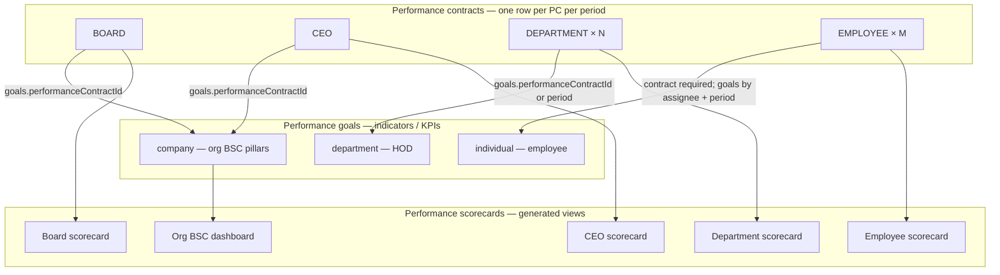
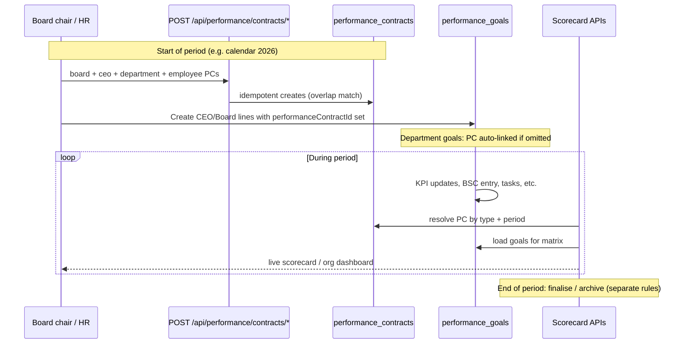
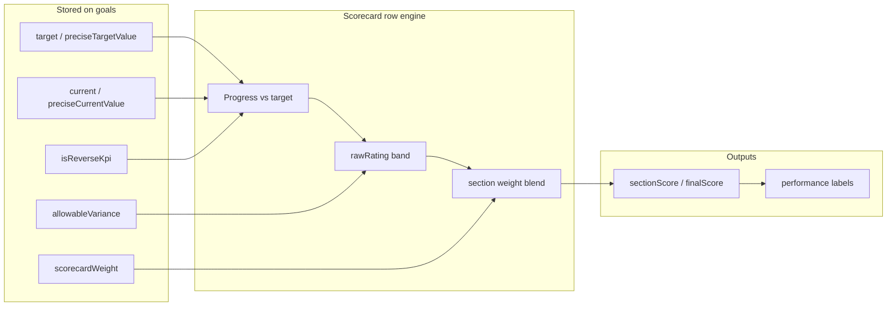

# Performance contracts, scorecards, and BSC data flow

This document verifies how **performance contracts (PCs)**, **goals**, **scorecards**, and **BSC digital entry** fit together after the payroll auto-PC removal and explicit PC APIs. Counts (1 board, 1 CEO, *N* departments, *M* employees) are **examples**; the system scales with how many PCs you create for the period.

---

## 1. Entity model (what holds what)

**Important:** CEO and Board scorecard code loads goals with **`where: { performanceContractId: contract.id }` only**. Those indicators must be created (or updated) on goals that reference the correct PC.

Organisational BSC (`getOrgBSCDashboard`) loads **`type: company`** goals by **`performanceContractId` **or** period overlap** on goal `startDate` / `endDate`, and optional `ORG_BSC` contract for weights.

---

## 2. Lifecycle (annual cycle — NVCCZ-style)

**Payroll:** creating an **employee** no longer creates a PC. Use **`POST /api/performance/contracts/employee`** (or the backfill script) so employee scorecards can resolve an **EMPLOYEE** contract for the period.

---

## 3. How each scorecard resolves its PC and goals

| Surface | PC resolution | Goals query (simplified) |
|--------|----------------|---------------------------|
| **Employee** | `EMPLOYEE` + `subjectUserId` + period overlap | `assignedToId`, `type: individual`, date overlap with scorecard period (contract required to exist) |
| **Department** | `DEPARTMENT` + `departmentName` + period overlap | `type: department`, `departmentName`, date overlap (contract **required**; throws if missing) |
| **CEO** | `CEO` / `ceo` + period overlap or `periodLabel` | **`performanceContractId = CEO PC id`** |
| **Board** | `BOARD` + period overlap or `periodLabel` | **`performanceContractId = Board PC id`** |
| **Org BSC** | Optional `ORG_BSC` contract for weights | `type: company` and (linked `performanceContractId` **or** period overlap) |

**CEO ↔ company goal automation** (`CeoPerformanceContractLinkService`):

- On **`POST /performance/goals`** with `type: company`: if an ACTIVE CEO PC overlaps the goal dates, set `performanceContractId` automatically (no CEO PC → leave null).
- On **`POST /performance/contracts/ceo`**: after create (or idempotent return of existing PC), link all overlapping `type: company` goals with null or matching `performanceContractId`; response includes **`linkedGoalCount`**.

Default **period** when the client sends nothing: scorecard service uses **current calendar month** (`currentPeriodBounds`) unless `periodLabel` is a 4-digit year (then **UTC full year**, aligned with PC creation via `periodYear` / `periodLabel: "2026"`).

**Recommendation:** for annual reviews, always pass **`periodLabel: "2026"`** (or explicit `periodStart` / `periodEnd`) on both **PC creation** and **scorecard** calls so behaviour matches.

---

## 4. Calculations (where numbers come from)

- **Department scorecard:** combines **direct** goal progress with **rollup** from finalised **employee** scorecards mapped via sub-goals; uses `computeGoalProgress`, `computeRawRating`, weight redistribution. See `getDepartmentScorecard` in `PerformanceScorecardService.ts`.
- **CEO / Board:** section rows from goals on the contract, `CEO_SECTION_WEIGHTS` / `BOARD_SECTION_WEIGHTS`, optional budget blend on CEO.
- **BSC digital entry** (`BscDigitalEntryService`): updates a **single goal** by `goalId` (actual, `syncConfig`, audit). It does **not** create PCs; that goal must already belong to the right contract/pillar for the dashboard you care about.
- **BSC entry routes** (`POST /api/performance/bsc-entry/...`, `authenticate` only): `financial-outcome-roi`, `internal-process-funding-rate`, `stakeholder-survey`, `partnerships-signed`, `service-delivery-customer-charter`, `jobs-created-aggregate`, `resource-budget-alignment` (optional `criticalOverspendPercent`, default 15, triggers RED + activity log when spend exceeds allocation by more than that %), `inclusion-diversity-reporting`, `accounting-period-from-gl` (**no** required `goalId`; optional `revenueGoalId` / `netProfitGoalId` + `periodStart` / `periodEnd` for posted GL roll-up), `statutory-reports-output`, `governance-checklist-score`, `procurement-plan-compliance`, `ease-of-doing-business-progress`, `skills-development-progress`, `csr-participation-rate`.
- **BSC workflow** (`/api/performance/bsc-workflow`, `authenticate` only): `POST .../budget-variance-reports` (Flow 6 narrative tied to a budget-alignment goal), `GET .../budget-variance-reports/by-goal/:goalId`, `POST .../statutory-submissions` (increments statutory counter **and** creates a pending manager-review row), `POST .../statutory-submissions/:id/manager-sign-off`, `GET .../statutory-submissions/by-goal/:goalId`, `POST .../training-certificate-recorded` (body **`goalId` required**).
- **Financial outcome ROI:** `POST .../financial-outcome-roi` updates the given goal, then (unless `skipCeoBoardMirror: true`) copies the same ROI % to the first overlapping **CEO** and **Board** indicator with `formulaType: ROI` (seed CEO contract). CEO/Board scorecards read that value when `syncConfig.bscEntryKind === "FINANCIAL_OUTCOME_ROI"` (otherwise they keep the activities-based ROI formula). BSC applies also trigger **parent rollup** and **KPI recalc** when `parentGoalId` / `kpiId` are set. **Revert test writes:** `npm run db:revert:bsc-financial-roi-goal -- <goalId> [--with-mirrors]`.
- **GL → BSC (manual / scheduled externally):** `POST /api/performance/bsc-entry/accounting-period-from-gl` with `periodStart`, `periodEnd`, and optional `revenueGoalId` / `netProfitGoalId` — no in-app cron; a host scheduler can call this endpoint with a service user JWT if you add that later.
- **Payroll → BSC (optional):** `POST /api/payroll/employees` may include **`bscNewHireCounterGoalId`** (performance goal id). When present, the new-hire counter increment runs after the employee row is created (non-blocking); audit uses the authenticated payroll actor as `responsibleUserId`.

---

## 5. API alignment checklist

| Step | API / behaviour |
|------|------------------|
| Create PCs for the year | `POST /api/performance/contracts/board`, `/ceo`, `/department`, `/employee` (idempotent) |
| Link CEO indicators | Auto on company goal create + backfill on `POST /api/performance/contracts/ceo` (`linkedGoalCount`); or set **`performanceContractId`** manually on `POST /api/performance/goals` |
| Link Board indicators | `POST /api/performance/goals` with **`performanceContractId`** set to the Board PC id |
| Link department goals | Optional explicit `performanceContractId`; else first department goal still **ensures** a DEPARTMENT PC |
| Employee scorecard | Requires overlapping **EMPLOYEE** PC; goals typically by assignee + period |
| Feed BSC metrics | `POST /api/performance/bsc-entry/<name>` — **`goalId`** on the configured goal, except **`accounting-period-from-gl`** (period + optional goal ids). See route list in §4. |

---

## 6. Gaps and caveats (honest)

1. **Department name list** in `PerformanceGoalService` is still a fixed allow-list for validation; real departments in DB may need alignment with `User.userDepartment` and PC `departmentName`.
2. **`scorecardSection`** for CEO/Board matrix rows is not set in `createPerformanceGoal` by default; indicators may need to be created/updated through flows that set `scorecardSection` (or future API fields).
3. **Org BSC vs CEO/Board:** `company` goals can power the org dashboard by period; CEO/Board scorecards still need **`performanceContractId`** on those goals if they are the same rows (or duplicate indicators per surface — product choice).
4. **Timezone:** PCs default to **UTC** calendar year; scorecard default without year label uses **local** current month — both overlap correctly for in-year windows, but be explicit at year boundaries if you mix APIs.

---

## 7. Related code

| Area | Primary files |
|------|----------------|
| PC creation | `PerformanceContractSetupService.ts`, `performanceContractRoutes.ts` |
| Payroll (no PC) | `PayrollController.ts` |
| Department PC fallback | `DepartmentPerformanceContractService.ts` |
| Goal + contract link | `PerformanceGoalService.ts`, `PerformanceGoalController.ts` |
| Scorecards | `PerformanceScorecardService.ts` |
| CEO ↔ company link | `CeoPerformanceContractLinkService.ts` |
| BSC entry | `BscDigitalEntryService.ts`, `performanceBscEntryRoutes.ts` |
| Rating / weights helpers | `performanceScorecardSupport.ts`, `performanceGoalRollupUtils.ts` |

---

## 8. Principal review — workflow correctness & latency (≤ ~5s targets)

**Correctness**

- PCs are the period container; scorecards **resolve** them by `contractType` + period overlap (and label fallback for CEO/Board).
- CEO/Board matrices require goals with **`performanceContractId`** set to that PC.
- Employee scorecards require an **EMPLOYEE** PC; goals are matched primarily by assignee + date overlap.
- Department scorecards require a **DEPARTMENT** PC; department goals match `departmentName` + period.
- BSC digital entry updates **goals by id**; it does not create PCs. Internal-process funding rate sets **RED** only when below target; otherwise risk zone is **recomputed** from the new actual (same as other entries).

**Performance (implemented)**

- **BSC entry:** one goal `select` (narrow columns), single goal `update`, **no** follow-up `refreshPerformanceRiskZoneOnGoal` round-trip; **no** `recalculateKPIProgress` on each post (that helper was logging-only and added extra reads).
- **Partnerships / charter:** one read + apply with `preloadedGoal` (no double fetch).
- **CEO/Board contract resolution:** cap candidate rows at **15** (overlap/label match does not need 40).
- **Department scorecard:** department users query uses a **narrow `select`** instead of full `role` + `employee` includes.
- **MySQL:** optional indexes via `npm run db:migrate:performance-goals-indexes` (and matching `schema.prisma` `@@index` for `prisma generate` types). Run once per environment after deploy.

Heavy scorecard responses still depend on goal volume and JSON document build; if any endpoint exceeds ~5s, next steps are pagination, async PDF, or caching — not changed here to avoid behaviour shifts.
