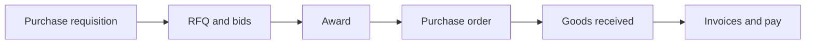

# Procurement operational workflow (post-configuration)

This document describes the **end-to-end procurement journey** in business order: what happens at each stage, typical **status** values, and **who** is expected to act. It intentionally **does not** cover how approval rules are configured (stages, steps, `roleCode`, amount thresholds); assume that is already in place so workflows can run.

For API-level UAT steps, migrations, and env vars, use the suite docs linked at the bottom.

---

## Two procurement tracks in this codebase

| Track | Who uses it | HTTP surface (always prefix `{{baseUrl}}`) | Purpose |
|-------|-------------|---------------------------------------------|---------|
| **A — Internal company procurement** | Staff (JWT): procurement department roles, finance, department heads, etc. Vendors hit **only** the public invoice endpoints on the same router. | **`/api/procurement/...`** (mostly JWT after two public invoice routes) · **`/api/procurement/suite06/...`** (Suite 06) · approval workflow config at **`/api/procurement-approval-configs/...`** | Day-to-day buying for **your organisation**: PR → RFQ → award → PO → GRN → pay (procurement invoice and/or accounting vendor bill + 3-way match). |
| **B — Investee / portfolio (drawdown PR)** | Investee **applicant JWT** for create/submit/cancel/GRN; staff use **some** shared `GET/PUT` on **`/api/procurement/requisitions/...`** for oversight and VC approval. | **`/api/applicant/procurement/...`** · plus **`/api/procurement/requisitions/investee`**, **`.../investee/sla-breached`**, shared **`PUT .../requisitions/:id/approve|reject`**, etc. | Portfolio-linked requisitions, tranche drawdown caps, use-of-funds, auto-RFQ after VC approval. |

**This document’s main body (sections 1–6)** describes **Track A — internal** procurement as implemented under **`src/routes/procurementRoutes.ts`**, **`ProcurementService`**, and related controllers. **Track B** is summarised only at the end with pointers to [procurement-uat.md](./procurement-uat.md) (Suite 02); do not confuse applicant paths with internal staff paths.

---

## Where it lives (code map)

| Area | Entry |
|------|--------|
| Internal procurement API | `src/routes/procurementRoutes.ts` → mounted at **`/api/procurement`** in `src/app.ts`. |
| Suite 06 (AI intake, 3-way match, CFO dashboard) | `src/routes/procurementSuite06Routes.ts` → **`/api/procurement/suite06`**. |
| Approval **configuration** (admin; not runtime “approve PR”) | `src/routes/procurementApprovalConfigRoutes.ts` → **`/api/procurement-approval-configs`**. |
| Investee portal | `src/routes/applicantPortalRoutes.ts` → paths under **`/api/applicant/procurement/...`**. |
| Core orchestration | `src/services/ProcurementService.ts` (requisitions, RFQ, PO, GRN, procurement invoices, etc.). |
| Drawdown / tranche rules | `src/services/InvesteeDrawdownProcurementService.ts` (when `portfolioCompanyId` + `drawdownRequestAmount` are present on a PR). |

**Authentication:** Almost everything under **`/api/procurement`** uses `authenticate` **except** the first two routes on the router: **`POST /api/procurement/invoices/upload-document`** and **`POST /api/procurement/invoices`** (vendor-submitted procurement invoices). Exact JWT / role hints per route are in **Swagger** (`/api-docs`) by tag (e.g. **Procurement - Requisitions**, **Procurement — RFQ & Bidding (Suite 03)**).

---

## Big picture — internal track (stages in order)

1. **Purchase requisition (PR)** — need is captured (department, items, optional sourcing category); submitted into **configured approval** and/or **department HEAD/DEPUTY** queues where applicable.
2. **RFQ & quotations** — competitive sourcing from **`POST /api/procurement/rfq`** (linked to PR when used).
3. **Award** — winning vendor side settled with **`POST /api/procurement/rfqs/:id/award`**.
4. **Purchase order (PO)** — **`POST /api/procurement/purchase-orders`** then internal workflow, **`POST .../send`** to vendor, optional vendor **ack** via token (`GET /api/procurement/purchase-orders/verify`).
5. **GRN** — receipt against PO (**`POST /api/procurement/goods-received-notes`**); optional **return-to-vendor** (**`POST /api/procurement/grn-return-to-vendor`**).
6. **Invoices** — (a) **ProcurementInvoice** (including public vendor submit + staff approve/pay) and/or (b) **Suite 06** intake + **`PurchaseInvoice`** 3-way match and accounting pay — see §6.

---

## 1. Purchase requisition (internal)

| Aspect | Detail |
|--------|--------|
| **Purpose** | Capture what is needed: **`title`**, **`items`**, **`department`** (enum: Finance, Operations, Procurement, Human Resources, Marketing, Legal, IT), priority, justification, optional **`sourcingCategory`** (aligns with **`vendor.category`** for later RFQ filtering). Staff may also attach **portfolio / drawdown** fields on **`POST /api/procurement/requisitions`** (`portfolioCompanyId`, `fundId`, `useOfFundsDocumentUrl`, `drawdownRequestAmount`); when those are set, **InvesteeDrawdownProcurementService** enforces tranche caps — that blurs into Track B; pure internal PRs omit them. |
| **Typical statuses** | **`DRAFT`** → **`PUT .../requisitions/:id/submit`** → **`PENDING_APPROVAL`** → approvers → **`APPROVED`** (then may move to **`RFQ_SENT`** when an RFQ is issued from this PR, depending on flow). Rejection uses **`PUT .../requisitions/:id/reject`** with a reason. |
| **Who acts** | **Requestor:** procurement department users create **`POST /api/procurement/requisitions`**. **Submit:** **`PUT /api/procurement/requisitions/:id/submit`**. **Lists:** **`GET /api/procurement/requisitions`**, **`GET .../my`**, **`GET .../:id`**. **Department gate:** **`GET /api/procurement/requisitions/pending-approval`** (HEAD/DEPUTY for their department). **Approval engine:** **`PUT .../approve`** / **`PUT .../reject`** — must satisfy **approval config** `roleCode` **or** department HEAD/DEPUTY rules as implemented in `ProcurementController`. |

**Investee-only lists (staff monitoring Track B, not the core internal queue):**  
`GET /api/procurement/requisitions/investee`, `GET /api/procurement/requisitions/investee/sla-breached` — see Suite 02 in [procurement-uat.md](./procurement-uat.md).

**After approval:** staff create/send RFQs with **`POST /api/procurement/rfq`** (optional `requisitionId`). Vendor picker: **`GET /api/accounting/vendors/for-rfq`**.

---

## 2. RFQ and vendor quotations (Suite 03)

| Aspect | Detail |
|--------|--------|
| **Purpose** | Invite vendors, collect bids until **`closingAt`**, compare, clarify, extend closing. |
| **Typical statuses** | RFQ: e.g. **`OPEN`** → **`AWARDED`** after award. Quotations submitted by vendors (public / invited per RFQ **`visibility`**). |
| **Who acts** | **Procurement staff:** **`POST /api/procurement/rfq`**, **`GET /api/procurement/rfq`**, **`GET /api/procurement/rfqs/:id/comparison-matrix`**, **`POST /api/procurement/rfqs/:id/award`**, **`PATCH /api/procurement/rfqs/:id/closing`**, **`POST|GET .../rfqs/:id/clarifications`**. **Vendors:** quotation flows documented under Suite 03 (public/vendor-facing). |
| **Downstream** | Award drives PO creation from the winning quotation / PR context. |

Details: [procurement-uat-suites-03-05.md](./procurement-uat-suites-03-05.md#suite-03--rfq--competitive-bidding).

---

## 3. Award

| Aspect | Detail |
|--------|--------|
| **Purpose** | Lock in supplier choice. |
| **Who acts** | **`POST /api/procurement/rfqs/:id/award`** (authorised procurement roles per Swagger). |
| **Downstream** | **Purchase order** creation (**`POST /api/procurement/purchase-orders`**) uses the awarded quotation / PR linkage. |

---

## 4. Purchase order (Suite 04)

| Aspect | Detail |
|--------|--------|
| **Purpose** | Commit to the vendor: lines, totals, delivery expectations; PDF for audit (**`GET /api/procurement/purchase-orders/:id/pdf`**). |
| **Typical statuses** | Internal approvals per config, then **`POST /api/procurement/purchase-orders/:id/send`** dispatches to vendor (`sentAt` / similar). Vendor **ack** via link using **`GET /api/procurement/purchase-orders/verify`** (query token). |
| **Who acts** | Procurement / authorised staff: **`POST /purchase-orders`**, **`GET /purchase-orders`**, **`GET .../:id`**, **`POST .../:id/send`**, **`POST .../:id/convert-to-bill`**, **`PATCH .../:poId/lines/:lineId/cancel`** (line cancel). |
| **Notes** | Suite 04 UAT tables cover validity, per-line **expected delivery**, etc. |

Details: [procurement-uat-suites-03-05.md](./procurement-uat-suites-03-05.md#suite-04--po-management--sign-off).

---

## 5. Goods received note — GRN (Suite 05)

| Aspect | Detail |
|--------|--------|
| **Purpose** | Record what arrived against the PO (partial receipts supported); quality fields on lines. |
| **Typical outcomes** | PO line **`quantityPending`** decreases; PO may become fully or partially received. |
| **Who acts** | **Internal staff:** **`POST /api/procurement/goods-received-notes`**, **`GET /api/procurement/goods-received-notes`** (+ **`/:id`**). **Return to vendor:** **`POST /api/procurement/grn-return-to-vendor`**. **Investee GRN** uses **`/api/applicant/procurement/goods-received-notes`** (Track B — not the default internal desk path). |
| **Side effect** | **Vendor rating** recalculates from GRN **receivedDate** vs PO **expectedDeliveryDate** (Suite 01 in [procurement-uat.md](./procurement-uat.md)). |

Details: [procurement-uat-suites-03-05.md](./procurement-uat-suites-03-05.md#suite-05--grn--quality-control).

---

## 6. Invoices and payment

There are **two** bill concepts; internal operations may use one or both.

### 6a. Procurement module invoice (`ProcurementInvoice`)

| Aspect | Detail |
|--------|--------|
| **Purpose** | Operational vendor bill tied to procurement: link to **PO** (and quotation where set), staff **approve** and **record payment** with optional proof file. |
| **Who acts** | **Vendor (no JWT):** **`POST /api/procurement/invoices/upload-document`** then **`POST /api/procurement/invoices`**. **Staff (JWT):** **`GET /api/procurement/invoices`**, **`PUT /api/procurement/invoices/:id/approve`**, **`POST /api/procurement/invoices/:id/payment`** (multipart **`proofOfPayment`**). **`GET /api/procurement/payments`** lists payment activity. |

### 6b. Suite 06 — AI intake + accounting vendor bill (`PurchaseInvoice`) + 3-way match

| Aspect | Detail |
|--------|--------|
| **Purpose** | PDF intake → extraction → optional human verify → **PO vs GRN vs invoice** matching, CFO visibility, handoff to accounting purchase-invoice lifecycle. |
| **Base path** | **`/api/procurement/suite06/...`** (separate router; all JWT). |
| **Who acts** | AP / finance per [procurement-uat-suite-06.md](./procurement-uat-suite-06.md) and **`/api/accounting/purchase-invoices/...`** where referenced. |

Details: [procurement-uat-suite-06.md](./procurement-uat-suite-06.md).

---

## Internal procurement — primary HTTP reference (Track A)

Grouped by stage. All paths are under **`/api`** unless noted. **Auth:** JWT staff unless marked **PUBLIC**.

| Stage | Method | Path | Notes |
|-------|--------|------|--------|
| **PR** | `POST` | `/procurement/requisitions` | Create |
| | `GET` | `/procurement/requisitions/my` | Requestor’s list |
| | `GET` | `/procurement/requisitions/pending-approval` | Department HEAD/DEPUTY queue |
| | `GET` | `/procurement/requisitions` | Broader list (procurement roles) |
| | `GET` | `/procurement/requisitions/:id` | Detail |
| | `PUT` | `/procurement/requisitions/:id/submit` | → `PENDING_APPROVAL` |
| | `PUT` | `/procurement/requisitions/:id/approve` | Also used for VC gate on investee PRs when status warrants |
| | `PUT` | `/procurement/requisitions/:id/reject` | Body: `rejectionReason` |
| **Investee oversight** | `GET` | `/procurement/requisitions/investee` | Track B monitoring |
| | `GET` | `/procurement/requisitions/investee/sla-breached` | SLA queue |
| **RFQ** | `POST` | `/procurement/rfq` | Create + send |
| | `GET` | `/procurement/rfq` | List |
| | `GET` | `/procurement/rfqs/:id/comparison-matrix` | |
| | `POST` | `/procurement/rfqs/:id/award` | |
| | `PATCH` | `/procurement/rfqs/:id/closing` | Extend closing |
| | `POST` / `GET` | `/procurement/rfqs/:id/clarifications` | |
| **PO** | `POST` | `/procurement/purchase-orders` | |
| | `GET` | `/procurement/purchase-orders` | |
| | `GET` | `/procurement/purchase-orders/verify` | Vendor token ack |
| | `GET` | `/procurement/purchase-orders/:id` | |
| | `POST` | `/procurement/purchase-orders/:id/send` | |
| | `POST` | `/procurement/purchase-orders/:id/convert-to-bill` | |
| | `GET` | `/procurement/purchase-orders/:id/pdf` | |
| | `PATCH` | `/procurement/purchase-orders/:poId/lines/:lineId/cancel` | |
| **GRN** | `GET` | `/procurement/goods-received-notes` | |
| | `GET` | `/procurement/goods-received-notes/:id` | |
| | `POST` | `/procurement/goods-received-notes` | |
| | `POST` | `/procurement/grn-return-to-vendor` | RTV |
| **Procurement invoices** | `POST` | `/procurement/invoices/upload-document` | **PUBLIC** |
| | `POST` | `/procurement/invoices` | **PUBLIC** create |
| | `GET` | `/procurement/invoices` | Staff list |
| | `PUT` | `/procurement/invoices/:id/approve` | |
| | `POST` | `/procurement/invoices/:id/payment` | multipart proof |
| **Dashboard / payments** | `GET` | `/procurement/dashboard` | Includes investee widgets when applicable |
| | `GET` | `/procurement/payments` | |

---

## Track B — investee / portfolio (short pointer only)

- **Applicant:** **`/api/applicant/procurement/drawdown`**, **`.../requisitions`**, **`.../requisitions/:id/submit`**, **`.../requisitions/:id/cancel`**, **`.../goods-received-notes`** (and related GETs) — see **Suite 02** in [procurement-uat.md](./procurement-uat.md).
- **Staff:** investee list/SLA endpoints above; **`PUT /api/procurement/requisitions/:id/approve|reject`** for the VC executive gate; **`PROCUREMENT_INVESTEE_NOTIFY_EMAILS`** for desk email overrides.
- After VC approval, **auto-RFQ** behaviour is described in the same Suite 02 section.

RFQ → PO → GRN for an investee-sourced thread still uses the **same** internal **`/api/procurement/...`** Suite 03–05 endpoints once the PR is in the shared system.

---

## Role cheat sheet (common `roleCode` values)

| Role (examples) | Typical involvement |
|-----------------|---------------------|
| **PROC_MGR**, **PROC_OFF**, **BUYER**, **PROC_COORD**, **PROC_MEM** | Internal Track A: requisitions, RFQ, PO, GRN, procurement invoices; RFQ vendor picker consumption. |
| **CFO**, **SYSADMIN** | Investee PR executive approval (Track B); amount-threshold escalation when configured. |
| **Fund manager** | Investee PR lists scoped to **their** funds (`/requisitions/investee` behaviour). |
| **Department HEAD / DEPUTY** | Internal department PR pending queue and approve path. |
| **FIN_MGR** (and others) | Often appear on **approval configs** for PR/PO/invoice stages. |
| **Vendor (external)** | Registration/KYC (Suite 01), quotations (Suite 03), PO ack, **public** procurement invoice upload. |

Exact route-level **JWT** requirements are in **Swagger** (`/api-docs`) per tag.

---

## Related documentation

| Document | Contents |
|----------|----------|
| [procurement-uat.md](./procurement-uat.md) | Suite index 01–06, vendor KYC, **investee drawdown (Suite 02)**, links to 03–06. |
| [procurement-uat-suites-03-05.md](./procurement-uat-suites-03-05.md) | RFQ, PO, GRN acceptance criteria and endpoints. |
| [procurement-uat-suite-06.md](./procurement-uat-suite-06.md) | AI intake, 3-way match, CFO dashboard, env vars. |

When **testing internal** procurement, start from **`POST /api/procurement/requisitions`** → submit → approve, then **03 → 04 → 05 → 06** in order. When **testing investee** flow, start from Suite 02 in **procurement-uat.md**, then join the same RFQ/PO/GRN endpoints as staff.
