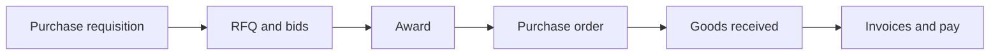

# Procurement operational workflow (post-configuration)

This document describes the **end-to-end procurement journey** in business order: what happens at each stage, typical **status** values, and **who** is expected to act. It intentionally **does not** cover how approval rules are configured (stages, steps, `roleCode`, amount thresholds); assume that is already in place so workflows can run.

For API-level UAT steps, migrations, and env vars, use the suite docs linked at the bottom.

---

## Big picture (stages in order)

1. **Purchase requisition (PR)** — need is captured and approved (path differs for **staff** vs **investee**).
2. **RFQ & quotations** — competitive sourcing (or continuation after investee auto-RFQ).
3. **Award** — winning vendor quotation is selected.
4. **Purchase order (PO)** — legal/commercial document to the vendor; internal sign-off then **send** to vendor.
5. **GRN** — receipt and quality line against the PO (partial receipts supported).
6. **Invoices** — vendor billing; **legacy procurement invoice** path and/or **accounting vendor bill** with optional **3-way match (Suite 06)** before submit and pay.

---

## 1. Purchase requisition

| Aspect | Detail |
|--------|--------|
| **Purpose** | Capture what is needed, quantities, optional preferred vendor, department, sourcing category, and (for investees) drawdown / use-of-funds context. |
| **Typical statuses** | `DRAFT` → after submit: `PENDING_APPROVAL` (staff workflow) **or** `PENDING_VC_EXECUTIVE_REVIEW` (investee drawdown path) → `APPROVED` → may move to `RFQ_SENT` when an RFQ is issued from this PR. |
| **Who acts** | **Requestor**: staff user creating `POST /api/procurement/requisitions`, or **investee** via applicant portal `POST /api/applicant/procurement/requisitions`. **Approvers**: resolved from your configured workflow (and, on some code paths, **department HEAD / DEPUTY** for department PRs). **Investee gate**: **CFO** or **SYSADMIN** approves or rejects at `PENDING_VC_EXECUTIVE_REVIEW`. **Visibility**: **Fund managers** see investee PRs for funds they manage; **CFO**, **SYSADMIN**, and **PROC_MGR** see broader lists (see `GET /api/procurement/requisitions/investee` behaviour in code). |
| **Procurement desk** | After investee submit, emails may go to procurement (**PROC_MGR**, **PROC_OFF**, **BUYER**, **PROC_COORD**, or Procurement department) — configurable via `PROCUREMENT_INVESTEE_NOTIFY_EMAILS`. |

**After approval:** staff may create/send **RFQs** tied to the PR; investee-approved PRs can trigger **automatic RFQ** to eligible vendors (see Suite 02 in [procurement-uat.md](./procurement-uat.md)).

---

## 2. RFQ and vendor quotations (Suite 03)

| Aspect | Detail |
|--------|--------|
| **Purpose** | Invite vendors, collect sealed bids until closing, compare, clarify, optionally extend closing. |
| **Typical statuses** | RFQ record: e.g. `OPEN` → `AWARDED` after award. Quotations: submitted by vendors; prices may be **redacted** until `closingAt`. |
| **Who acts** | **Procurement staff** (`POST /api/procurement/rfq`, clarifications, matrix, award). **Vendors** (invited or public listing per `visibility`) submit quotations via **public** or vendor-facing flows. |
| **Downstream** | **Award** sets the winning quotation and rejects others; then a **PO** is created from that quotation / award. |

Details: [procurement-uat-suites-03-05.md](./procurement-uat-suites-03-05.md#suite-03--rfq--competitive-bidding).

---

## 3. Award

| Aspect | Detail |
|--------|--------|
| **Purpose** | Lock in supplier choice and rationale. |
| **Who acts** | **Procurement staff** with rights to award the RFQ (`POST /api/procurement/rfqs/:id/award`). |
| **Downstream** | **Purchase order** creation uses the winning quotation (and copies investee / fund tags from the PR when present). |

---

## 4. Purchase order (Suite 04)

| Aspect | Detail |
|--------|--------|
| **Purpose** | Commit to the vendor: lines, totals, delivery expectations, PDF for signature/audit trail. |
| **Typical statuses** | Often `DRAFT` / `PENDING` through internal approvals, then **`SENT`** after dispatch to vendor (`sentAt`, `dispatchedAt`). Vendor may **acknowledge** via token link in email. |
| **Who acts** | **Procurement / authorised staff** create and move the PO through approval steps (driven by your **PO** stage in configuration where used). **Vendor** acknowledges when prompted. |
| **Notes** | Partial **line cancel**, **validity** dates, per-line **expected delivery** — see Suite 04 table. |

Details: [procurement-uat-suites-03-05.md](./procurement-uat-suites-03-05.md#suite-04--po-management--sign-off).

---

## 5. Goods received note — GRN (Suite 05)

| Aspect | Detail |
|--------|--------|
| **Purpose** | Record what arrived against the PO: accepted/rejected quantities, quality flags, optional attachments, geo, serials, services milestones. |
| **Typical outcomes** | PO may become **fully received** or **partially received** depending on pending quantities. **Investee** may post GRNs for their portfolio-linked POs (`POST /api/applicant/procurement/goods-received-notes`); staff use `POST /api/procurement/goods-received-notes`. |
| **Who acts** | **Warehouse / site / investee user** (as allowed), then any **approval** steps you attached to the **GRN** stage in configuration. |
| **Side effect** | **Vendor rating** can update from on-time vs late receipt vs PO `expectedDeliveryDate` (see Suite 01 in [procurement-uat.md](./procurement-uat.md)). |

Details: [procurement-uat-suites-03-05.md](./procurement-uat-suites-03-05.md#suite-05--grn--quality-control).

---

## 6. Invoices and payment

There are **two** bill concepts in the codebase; your test path may use one or both.

### 6a. Procurement module invoice (`ProcurementInvoice`)

| Aspect | Detail |
|--------|--------|
| **Purpose** | Operational vendor bill tied to **procurement** flows: link to **PO** (and optionally **quotation**), matching fields, approval, payment status, journal/cashbook hooks when implemented for this model. |
| **Who acts** | **Vendor** can upload via public procurement invoice routes; **staff** list/approve/process payment per `GET/POST` under **`/api/procurement/invoices`** (see Swagger tags **Procurement - Invoices**). |

### 6b. Accounting vendor bill (`PurchaseInvoice`) + Suite 06 (3-way match)

| Aspect | Detail |
|--------|--------|
| **Purpose** | **Accounts payable** bill with `sourcePurchaseOrderId` and optional `sourceGoodsReceivedNoteId` for **PO vs GRN vs invoice** matching. |
| **Typical flow** | Intake PDF → extract → (optional) human verify → draft bill → **run match** → `suite06MatchStatus` **`MATCHED`** (or **`DISPUTED`**) → submit to GL / pay rules per accounting service. |
| **Who acts** | **AP / finance staff** on **`/api/procurement/suite06/...`** and **`/api/accounting/purchase-invoices/...`**. **CFO-style** visibility: `GET /api/procurement/suite06/cfo-dashboard`. |

Details: [procurement-uat-suite-06.md](./procurement-uat-suite-06.md).

---

## Role cheat sheet (common `roleCode` values)

| Role (examples) | Typical involvement |
|-----------------|---------------------|
| **PROC_MGR**, **PROC_OFF**, **BUYER**, **PROC_COORD** | Procurement operations: RFQs, POs, monitoring investee PRs (with CFO/SYSADMIN), notifications. |
| **CFO**, **SYSADMIN** | Investee PR executive approval; often **amount-threshold** escalation on PO/PR when configured. |
| **Fund manager** (FundManager linkage) | Sees investee PRs for **their** funds only on scoped endpoints. |
| **Department HEAD / DEPUTY** | Some **department PR** approve/reject paths (same department as the requisition). |
| **ADMIN** | Administration including seeding procurement approval config (outside the scope of this doc). |
| **Vendor (external)** | Registration/KYC, quotations, acknowledgements, optional invoice document upload. |

Exact route-level **JWT** requirements are in **Swagger** (`/api-docs`) per tag.

---

## Related documentation

| Document | Contents |
|----------|----------|
| [procurement-uat.md](./procurement-uat.md) | Suite index 01–06, vendor KYC, investee drawdown PR, links to 03–06. |
| [procurement-uat-suites-03-05.md](./procurement-uat-suites-03-05.md) | RFQ, PO, GRN acceptance criteria and endpoints. |
| [procurement-uat-suite-06.md](./procurement-uat-suite-06.md) | AI intake, 3-way match, CFO dashboard, env vars. |

When testing, start from **purchase requisitions** (staff `POST /api/procurement/requisitions` + submit, or investee portal flow in Suite 02), then proceed **03 → 04 → 05 → 06** in order for a full thread.
