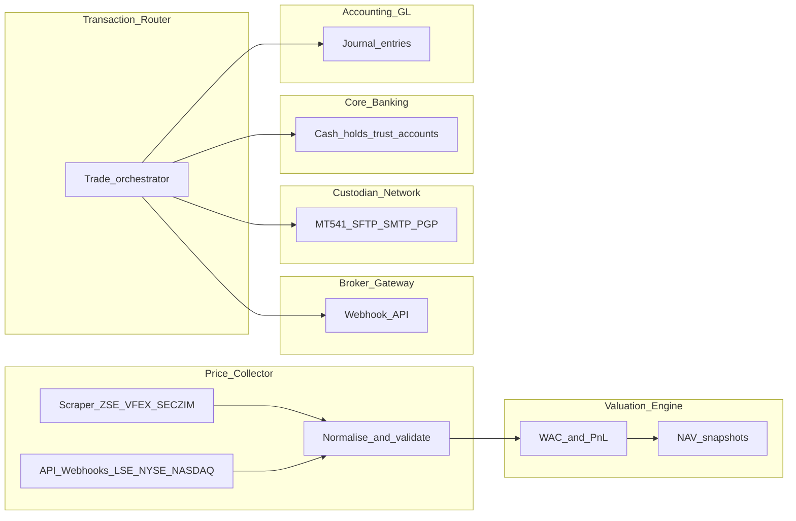
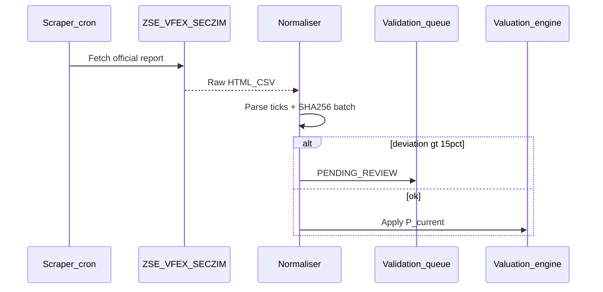
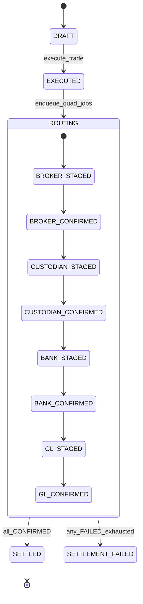

# Stock Price Collector & Multi-Module Transaction Router — backend requirements specification

Full backend specification for the **Arcus Stock Price Collector & Multi-Module Transaction Router** (Phase 2, Sections 3.4 and 5.4). Frontend design session companion: [`design-sessions/stock-price-collector.md`](../design-sessions/stock-price-collector.md).

**Status:** Greenfield — no equity price ingestion, listed-security holdings registry, or quad-target trade routing exists in the codebase today. This document defines what must be built.

**Related docs:** [Forecasting Engine](./forecasting-engine-backend-requirements.md) (FX + portfolio context) · [Short-term investments API](../src/config/short-term-investments-endpoints.ts) (money-market instruments — **not** listed equities; coexistence only)

---

## Table of contents

1. [Executive summary](#1-executive-summary)
2. [Architectural goals and system context](#2-architectural-goals-and-system-context)
3. [Current codebase baseline](#3-current-codebase-baseline)
4. [Functional requirements — four epics](#4-functional-requirements--four-epics)
5. [Acceptance criteria traceability matrix](#5-acceptance-criteria-traceability-matrix)
6. [Process workflows](#6-process-workflows)
7. [Mathematical formulations and valuation engine](#7-mathematical-formulations-and-valuation-engine)
8. [Proposed data model](#8-proposed-data-model)
9. [API specification — Section A: Price Collector](#9-api-specification--section-a-price-collector)
10. [API specification — Section B: Portfolio Valuation & P&L](#10-api-specification--section-b-portfolio-valuation--pl)
11. [API specification — Section C: Transaction Router](#11-api-specification--section-c-transaction-router)
12. [Quad-target integration specifications](#12-quad-target-integration-specifications)
13. [General Ledger posting matrix](#13-general-ledger-posting-matrix)
14. [Security, RBAC, and row-level access](#14-security-rbac-and-row-level-access)
15. [Auditing and compliance](#15-auditing-and-compliance)
16. [Non-functional requirements](#16-non-functional-requirements)
17. [Implementation phases](#17-implementation-phases)
18. [Testing and UAT checklist](#18-testing-and-uat-checklist)
19. [Swagger and OpenAPI](#19-swagger-and-openapi)

---

## 1. Executive summary

### 1.1 Problem statement

Fund administrators and investment analysts must reconcile daily market actions across fragmented systems: security prices, broker confirmations, custodian settlement, core banking liquidity, and general ledger postings. Manual exports and spreadsheet bridges introduce:

- Stale or unvalidated domestic reference prices (ZSE, VFEX, SECZIM)
- Delayed unrealized P&L and hedging decisions
- Settlement failures without auditable routing state
- Imbalanced or missing GL entries on trade confirmation

### 1.2 Solution — dual-engine ingestion + quad-target router

The **Stock Price Collector & Multi-Module Transaction Router** is the real-time valuation, automated settlement, and downstream routing core of Arcus ERP for **listed securities**. It:

1. **Harvests** official domestic prices (scraper) and international ticks (API/webhook feeds).
2. **Values** fund portfolios using WAC cost bases and USD/ZiG dual-currency lines.
3. **Routes** executed trades to four downstream targets: **Broker**, **Custodian**, **Core Banking**, **Accounting GL**.
4. **Audits** every ingest batch (SHA-256), routing hop, and journal linkage.

### 1.3 Module split (Swagger / API sections)

| Section | Scope | Base path (proposed) |
|---------|--------|----------------------|
| **A — Price Collector** | Securities master, ingest jobs, price ticks, validation queue | `/api/investments/market-data/*` |
| **B — Valuation & P&L** | Holdings, WAC, realized/unrealized P&L, NAV snapshots | `/api/investments/portfolio/*` |
| **C — Transaction Router** | Trade lifecycle, quad dispatch, settlement docs, status tracking | `/api/investments/trades/*` |

Cron endpoints mount under `/api/investments/market-data/cron/*` (same pattern as payroll compliance cron).

---

## 2. Architectural goals and system context

### 2.1 Three technical directives (non-negotiable)

| # | Directive | Backend enforcement |
|---|-----------|---------------------|
| 1 | **Dual-engine ingestion** | Scraper pipeline (ZSE/VFEX/SECZIM) + licensed API/webhook pipeline (LSE/NYSE/NASDAQ); shared normalisation layer |
| 2 | **Quad-target dispatcher** | Every `EXECUTED` trade emits four routable jobs with independent retry + status (`STAGED` → `DISPATCHED` → `CONFIRMED` / `FAILED`) |
| 3 | **Real-time valuation** | Holdings recalc on every confirmed price tick; unrealized P&L available via query API and websocket/event bus (Phase 2+) |

### 2.2 Arcus integration bus

| Module | Integration role |
|--------|------------------|
| **Price Collector** | Source of truth for `P_current`; stores FX rate used per valuation run |
| **Portfolio Valuation** | WAC, holdings qty, unrealized/realized P&L per fund |
| **Transaction Router** | Trade state machine + dispatch receipts |
| **Core Banking / Cashbook** | Trust-account holds and releases on buy/sell settlement |
| **Accounting GL** | Balanced JE on settlement; CGT liability lines where configured |
| **Multi-currency FX** | `UsdZwgRateResolver` / `ExchangeRate` for ZiG ↔ USD conversion ([Eq. 4](#74-mixed-currency-valuation-conversions)) |

---

## 3. Current codebase baseline

### 3.1 Related assets (do not conflate)

| Existing asset | Path | Relevance |
|----------------|------|-----------|
| Short-term investments | `ShortTermInvestmentInstrument`, `/api/short-term-investments/*` | Money-market / T-bill accruals — **different product**; reuse GL posting patterns only |
| Private equity valuations | `PortfolioValuation`, `PortfolioValuationService` | Quarterly PE workflow — **not** listed-equity marks |
| Portfolio companies | `PortfolioCompany`, fund links | Fund scope for holdings; optional `fundId` on positions |
| GL / journal entries | `JournalEntry`, `JournalEntryLine` | Settlement postings |
| FX resolver | `src/services/UsdZwgRateResolver.ts` | Daily ZiG → USD for domestic listings |
| Exchange rates API | `MultiCurrencyService`, `/api/accounting/exchange-rates` | Manual override + audit |
| Cashbook | `CashbookController`, `/api/cashbook/*` | Trust liquidity holds (core banking bridge) |
| Forecasting engine | `ForecastingFxService` | Optional NAV forecast vectors (Phase 3) |
| Audit logs | `AuditLog` | Pattern for ingest + routing events |

### 3.2 Gap summary

| Capability | Maturity | Primary gaps |
|------------|----------|--------------|
| Listed security master | ❌ | No `Security`, `Exchange`, ISIN/ticker registry |
| Domestic price scrape | ❌ | No cron, no validation queue, no SHA-256 ingest log |
| International live feeds | ❌ | No webhook ingress, no vendor adapter layer |
| Holdings + WAC | ❌ | No position ledger, no lot history |
| Trade routing | ❌ | No quad dispatcher, no custodian doc generation |
| Listed-equity GL | ❌ | No standard COA mapping for portfolio asset / clearing |

**Critical rule:** Do **not** overload `ShortTermInvestmentInstrument` for listed equities — create dedicated tables under `investments_*` namespace.

---

## 4. Functional requirements — four epics

### Epic 1 — Multi-currency data ingestion and harvesting (US-3.4.1, US-3.4.2)

#### US-3.4.1 — SECZIM, ZSE, and VFEX data scraping

**As an** Asset Management Operations Lead, **I want** automated scraping of official daily opening, closing, and reference prices from SECZIM, ZSE, and VFEX, **so that** portfolio valuations use validated domestic pricing data without manual entry.

**Backend must:**

1. Run cron jobs at **09:00 CAT** (market open) and **16:00 CAT** (market close) targeting configured source URLs.
2. Parse opening, closing, and official reference prices into normalised `PriceTick` rows keyed by `(securityId, priceType, asOfDate)`.
3. Implement exponential backoff (max 5 attempts, jitter) and fallback to last validated close when source is unreachable (flag `sourceStatus: FALLBACK`).
4. If `|price - previousClose| / previousClose > 0.15`, set tick `validationStatus: PENDING_REVIEW` and exclude from auto-valuation until approved.
5. Compute SHA-256 over canonical JSON payload of each ingest batch; persist on `MarketDataIngestBatch`.

#### US-3.4.2 — Real-time international market integration

**As a** Global Fund Manager, **I want** real-time and near-live pricing feeds for international stocks (LSE, NYSE, NASDAQ) using approved API feeds, **so that** I can manage global holdings and spot market trends as they develop.

**Backend must:**

1. Expose authenticated webhook ingress `POST /market-data/webhooks/:providerCode` with HMAC signature verification.
2. Support polling adapter interface for licensed REST/streaming providers (pluggable `MarketDataProviderAdapter`).
3. Map vendor symbols to internal `Security` via `vendorSymbol` cross-reference table.
4. Store tick frequency metadata (`LIVE`, `DELAYED_15M`, `EOD`) for UI badges.
5. Rate-limit and queue bursts; never block HTTP webhook ack — process async via job table.

### Epic 2 — Automated transaction routing (US-3.4.3)

#### US-3.4.3 — Broker and custodian dispatch pipeline

**As a** Trade Operations Officer, **I want** executed trades to automatically dispatch structured payloads to our broker and custodian, **so that** settlement instructions are sent without manual re-keying.

**Backend must:**

1. On trade transition to `EXECUTED`, enqueue quad-target jobs (broker + custodian are first two hops).
2. POST signed JSON payload to broker webhook (`BrokerGatewayConfig.endpointUrl`).
3. Generate PDF settlement instruction; apply fund digital signature (`FundSigningKey`); deliver via SMTP-TLS + PGP/MIME **or** SFTP per custodian profile.
4. Persist dispatch receipts and map external correlation IDs.
5. Expose per-hop status: `STAGED`, `DISPATCHED`, `CONFIRMED`, `FAILED`, `RETRYING` with `attemptCount`, `lastError`, `confirmedAt`.

### Epic 3 — Core banking and accounting ledger updates (US-3.4.4)

#### US-3.4.4 — Core banking and GL sync

**As a** Fund Accountant, **I want** confirmed trade executions to update core banking liquidity lines and write balancing double-entry ledger records automatically, **so that** internal asset ratios and financial registers remain in continuous sync.

**Backend must:**

1. On `EXECUTED` buy: create **cash hold** on trust account via cashbook/core-banking bridge (`HOLD_PLACED`).
2. On custodian `CONFIRMED` settlement: release hold, increment/decrement `PortfolioHolding.quantity`, post GL JE.
3. Post balanced journal: **DR** Listed securities asset (portfolio COA) / **CR** Bank clearing (or inverse on sell); include realized P&L and CGT lines on sells ([Section 13](#13-general-ledger-posting-matrix)).
4. Fail-closed: if JE imbalanced, trade stays `SETTLEMENT_FAILED`; no silent partial state.
5. Link `TradeSettlement.journalEntryId` and `cashbookTransactionId` for traceability.

### Epic 4 — Valuation and dynamic P&L (US-3.4.5)

#### US-3.4.5 — Dynamic multi-currency P&L dashboard

**As an** Institutional Portfolio Manager, **I want** realized and unrealized P&L across holdings split by USD and ZiG valuation lines, **so that** I can report fund valuations to investors and align hedging strategies with real-time currency ratios.

**Backend must:**

1. Maintain WAC per `(fundId, securityId, currencyLeg)` using [Eq. 1](#71-weighted-average-cost-wac).
2. Recalculate unrealized P&L on every validated price tick ([Eq. 2](#72-unrealized-profit-and-loss)).
3. On settlement, compute realized P&L ([Eq. 3](#73-realized-profit-and-loss)) and optional CGT accrual.
4. Store dual-currency valuation snapshots: native listing currency + fund base currency (USD) + ZiG reporting line using daily `R_ZiG→USD` ([Eq. 4](#74-mixed-currency-valuation-conversions)).
5. Expose fund-level NAV aggregate API for dashboard header.

---

## 5. Acceptance criteria traceability matrix

| ID | Acceptance criterion | Epic | API / service | Phase |
|----|---------------------|------|---------------|-------|
| US-3.4.1-A1 | Cron at 09:00 and 16:00 CAT | 1 | `MarketDataScraperCronService` | P1 |
| US-3.4.1-A2 | Backoff + fallback reference rate | 1 | Scraper adapter + batch log | P1 |
| US-3.4.1-A3 | >15% deviation → manual validation queue | 1 | `GET /market-data/validation-queue` | P1 |
| US-3.4.1-A4 | SHA-256 per ingest batch | 1 | `MarketDataIngestBatch.checksum` | P1 |
| US-3.4.2-A1 | Webhook ingress with HMAC | 1 | `POST /market-data/webhooks/:provider` | P2 |
| US-3.4.2-A2 | Symbol cross-ref to internal security | 1 | `SecurityVendorSymbol` | P2 |
| US-3.4.3-A1 | Broker payload on EXECUTED | 2 | `BrokerDispatchService` | P2 |
| US-3.4.3-A2 | PDF + digital sign + custodian delivery | 2 | `CustodianSettlementDocService` | P2 |
| US-3.4.3-A3 | Routing badges STAGED/DISPATCHED/CONFIRMED | 2 | `TradeRoutingHop` status API | P2 |
| US-3.4.4-A1 | Cash hold on buy execution | 3 | `CoreBankingBridgeService.placeHold` | P3 |
| US-3.4.4-A2 | Release hold + holdings update on confirm | 3 | `TradeSettlementService` | P3 |
| US-3.4.4-A3 | Balanced GL on settlement | 3 | `ListedEquityGlPostingService` | P3 |
| US-3.4.5-A1 | WAC across multi-lot buys | 4 | `WacCalculatorService` | P2 |
| US-3.4.5-A2 | Real-time unrealized P&L | 4 | `PortfolioValuationEngine` | P2 |
| US-3.4.5-A3 | Realized P&L on settlement | 4 | Same + CGT registry hook | P3 |
| US-3.4.5-A4 | USD + ZiG valuation lines with logged FX | 4 | `ValuationSnapshot.fxRateUsed` | P2 |
| QA-7.2-A1 | All four downstream dispatches on trade | 2–3 | UAT full router script | P4 |
| QA-7.2-A2 | Retry + error log on downstream failure | 2–3 | `TradeRoutingHop` + dead-letter | P3 |
| QA-7.2-A3 | Multi-currency P&L uses verified FX | 4 | Valuation + FX audit fields | P2 |
| QA-7.2-A4 | Row-level permission denial logged | 14 | `AuditLog` SECURITY_ALERT | P4 |

---

## 6. Process workflows

### 6.1 Domestic scrape ingest (daily)

### 6.2 Trade execution → quad dispatch

**Retry policy:** exponential backoff per hop (1m, 5m, 15m, 60m, 240m); max 5 attempts; `FAILED` requires manual replay via `POST /trades/:id/routing-hops/:hopId/retry`.

### 6.3 Buy settlement (cash hold → GL)

1. `EXECUTED` → place cash hold (`trustAccountId`, `amount = qty × price + fees`).
2. Custodian `CONFIRMED` → release hold; increase `PortfolioHolding.quantity`; WAC recalc on buy.
3. Post JE: DR securities asset, CR bank clearing.
4. Mark trade `SETTLED`; emit `TRADE_SETTLED` audit event.

### 6.4 Sell settlement (realized P&L)

1. `EXECUTED` → optional securities hold flag (configurable).
2. Custodian `CONFIRMED` → decrease quantity; compute realized P&L at WAC.
3. Post JE: DR bank clearing, CR securities asset at cost; CR/DR realized gain/loss; CR CGT payable if applicable.
4. Persist `RealizedPnLEntry` linked to trade.

---

## 7. Mathematical formulations and valuation engine

### 7.1 Weighted Average Cost (WAC)

For security $S$ with $N$ historical buy transactions, quantity $Q_i$ and execution price $P_i$ (in portfolio base currency at trade date):

$$WAC = \frac{\sum_{i=1}^{N}(Q_i \times P_i)}{\sum_{i=1}^{N} Q_i} \tag{1}$$

- **Buys** increase denominator and numerator; WAC updates.
- **Sells** reduce $Q_{held}$ only; WAC unchanged until position closed.
- Implement with `PortfolioHoldingLot` append-only ledger for audit replay.

### 7.2 Unrealized profit and loss

$$P\&L_{unrealized} = Q_{held} \times (P_{current} - WAC) \tag{2}$$

- $P_{current}$ = latest **validated** tick (`validationStatus: APPROVED`).
- Compute per currency leg, then translate to fund base using tick-date FX.

### 7.3 Realized profit and loss

On sale of $Q_{sold}$ at $P_{sell}$:

$$P\&L_{realized} = Q_{sold} \times (P_{sell} - WAC) \tag{3}$$

- Log to income statement registry; trigger CGT evaluation module (configurable rules).

### 7.4 Mixed-currency valuation conversions

$$V_{USD} = V_{ZiG} \times R_{ZiG \to USD} \tag{4}$$

- Store `fxRateUsed`, `fxRateSource` (`ZIMRATE`, `MANUAL`, `EXCHANGE_RATE_TABLE`) on every `ValuationSnapshot` and daily pricing tick log.
- Never reuse stale FX silently — if rate missing, valuation row status `FX_MISSING` and block NAV publish.

---

## 8. Proposed data model

### 8.1 Security master

**`Security`**

| Field | Notes |
|-------|-------|
| `id` | cuid |
| `symbol` | e.g. `ECO.ZW`, `TSLA.US` |
| `isin` | Optional |
| `exchangeCode` | `ZSE`, `VFEX`, `LSE`, `NYSE`, `NASDAQ` |
| `name` | Display |
| `listingCurrencyCode` | `USD`, `ZWG`, `GBP`, … |
| `isActive` | Soft retire |

**`SecurityVendorSymbol`** — maps provider codes to `securityId`.

### 8.2 Market data

**`MarketDataIngestBatch`**

| Field | Notes |
|-------|-------|
| `sourceType` | `SCRAPER` \| `WEBHOOK` \| `POLL` |
| `sourceCode` | `ZSE`, `VFEX`, `SECZIM`, `POLYGON`, … |
| `asOfDate` | Trading date |
| `rawPayloadRef` | Object storage path |
| `sha256Checksum` | Integrity |
| `recordCount` | |
| `status` | `COMPLETED`, `PARTIAL`, `FAILED` |

**`PriceTick`**

| Field | Notes |
|-------|-------|
| `securityId` | FK |
| `batchId` | FK |
| `priceType` | `OPEN`, `CLOSE`, `REFERENCE`, `LIVE` |
| `price` | Decimal(18,6) |
| `previousClose` | For deviation check |
| `deviationPct` | Computed |
| `validationStatus` | `APPROVED`, `PENDING_REVIEW`, `REJECTED` |
| `pricedAt` | Timestamp |

### 8.3 Portfolio positions

**`PortfolioFund`** (or link existing fund entity)

| Field | Notes |
|-------|-------|
| `id`, `name`, `baseCurrencyCode` | USD default |
| `trustBankAccountId` | Core banking link |

**`PortfolioHolding`**

| Field | Notes |
|-------|-------|
| `fundId`, `securityId` | Unique composite |
| `quantity` | Decimal(18,6) |
| `wac` | Decimal(18,6) in base currency |
| `wacCurrencyCode` | |
| `lastValuationAt` | |

**`PortfolioHoldingLot`** — immutable buy lots for WAC replay.

### 8.4 Trades and routing

**`InvestmentTrade`**

| Field | Notes |
|-------|-------|
| `tradeRef` | `TXN-{uuid}` display |
| `fundId`, `securityId` | |
| `side` | `BUY`, `SELL` |
| `quantity`, `executionPrice` | |
| `executionCurrencyCode` | |
| `status` | `DRAFT`, `EXECUTED`, `ROUTING`, `SETTLED`, `SETTLEMENT_FAILED`, `CANCELLED` |
| `executedAt`, `settledAt` | |
| `executedById` | User |

**`TradeRoutingHop`**

| Field | Notes |
|-------|-------|
| `tradeId` | FK |
| `target` | `BROKER`, `CUSTODIAN`, `CORE_BANKING`, `ACCOUNTING_GL` |
| `status` | `STAGED`, `DISPATCHED`, `CONFIRMED`, `RETRYING`, `FAILED` |
| `attemptCount` | |
| `externalRef` | Broker/custodian correlation |
| `payloadRef` | Stored dispatch JSON |
| `receiptRef` | Confirmation artifact |
| `lastError` | Text |
| `confirmedAt` | |

**`TradeSettlement`**

| Field | Notes |
|-------|-------|
| `tradeId` | |
| `journalEntryId` | FK nullable until posted |
| `cashbookTransactionId` | FK nullable |
| `realizedPnl` | Decimal |
| `cgtAmount` | Decimal nullable |

### 8.5 Valuation snapshots

**`ValuationSnapshot`**

| Field | Notes |
|-------|-------|
| `fundId` | |
| `asOf` | |
| `navBaseCurrency` | |
| `unrealizedPnlUsd`, `unrealizedPnlZig` | |
| `realizedPnlUsd`, `realizedPnlZig` | Period slice |
| `fxRateUsed` | For ZiG leg |
| `fxRateSource` | |

### 8.6 Configuration

**`BrokerGatewayConfig`**, **`CustodianProfile`** (SMTP/SFTP, PGP key id), **`FundSigningKey`** (encrypted private key ref), **`MarketDataSourceConfig`** (URLs, cron, enabled flag).

---

## 9. API specification — Section A: Price Collector

Base: `/api/investments/market-data`. Auth: Bearer JWT.

| Method | Path | Purpose |
|--------|------|---------|
| GET | `/securities` | List/filter securities |
| POST | `/securities` | Admin: register security |
| PUT | `/securities/:id` | Admin: update |
| GET | `/securities/:id/prices` | Tick history |
| GET | `/prices/latest` | Watchlist bulk latest |
| POST | `/ingest/run` | Admin: manual scrape trigger |
| GET | `/ingest/batches` | Batch list with checksum |
| GET | `/ingest/batches/:id` | Batch detail + verify checksum |
| GET | `/validation-queue` | Ticks `PENDING_REVIEW` |
| POST | `/validation-queue/:tickId/approve` | Checker |
| POST | `/validation-queue/:tickId/reject` | Checker |
| POST | `/webhooks/:providerCode` | HMAC-signed provider ingress (no JWT; signature auth) |
| POST | `/cron/scrape-domestic` | Cron secret header |
| POST | `/cron/retry-failed-ingest` | Cron secret header |

---

## 10. API specification — Section B: Portfolio Valuation & P&L

Base: `/api/investments/portfolio`.

| Method | Path | Purpose |
|--------|------|---------|
| GET | `/funds` | Funds with NAV summary |
| GET | `/funds/:fundId/holdings` | Positions + WAC + market value |
| GET | `/funds/:fundId/pnl` | Realized + unrealized breakdown |
| GET | `/funds/:fundId/valuations` | Snapshot history |
| POST | `/funds/:fundId/valuations/run` | Force aggregation (admin) |
| GET | `/watchlist` | User watchlist with live indicators |
| PUT | `/watchlist` | Replace symbols |

---

## 11. API specification — Section C: Transaction Router

Base: `/api/investments/trades`.

| Method | Path | Purpose |
|--------|------|---------|
| POST | `/` | Create draft trade |
| GET | `/` | List with filters (fund, status, date) |
| GET | `/:id` | Detail + routing hops |
| POST | `/:id/execute` | Transition to EXECUTED; start routing |
| POST | `/:id/cancel` | Cancel if not settled |
| GET | `/:id/routing-hops` | Quad status board |
| POST | `/:id/routing-hops/:hopId/retry` | Manual replay |
| GET | `/:id/settlement-document` | PDF stream |
| POST | `/cron/retry-failed-routing` | Cron secret |

**Idempotency:** `execute` requires `Idempotency-Key` header; duplicate returns existing routing state.

---

## 12. Quad-target integration specifications

| Target | Service | Outbound | Inbound confirmation |
|--------|---------|----------|----------------------|
| **Broker** | `BrokerDispatchService` | HTTPS JSON webhook + API key | Callback URL or poll status endpoint |
| **Custodian** | `CustodianSettlementDocService` | PDF + MT541 XML optional; SFTP or PGP email | ACK file / webhook |
| **Core Banking** | `CoreBankingBridgeService` | Internal call to cashbook hold API | Hold confirmation id |
| **Accounting GL** | `ListedEquityGlPostingService` | `JournalEntryService.createJournalEntryWithAuditSequence` | `journalEntryId` on success |

**Ordering:** Broker and Custodian may run in parallel after `EXECUTED`. Core Banking hold should complete before Custodian dispatch for buys. GL posts **only** after Custodian `CONFIRMED` (and bank hold released).

---

## 13. General Ledger posting matrix

Configurable COA codes (defaults proposed):

| Event | Account | DR/CR | Amount |
|-------|---------|-------|--------|
| Buy settlement | Listed securities asset (e.g. **1210**) | DR | `qty × WAC` |
| Buy settlement | Bank clearing (e.g. **1105**) | CR | cash out |
| Sell settlement | Bank clearing | DR | cash in |
| Sell settlement | Listed securities asset | CR | `qty × WAC` |
| Sell — gain | Realized gain (e.g. **4200**) | CR | positive P&L |
| Sell — loss | Realized loss (e.g. **5200**) | DR | negative P&L |
| CGT accrual | CGT payable (e.g. **2180**) | CR | tax engine output |

**Fail-closed:** `LISTED_EQUITY_JE_IMBALANCED` — trade remains `SETTLEMENT_FAILED`.

---

## 14. Security, RBAC, and row-level access

### 14.1 Roles

| Role | Capabilities |
|------|--------------|
| Asset Management Operations Lead | Configure scrapers, approve validation queue |
| Global Fund Manager | Execute trades, view all fund holdings |
| Trade Operations Officer | Retry routing hops, download settlement PDFs |
| Fund Accountant | View GL links, settlement status |
| Portfolio Manager (read-only) | Dashboard + P&L; no execute |
| System Administrator | Full config, signing keys, custodian profiles |

### 14.2 Row-level rules

- Users scoped to `fundId` via `UserFundAccess` (or existing fund membership).
- `GET /trades`, `/holdings`, `/pnl` **must** filter by accessible funds.
- Unauthorized access → **403** + `AuditLog` entry `SECURITY_ALERT` (QA-7.2-A4).
- Admin role bypasses fund scope for support (logged).

### 14.3 Webhook / cron auth

- Provider webhooks: HMAC-SHA256 of raw body with `MARKET_DATA_WEBHOOK_SECRET`.
- Cron routes: `x-market-data-cron-secret` / `x-trade-router-cron-secret` (same pattern as payroll compliance cron).

---

## 15. Auditing and compliance

| Action | Priority | Payload |
|--------|----------|---------|
| MARKET_DATA_BATCH_INGESTED | NORMAL | batchId, sha256, sourceCode |
| PRICE_TICK_PENDING_REVIEW | NORMAL | securityId, deviationPct |
| PRICE_TICK_APPROVED / REJECTED | NORMAL | tickId, checkerId |
| TRADE_EXECUTED | HIGH | tradeId, fundId, side, qty |
| ROUTING_HOP_DISPATCHED | NORMAL | hopId, target, attempt |
| ROUTING_HOP_CONFIRMED | NORMAL | externalRef |
| ROUTING_HOP_FAILED | HIGH | error, attemptCount |
| CASH_HOLD_PLACED / RELEASED | HIGH | tradeId, amount |
| TRADE_GL_POSTED | HIGH | tradeId, journalEntryId |
| TRADE_GL_FAILED | HIGH | error |
| VALUATION_SNAPSHOT_CREATED | NORMAL | fundId, nav |
| SECURITY_ALERT_UNAUTHORIZED_ACCESS | HIGH | userId, resource |

---

## 16. Non-functional requirements

| Requirement | Target |
|-------------|--------|
| Domestic scrape job | Complete within 10 min of cron fire |
| Webhook ack | < 200ms (async processing) |
| Valuation recalc (50 holdings) | < 5s |
| Trade routing retry | Exponential, max 5 attempts |
| Ingest + dispatch logs | Retain 7 years (configurable) |
| PII / keys | Fund signing keys in encrypted vault; never log private key material |
| Timezone | Africa/Harare for domestic market calendar |

---

## 17. Implementation phases

| Phase | Epic | Deliverables |
|-------|------|--------------|
| **P1** | US-3.4.1 | Security master, scraper cron, validation queue, SHA-256 batches |
| **P2** | US-3.4.2, US-3.4.5 | Webhook ingress, WAC engine, unrealized P&L APIs, watchlist |
| **P3** | US-3.4.3, US-3.4.4 | Trade router, broker/custodian dispatch, cash holds, GL posting |
| **P4** | QA 7.2 | Full UAT, Swagger tags, retry/cron hardening, RBAC fund scope |
| **P5** | 5.4 polish | NAV publish hooks to forecasting; websocket live prices (optional) |

---

## 18. Testing and UAT checklist

**Scripts to add:**

| npm script | Coverage |
|------------|----------|
| `uat:investments:market-data` | Scrape batch, deviation queue, checksum verify |
| `uat:investments:valuation` | WAC buys, unrealized P&L, FX logging |
| `uat:investments:trade-router:full` | Execute → 4 hops → JE + hold release |

**QA 7.2 checklist (automated):**

- [ ] Trade execution dispatches all four targets
- [ ] Simulated downstream 500 triggers retry + `FAILED` after exhaustion
- [ ] Multi-currency holding values match manual spreadsheet within 0.01
- [ ] Cross-fund trade access returns 403 and audit alert

---

## 19. Swagger and OpenAPI

Register in `swagger.ts` with protected tags:

| Tag | Paths |
|-----|-------|
| **Investments — Market Data** | Section A |
| **Investments — Portfolio** | Section B |
| **Investments — Trade Router** | Section C |

Add `src/config/stock-price-collector-swagger-paths.ts` mirroring payroll/forecasting pattern.

---

*Document version: 1.0 — 2026-06-16*
